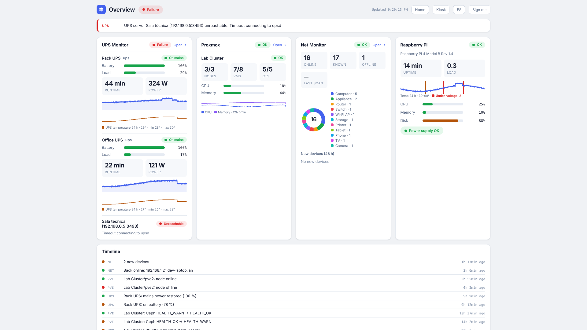
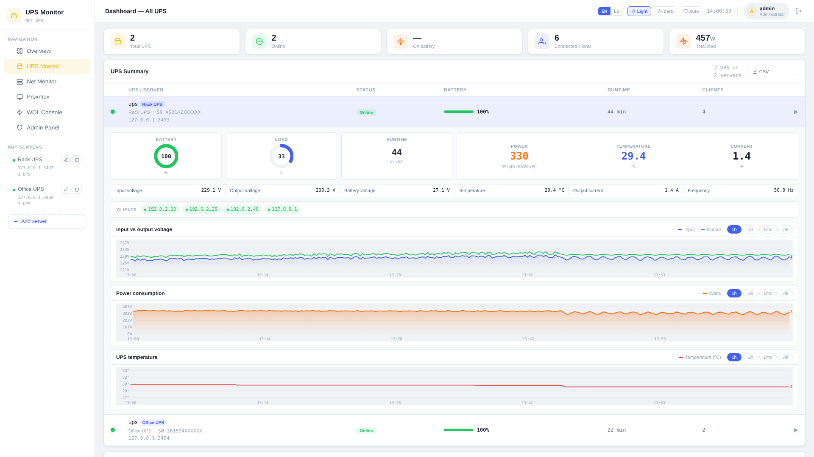
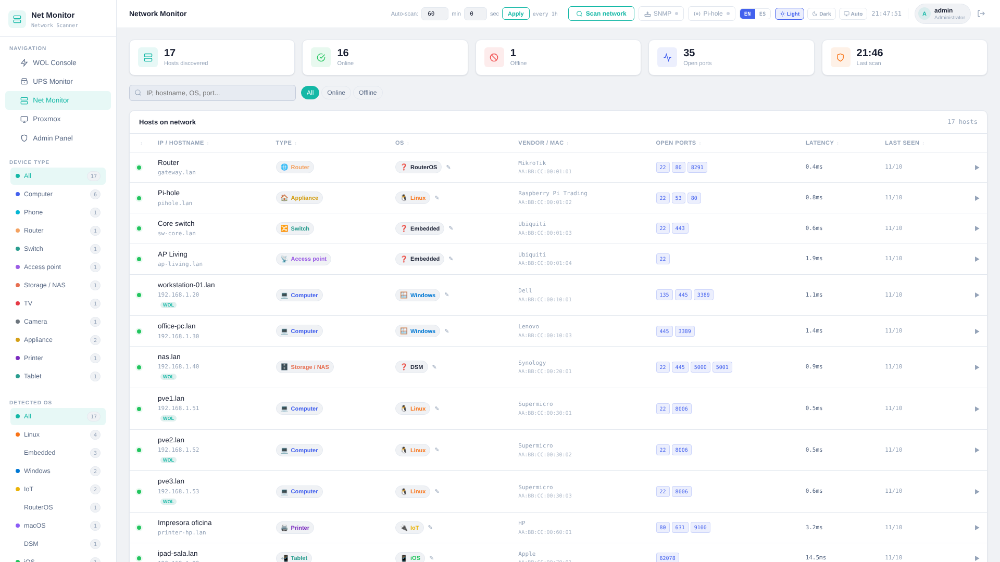
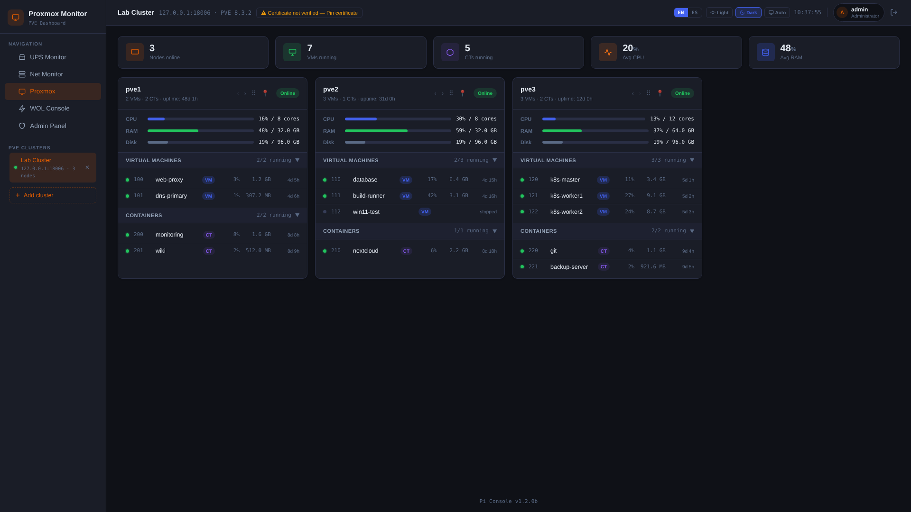
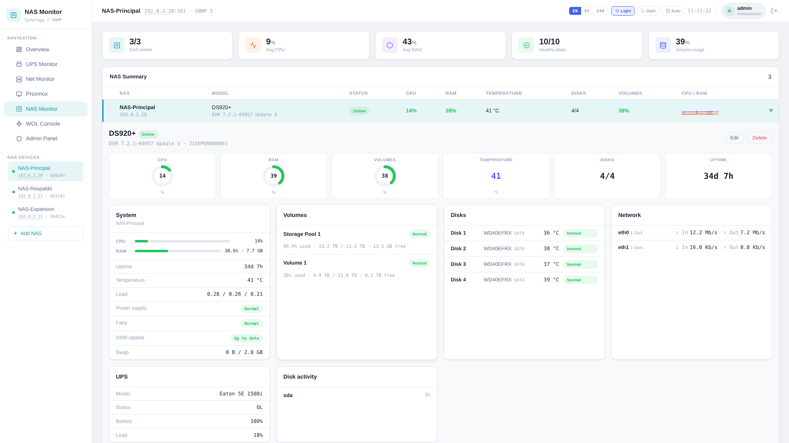

<p align="center"></p>

# LabTower

**Homelab dashboard** (Raspberry Pi, VM or x86 machine): UPS, network, Proxmox, NAS (Synology, TrueNAS, OpenMediaVault), Wake-on-LAN and administration in one place. No external dependencies: standard-library Python + nginx.

[Español → README.md](README.md)



**Contents:** [Modules](#modules) · [Screenshots](#screenshots) · [Requirements](#requirements) · [Install](#install) · [Update](#update) · [First login](#first-login) · [Features](#features-by-module) · [HTTPS](#https) · [Backups](#backups) · [Health and operations](#health-and-operations) · [Settings](#settings) · [Security](#security) · [Layout](#layout) · [License](#license)

---

## Modules

| Module | Path | Port | What it does |
|---|---|---|---|
| **Overview** | `/overview/` | 8085 | Status of everything on one screen, event timeline and kiosk mode |
| **UPS Monitor** | `/nut/` | 8081 | Reads UPS units through NUT: battery, load, runtime, power, voltages, temperature, history and CSV |
| **Net Monitor** | `/net/` | 8083 | Scans the network: hosts, type, OS, ports, MAC and vendor |
| **Proxmox Monitor** | `/pve/` | 8084 | Proxmox VE clusters: nodes, VMs, CTs and Ceph |
| **NAS Monitor** | `/nas/` | 8086 | One or more NAS (Synology over SNMP, TrueNAS and OpenMediaVault over their API): disks, volumes, temperature, CPU, memory and network |
| **DNS Monitor** | `/dns/` | 8087 | Pi-hole (v5 and v6) and AdGuard Home: queries, % blocked, top lists, upstream DNS and pausing the blocking |
| **WAN Monitor** | `/wan/` | 8088 | Internet uplink: latency, loss, outages, public IP and a scheduled speed test |
| **WOL Console** | `/wol/` | 8080 | Powers on machines with Wake-on-LAN |
| **Admin Panel** | `/admin/` | 8082 | Users, permissions, sessions, backups and system health |

Each user can reorder the menu. The home page (`/`) has one card per module.

## Screenshots

   

All screens (light and dark, 4 sizes) are in [`docs/screenshots/`](docs/screenshots/). The data is demo data.

---

## Requirements

- Raspberry Pi (tested on 3A+) or a VM/x86 machine, with Raspberry Pi OS, DietPi, Debian 12+ or Ubuntu.
- Python 3.9+, nginx, `sudo`, `snmp`, NUT (`nut`, `nut-client`), `openssh-client`, `gnupg`, `gpg-agent`, `openssl`, `cron`, `curl`, `iproute2`, `systemd` and other base packages. `apt` installs them with the `.deb`.
- Optional: `ieee-data` (local MAC vendor database) and the speed-test engines (see below).

## Install

```bash
wget https://github.com/gonzalovalenzuela/labtower/releases/download/2.1/labtower_2.1_all.deb
sudo apt-get update
sudo apt-get install -y ./labtower_2.1_all.deb
```

Use `apt-get install ./file.deb`, not `dpkg -i`, so `apt` installs the dependencies. Then open `http://<pi-ip>/`.

The installer creates one system user per service (`labtower-auth`, `labtower-wol`, …), the systemd services, the nginx config and the `admin` user with a **random password**, shown when it finishes. If you lost it: `sudo cat /var/lib/labtower/auth/initial-admin-password`.

**From source** (development): copy the modules to `/opt/labtower`, install the config from `etc/nginx/` and create the services using `debian/postinst` as a guide.

### Speed tests (optional)

WAN Monitor ships its own engine and needs nothing else. To use **Ookla** or **LibreSpeed**, install their program; it then shows up in *WAN Monitor → Settings → Test engine* (until then it is marked "not installed").

**Ookla `speedtest`** (the official package is called `speedtest`; Debian's `speedtest-cli` is a different program and will not work):

```bash
sudo apt-get install -y curl
curl -s https://packagecloud.io/install/repositories/ookla/speedtest-cli/script.deb.sh | sudo bash
sudo apt-get install -y speedtest
speedtest --version
```

If the repository script does not recognise your Debian or Raspberry Pi OS release, download the Linux `.tgz` for your architecture (`x86_64`, `aarch64`, `armhf`) from <https://www.speedtest.net/apps/cli>, extract it and copy `speedtest` to `/usr/local/bin/`. LabTower runs it with `--accept-license --accept-gdpr`.

**LibreSpeed `librespeed-cli`:**

```bash
sudo apt-get install -y librespeed-cli     # Debian 13 (trixie) or later
librespeed-cli --version
```

Where the package does not exist, use the binary from [release v1.0.14](https://github.com/librespeed/speedtest-cli/releases/tag/v1.0.14). Each file is a `.tar.gz` holding the `librespeed-cli` program; pick the one for your architecture (`uname -m`):

| `uname -m` | File |
|---|---|
| `x86_64` | `librespeed-cli_1.0.14_linux_amd64.tar.gz` |
| `aarch64` (64-bit Raspberry Pi) | `librespeed-cli_1.0.14_linux_arm64.tar.gz` |
| `armv7l` (32-bit Raspberry Pi) | `librespeed-cli_1.0.14_linux_armv7.tar.gz` |

```bash
wget https://github.com/librespeed/speedtest-cli/releases/download/v1.0.14/librespeed-cli_1.0.14_linux_arm64.tar.gz
tar -xzf librespeed-cli_1.0.14_linux_arm64.tar.gz librespeed-cli
sudo install -m 755 librespeed-cli /usr/local/bin/librespeed-cli
librespeed-cli --version
```

## Update

```bash
wget https://github.com/gonzalovalenzuela/labtower/releases/download/2.1/labtower_2.1_all.deb
sudo apt-get install -y ./labtower_2.1_all.deb
labtower-health
```

- Works from any 1.1.x, 1.2.x, 1.3, 1.4 and also from **Pi Console** (the previous name, see below). Data in `/var/lib/labtower` is kept and also copied to `/var/backups/labtower`.
- **From Pi Console (1.x):** LabTower is the same project under a new name. The 2.0 `.deb` replaces `pi-console` and migrates by itself the user, data, HTTPS certificates, SFTP backup and earlier backups to the new paths (`/var/lib/labtower`, `/etc/labtower`…). You have to log in again. The `pi-console-*` commands are now `labtower-*`. Afterwards you can run `sudo dpkg -P pi-console` to clean up the old package record.
- Installing a **lower** version number than the current one needs `--allow-downgrades`.
- After updating, reload the page (Ctrl+Shift+R). On iPad, close and reopen the page.
- Changes for each version are in [CHANGELOG.md](CHANGELOG.md).

## First login

1. Sign in as `admin` with the password the installer showed.
2. You must choose a new password (minimum 8 characters) before using any module.
3. Create your users in the Admin Panel. For any user you can tick "must change password" when creating them or resetting their password.

---

## Features by module

### Overview
- **Global status** (All good / Attention / Failure) and a list of what needs attention, linked to the module.
- **UPS:** state, battery, load, runtime, power and 24 h charts.
- **Proxmox:** nodes online, running VMs and CTs, CPU and memory (12 h chart), Ceph health.
- **NAS:** per NAS, status, CPU and memory (12 h chart with temperature), healthy disks, temperature and the fullest volume.
- **Network:** hosts online, known and offline, last scan, device types and new hosts from the last 48 h.
- **Raspberry Pi:** temperature, CPU, memory, disk, uptime and power supply status. On a Raspberry Pi only, it adds a 24 h temperature chart with under-voltage and throttling marks (kept 7 days in `metrics.db`).
- **Event timeline:** important changes with their time (UPS on battery, node down, Ceph change, new or vanished hosts). The modules record them even when nobody has the page open: last 300 events or 30 days.
- Everyone sees only the modules they can access.
- **Refresh:** interval selector (10 s, 30 s, 1, 2, 5 min or manual with ↻), per browser. A hidden tab makes no requests.

**Kiosk mode** (*Kiosk* button or `/overview/?kiosk=1`): full screen, large text, no buttons or cursor, screen kept awake. A touch or the mouse shows the exit button. URL options: `?zoom=0.8` (0.5 to 2) and `?autoscroll=1` (scrolls up and down by itself if the content does not fit). A read-only user is recommended.

**iPad as a display:** open `http://PI-IP/overview/?kiosk=1` in Safari → Share → *Add to Home Screen*, with *Open as Web App* on. To stop it from locking: *Guided Access* or *Auto-Lock: Never*.

### UPS Monitor
- Starts with no servers. An admin adds one (name, `upsd` host and port, default 3493) and can test the connection before saving.
- Polls `upsd` every 10 s and keeps history in SQLite (WAL, 1 year).
- Voltage, power and temperature charts (if the UPS reports it). CSV export.
- Shows the clients connected to each UPS.

### Net Monitor
- **Network:** detected automatically (the Pi's /24) or set with `SCAN_NETWORK`.
- **Scanning:** a new install scans nothing until you ask (*Run initial scan* button). Automatic scanning is enabled in *Settings* (minimum 60 s).
- **Detection:** ping (TTL), ports and HTTP banner. It does not use `nmap`.
- **MAC and vendor**, in this order: Pi-hole, local ARP, SNMP (ARP table of a router or switch). Vendors come from the Wireshark `manuf` list (weekly download) or `ieee-data`.
- **Device types:** computer, phone, tablet, router, switch, access point, storage, TV, camera, printer, game console, server, IP phone, UPS, smart speaker and other. OS, type and group can be edited by hand.
- **Trash button** to remove a host from the list (admins only). If it is still connected, the next scan discovers it again.
- Hovering (or tapping on iPad) an IP in UPS, Proxmox, WOL or Overview shows a card with the host's data.
- SNMP credentials and the Pi-hole password are stored with 600 permissions and the API never returns them.

#### Switch Monitor (Net Monitor tab)
- Second tab next to *Devices*. For each switch it shows the front panel with every port's state (up, down, disabled, new errors, link between switches, loop), negotiated speed, packets per second, errors, STP, temperature and which device is behind each port (the switch's MAC table is matched with the hosts Net Monitor already knows).
- **Models:** ZX310S (web interface), HC-SWTGW218AS (web interface) and any SNMP v2c switch (TP-Link and others); SNMP is the only one that reports bytes, so only there you get Mb/s.
- **Added from the UI** (*+ Add switch*, admins only), with a *Test* button before saving. User, password or community are stored in `switches.json` with 600 permissions and the API never returns them.
- **Read-only:** nothing is changed on the switches. Dangerous operations (clearing the ZX counters, wiping the HC MAC table, reboot, save) are blocked in the code.
- **1-year history** (like UPS Monitor): temperature and, per port, state, speed, packets or Mb/s and errors; ranges 1 h, 1 d, 1 wk, 1 mo and all. Rates are computed between samples and tolerate counters that reset to zero.
- **History** (sub-tab): cumulative totals per port (real bytes via SNMP; on ZX and HC, which only report packets, bytes are an estimate = packets × an average size configurable per switch, marked with «≈»), stored in the database and kept across switch and LabTower restarts. It adds up how far each counter advances between reads and starts from the value the switch already had when it was added.
- **Alerts** in the Overview (Net Monitor card and timeline): switch unreachable (after 2 failed reads), temperature ≥ 70 °C (warning) / ≥ 80 °C (critical), new errors on a port, link changes and loop. Ports between switches do not alert on loop. Thresholds can be changed with `SWITCH_TEMP_WARN` and `SWITCH_TEMP_CRIT`.
- **Basic topology** worked out from the MAC tables. Label and "link to another switch" are edited per port.
- Polled every 60 s by default (30 s to 1 h, configurable); each switch is read one request at a time, with pauses, because their web servers are fragile.
- Console diagnostic: `python3 /opt/labtower/net-monitor/switches.py --config switches.json --once`.

### Proxmox Monitor
- Polls each cluster every 5 s with the page open and every 60 s when idle.
- Node order and pinned nodes are saved per cluster (admin only).
- When adding a cluster you must confirm its certificate SHA-256 fingerprint, which is then pinned. If the certificate changes, the token is not sent.

### NAS Monitor
- Works like UPS Monitor: a **NAS Summary** table with every NAS (status, model, CPU, RAM, temperature, disks and fullest volume). Each row opens and shows its detail right below; the first one opens by default. You can also pick one from the side menu.
- Add as many NAS as you like (like Proxmox clusters or UPS servers). When adding one you pick its **type**: **Synology** (over **SNMP v3** —user, level `authPriv`/`authNoPriv`/`noAuthNoPriv`, auth and privacy keys— or v2c), **TrueNAS** (API key) or **OpenMediaVault** (user and password). The type cannot be changed later. *Test connection* checks the data before saving.
- **Detail of each NAS:** gauges (CPU, RAM, volume, temperature, disks and uptime), system, volumes with their space, disks with status and temperature, network, attached UPS and disk activity.
- **Charts** for CPU/RAM, temperature and network with **1h / 1d / 1mo / All** ranges; hovering shows the value at each moment. History is stored in `metrics.db` (`NAS_KEEP_DAYS`, 7 days by default).
- **Alerts** (also on the Overview timeline): failed disk, degraded or nearly full volume (90 %), high temperature and an available system update (TrueNAS also shows the machine's own alerts). A full *Storage Pool* does not alert, because it is normal for it to be full when its volumes use all the space.
- SNMP keys are stored with 600 permissions and the API never returns them. While polling they live in a private temporary file, never on the command line. When editing, leaving a key blank keeps the stored one.
- **Enable SNMP on Synology:** *Control Panel → Terminal & SNMP → SNMP → Enable SNMPv3*, set user and passwords (8+ characters) and use `SHA`/`AES`. Other NAS using the standard MIBs (UCD/IF-MIB) show CPU, memory and network, but not disks or volumes.
- Needs the `snmpget` and `snmpbulkwalk` commands (package `snmp`, already installed by the LabTower package) only for Synology NAS.
- **TrueNAS** (25.04 or newer): read over the JSON-RPC 2.0 API on WebSocket (`wss://host/api/current`); the REST API no longer exists in newer versions. Create an **API key** for a dedicated user (the *Read-only Admin* role is enough) and paste it in the form together with that user's name. It shows system, live CPU, memory and network, pools (status and space), disks with temperature and the machine's own alerts. TrueNAS only accepts keys over TLS, so HTTPS is always used.
- **OpenMediaVault** (7 or newer): read through `rpc.php` with an **administrator** user and password (OpenMediaVault has no read-only role: a dedicated account is recommended). It shows system, CPU, memory, disks with SMART status and temperature, file systems with their space, network interfaces and whether updates are available or a reboot is needed. It does not measure network speed. The session is reused between readings, so OpenMediaVault does not log a login per poll; the "new browser" notice may arrive once after LabTower restarts. Prefer HTTPS: over HTTP the password travels unencrypted.
- **Certificates:** with "Verify the TLS certificate" on, it is validated against the system CAs. Without it, ANY certificate is **not** accepted: the SHA-256 fingerprint is pinned on the first connection and, if it changes, the connection is dropped before the key is sent. Saving the NAS again clears the fingerprint and it is learned again.
- Read-only: LabTower never calls a TrueNAS or OpenMediaVault method that changes anything.

### WOL Console
- Sends magic packets (at most 10 per minute per IP).
- Picks hosts found by Net Monitor (name, MAC, IP and category) and uses the latest IP if DHCP changed it.
- Net Monitor tags hosts registered here with *WOL*.

### Admin Panel
- Users and per-module permissions (none, read-only, execute, admin).
- **Active sessions:** signed-in devices (user, browser, IP, last activity); close one or all the others.
- **System health** card and **Backups** (Teleporter).

### All modules
- **Language:** English (default) or Spanish; shared across modules.
- **24H/12H time** (since 1.2.2a): button next to the language buttons. Default 24 h; stored in the browser.
- **Remember me** at login: 1 day, 1 week, 1 month or forever. Unticked, the session lasts 24 h.

---

## HTTPS

By default it is served over HTTP on port 80, meant for a trusted local network. To encrypt:

```bash
sudo labtower-https enable --redirect                                  # self-signed certificate
sudo labtower-https enable --redirect --cert fullchain.pem --key privkey.pem   # your own certificate (for example Let's Encrypt)
sudo labtower-https status
sudo labtower-https disable
```

`--redirect` sends port 80 to HTTPS, marks the cookie `Secure` and sends HSTS. With the self-signed certificate the browser warns once. On iPad/iPhone you must install it and trust it (Settings → General → About → Certificate Trust Settings). With your own certificate, use the name in the certificate, not the IP.

---

## Backups

### Teleporter (manual)
```bash
sudo teleporter backup ~/labtower-$(date +%Y%m%d).tar.gz   # create
teleporter check ~/labtower-20261009.tar.gz                # verify, changes nothing
sudo teleporter restore ~/labtower-20261009.tar.gz         # restore (-y to skip the question)
```

- **Includes:** users, WOL, UPS (servers and history), Net Monitor (hosts, SNMP and switches with their history), Proxmox, NAS Monitor (NAS list and history), Overview histories, and the NUT and nginx config. **Does not include** sessions, HTTPS certificates or the SFTP backup key.
- **Restoring NUT and nginx** is only done from the console with `--nut` and `--nginx`; the panel does not allow it.
- **Before restoring**, a copy of the current state is saved in `/var/backups/labtower/`.
- **Limits:** an archive that expands to more than 2 GiB is rejected; uploads from the panel are capped at 200 MB.
- **From the panel** (`/admin/` → *Backup & restore*): create, download, upload, verify and restore. Only admins of every module can use it. Downloading asks for your account password and the file comes out **encrypted** (gpg, AES-256) with a passphrase you choose (12+ characters); uploading a `.gpg` asks for that passphrase. To open it by hand: `gpg --decrypt backup.tar.gz.gpg > backup.tar.gz`. Creating a backup does not download it.
- **Moving to another Pi:** install the `.deb`, sign in as `admin`, upload the backup and press *Restore*.
- The file holds password hashes and tokens (600 permissions): keep it somewhere private.

### Automatic SFTP backup
A daily cron job (03:17) makes a backup, verifies it and uploads it over SFTP. It ships installed and **disabled** until `SFTP_USER` is set. It only uses an SSH key.

```bash
sudo labtower-sftp-backup setup       # creates the SSH key and shows the public one
sudo nano /etc/labtower/backup.conf   # set SFTP_USER (and SFTP_HOST, SFTP_DIR)
sudo labtower-sftp-backup test        # checks connection, folder and write access
sudo labtower-sftp-backup run         # back up now
sudo labtower-sftp-backup status      # result of the last run
```

- **Encryption:** the file is uploaded encrypted with gpg (AES-256). The passphrase is created automatically in `/etc/labtower/backup_passphrase`: **keep a copy off the Pi** (`sudo cat /etc/labtower/backup_passphrase`); without it no backup can be opened.
- **Restore:** download the `.tar.gz.gpg`, run `sudo labtower-sftp-backup decrypt file.tar.gz.gpg`, then `sudo teleporter restore file.tar.gz`.
- **Safe:** uploaded as `.part` and renamed; the remote size is compared; the server's host key is pinned on first connection.
- **Retention:** 30 copies on the storage (`KEEP_REMOTE`) and 7 on the LabTower server (`KEEP_LOCAL`). Only files named `labtower-auto-<host>-<date>_<time>.tar.gz` are deleted.
- Result in `/var/log/labtower/backup.status`; errors with `journalctl -t labtower-sftp-backup`. Change the schedule in `/etc/cron.d/labtower-sftp-backup`.
- Use a dedicated SFTP user with access to that folder only.

---

## Health and operations

```bash
labtower-health         # summary: exit 0 = ok, 1 = degraded, 2 = failed (-j for JSON)
labtower-resources      # memory and CPU per service (-w refreshes every 2 s)
systemctl status wol-console labtower-ups admin-panel net-monitor proxmox-monitor nas-monitor dns-monitor wan-monitor labtower-overview
journalctl -u net-monitor -f        # logs of one service
sudo systemctl restart net-monitor  # restart one
```

Each module answers `GET /api/health` (200 = ok or degraded, 503 = failed). Without a session it only shows levels. It detects a stopped service, a corrupt data file, a nearly full disk, a locked history database, a stuck scan, and `upsd`, Proxmox or a NAS not answering. On a Raspberry Pi it also warns about under-voltage or throttling; that warning comes from the firmware and only clears on reboot.

| Service | Module |
|---|---|
| `wol-console` | WOL Console |
| `labtower-ups` | UPS Monitor (formerly `nut-monitor`, which clashed with NUT's `upsmon`) |
| `admin-panel` | Admin Panel |
| `net-monitor` | Net Monitor |
| `proxmox-monitor` | Proxmox Monitor |
| `nas-monitor` | NAS Monitor |
| `dns-monitor` | DNS Monitor |
| `wan-monitor` | WAN Monitor |
| `labtower-overview` | Overview |

**Uninstall:** `sudo apt remove labtower` stops the services and saves a copy of the data in `/var/backups/labtower`. `sudo apt purge labtower` also removes the code, services, nginx site and the `labtower-*` users. In both cases `/var/lib/labtower` and `/var/backups/labtower` are **not deleted**; remove them by hand for a clean machine.

---

## Settings

The defaults suit most setups. To change them, write `NAME=value` in `/etc/default/labtower` and restart the services:

```bash
echo 'NUT_POLL=5' | sudo tee -a /etc/default/labtower
sudo systemctl restart wol-console labtower-ups admin-panel net-monitor proxmox-monitor nas-monitor dns-monitor wan-monitor labtower-overview
```

| Variable | Module | Default | Purpose |
|---|---|---|---|
| `SCAN_NETWORK` | Net | Pi's /24 | Network to scan (e.g. `192.0.2.0/24`) |
| `SCAN_INTERVAL` | Net | manual | Seconds between automatic scans (0 = manual) |
| `SCAN_PORTS` | Net | common ports | Ports probed |
| `PORT_TIMEOUT` | Net | `0.5` | Seconds to wait per port |
| `MAX_WORKERS` | Net | `30` | Hosts scanned at once |
| `PIHOLE_HOSTS`, `PIHOLE_PASS` | Net | empty | Pi-hole (also set from the page) |
| `NUT_POLL` | UPS | `10` | Seconds between `upsd` polls |
| `NUT_DB_FLUSH` | UPS | `60` | Seconds between history writes |
| `PVE_POLL_ACTIVE`, `PVE_POLL_IDLE` | Proxmox | `5`, `60` | Seconds between polls with the page open / idle |
| `PVE_KEEP_DAYS` | Proxmox | `7` | Days of CPU and memory history |
| `NAS_POLL_ACTIVE`, `NAS_POLL_IDLE` | NAS | `15`, `60` | Seconds between polls with the page open / idle |
| `NAS_KEEP_DAYS` | NAS | `7` | Days of history per NAS |
| `LABTOWER_PI_KEEP_DAYS` | Overview | `7` | Days of Pi history |
| `WOL_BROADCAST` | WOL | automatic | Comma-separated broadcast addresses |
| `LABTOWER_SECURE_COOKIE` | all | off | `1` marks the cookie `Secure` (only behind HTTPS) |

---

## Security

Designed for a **trusted local network**. Do not expose port 80 to the internet.

- **Access:** the Python services listen on `127.0.0.1` only; only nginx is visible on the network. To encrypt, see [HTTPS](#https).
- **Passwords:** minimum 8 characters, stored with scrypt. The initial account uses a random password that must be changed.
- **Login attempts:** 5 failures from one IP within 10 minutes lock that IP for 5 minutes; each account also has its own limit. The counter is shared by all modules. nginx rate-limits requests and connections per IP.
- **Sessions:** `HttpOnly` and `SameSite=Strict` cookie; only the SHA-256 hash of the token is stored on disk. They can be viewed and closed in the Admin Panel.
- **CSRF:** every request that changes data is rejected (403) unless it comes from the app's own page.
- **Strict CSP:** no inline scripts or handlers (`script-src 'self'`). Browsers: Chrome 75+, Firefox 105+, Safari 15.4+.
- **Per-module permissions:** an admin can only grant or remove permissions on modules where they hold that level, and cannot delete or change the password of a user with more permissions.
- **Least privilege:** the code in `/opt/labtower` is root-owned and read-only for the services; their data lives in `/var/lib/labtower/`. The systemd units are hardened. Scripts that run as root (installer, Teleporter, SFTP backup) never follow symlinks inside the services' folders.
- **Validated input:** NUT, Proxmox, NAS and Pi-hole hosts and names; the Pi-hole certificate is pinned on first connection; each Proxmox cluster's fingerprint is pinned. An old cluster without a fingerprint shows a permanent warning (use *Pin certificate*).
- **Backup from the panel:** runs as root through a `sudo` rule limited to `teleporter.sh gui-backup` and `gui-restore`. Restoring the NUT config can bring in commands that `upsd` runs as root: restore trusted backups only.

- **Critical actions:** creating a user, resetting someone else's password, restoring or downloading a backup ask again for your account password (with the same attempt brake as the login). A stolen session or an unattended browser is not enough.
- **Session life:** besides the sliding window, every session has an absolute cap since its creation (14 days the normal one, 30 for "one week", 90 for "one month", 400 for "forever"): a stolen token is not good forever.
- **Device credentials:** to connect to Proxmox, NAS, Pi-hole/AdGuard and switches, LabTower stores their users and passwords **readable** (they cannot be hashed because they are needed to log in) in files under `/var/lib/labtower/` with 600 permissions. Use **read-only** accounts on those devices (the exception is OpenMediaVault, which has no such role: LabTower needs an administrator account, so use a dedicated one) and, if you can, a management VLAN; whoever reads those files (or an unencrypted backup) gets those credentials.
- **Connection targets:** Proxmox, NAS, DNS, Pi-hole and switches do not accept the machine itself (loopback) or link-local addresses as a target, so LabTower cannot be used as a bridge to its own internal services. If a name is later changed to point there, the check is only repeated when the device is edited.
- **DNS servers with their own certificate:** if you turn "Verify the TLS certificate" off, the fingerprint is pinned on the first connection and a change is refused (saving the server again clears it).
- **Isolation between modules:** every service runs as its own system user (`labtower-wol`, `-nut`, `-net`, `-pve`, `-nas`, `-dns`, `-wan`, `-overview`) and can only write its own folder `/var/lib/labtower/<module>/` (mode 700, with its own `metrics.db`); systemd denies it the rest of the disk. Users, sessions, attempt counters and the event timeline belong to the **authentication service** (the Admin Panel, user `labtower-auth`, folder `auth/`), which the other modules query through a Unix socket (`/run/labtower/auth.sock`) that identifies the caller with the kernel (`SO_PEERCRED`). The socket only lets a module check a session, log in or out (the password is verified there, a module never sees a hash) and record events under the caller's own name; there is no operation to create a session without a password or to read users. A compromised module can no longer forge sessions, take password hashes away or read or delete another module's data. The only shared items are two read-only files (`wol-console/devices.json` and `net-monitor/hosts.json`, mode 640 for the `labtower` group) that each module reads from the other as untrusted input. Remaining limits: a compromised module can still **try** passwords against the authentication service (same per-account brake; it can dodge the per-IP brake by claiming another IP), and the Admin Panel keeps the only `sudo` into Teleporter.

---

## Layout

```
labtower/
├── auth/              # shared authentication, Admin Panel and panel backups
├── wol-console/       # each module: server.py + static/
├── nut-monitor/       # (UPS Monitor)
├── net-monitor/
├── proxmox-monitor/
├── nas-monitor/       # NAS Monitor (Synology over SNMP, TrueNAS and OpenMediaVault over API)
├── dns-monitor/       # DNS Monitor (Pi-hole / AdGuard Home)
├── wan-monitor/       # WAN Monitor (internet)
├── overview/          # Overview
├── home/              # home page and icons
├── etc/               # nginx, backup.conf, cron
├── scripts/           # teleporter.sh, labtower-sftp-backup, -https, -health, -resources, apt-repo.py
├── debian/            # .deb packaging
├── assets/icons/      # source icon and the script that regenerates the PNGs
├── assets/brand/      # brand kit: one icon per module and the palette
├── tests/             # automated tests (unittest)
├── docs/              # APT.md and screenshots
├── CHANGELOG.md, RELEASE_NOTES_2.0.md, VERSION, LICENSE
└── README.md, README.en.md
```

On the Pi:

| Path | Content |
|---|---|
| `/opt/labtower/` | Code (replaced on every update) |
| `/var/lib/labtower/` | Data: `auth/` (users, sessions, events; `labtower-auth` only) and `<module>/` (each with its own `metrics.db`) |
| `/etc/labtower/` | `backup.conf`, backup key and passphrase, `tls/` |
| `/var/backups/labtower/` | Copies made before updating, uninstalling or restoring |
| `/var/log/labtower/` | SFTP backup status and restore log |
| `/usr/local/bin/` | `teleporter`, `labtower-sftp-backup`, `labtower-https`, `labtower-health`, `labtower-resources` |

Each module is an independent Python HTTP server. All of them use `auth/auth.py` for users and sessions.

Tests (standard library only, never touches `/var/lib`): `python3 -m unittest discover -s tests -t . -v`

Code comments are in Spanish and English (English ones start with `EN:`). A generator for an APT repository is in `scripts/apt-repo.py` (not published yet, see [docs/APT.md](docs/APT.md)).

---

## License

[PolyForm Noncommercial 1.0.0](LICENSE), from version 1.3.

- **Free** for personal use, hobby projects, study, education and non-profit organizations.
- **Commercial use (for example, inside a company) and commercial derivative works require the author's written permission.** To ask for it, open an issue on GitHub.
- Versions before 1.3 were released under the MIT license; those copies keep that license.

Created with the help of AI.
