<p align="center"></p>

# LabTower

**Homelab dashboard** (Raspberry Pi, VM or x86 machine): UPS, network, Proxmox, NAS (Synology, TrueNAS, OpenMediaVault), Wake-on-LAN and administration in one place. No external dependencies: standard-library Python + nginx.

[Español → README.md](README.md)

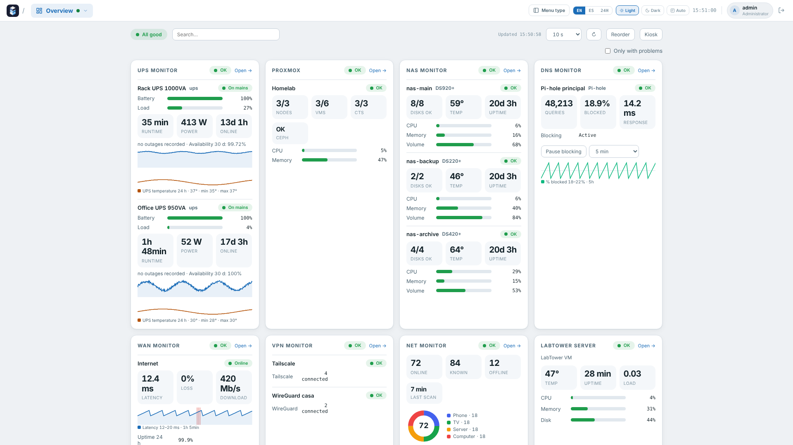

**Contents:** [Modules](#modules) · [Screenshots](#screenshots) · [Requirements](#requirements) · [Install](#install) · [Update](#update) · [First login](#first-login) · [Features](#features-by-module) · [HTTPS](#https) · [Backups](#backups) · [Health and operations](#health-and-operations) · [Settings](#settings) · [Security](#security) · [Layout](#layout) · [License](#license)

---

## Modules

| Module | Path | Port | What it does |
|---|---|---|---|
| **Overview** | `/overview/` | 8085 | Status of everything on one screen, event timeline and kiosk mode |
| **UPS Monitor** | `/nut/` | 8081 | Reads UPS units through NUT: battery, load, runtime, battery health, self-tests, voltages, temperature, history and CSV |
| **Net Monitor** | `/net/` | 8083 | Scans the network: hosts, type, OS, ports, MAC and vendor |
| **Proxmox Monitor** | `/pve/` | 8084 | Proxmox VE clusters: nodes, VMs, CTs and Ceph |
| **NAS Monitor** | `/nas/` | 8086 | One or more NAS (Synology over SNMP, TrueNAS and OpenMediaVault over their API): disks, volumes, temperature, CPU, memory and network |
| **DNS Monitor** | `/dns/` | 8087 | Pi-hole (v5 and v6) and AdGuard Home: queries, % blocked, top lists, upstream DNS and pausing the blocking |
| **WAN Monitor** | `/wan/` | 8088 | Internet uplink: latency, loss, outages (local or on the line, by asking the router), public IP and a scheduled speed test |
| **VPN Monitor** | `/vpn/` | 8089 | Who is connected to Tailscale, OpenVPN and WireGuard: since when, from which address and how much traffic, with connect / disconnect alerts |
| **Uptime Monitor** | `/uptime/` | 8090 | HTTP(S), TCP and DNS services: 24 h, 7 and 30 day uptime, response time and certificate expiry |
| **WOL Console** | `/wol/` | 8080 | Powers on machines with Wake-on-LAN |
| **Admin Panel** | `/admin/` | 8082 | Users, permissions, 2FA, sessions, audit log, backups and system health |

The home page (`/`) has one card per module, grouped like the menu: Power & servers, Network, Tools and System.

### Navigation

Every screen shares the same navigation, in the same order and grouping. Only the modules you have permission for, and that the admin did not turn off, are shown.

- **Top bar with a switcher** (default): the logo goes to the home page, and the module switcher opens a panel with all the modules, grouped, with their status (active, warnings or failing, shown with a shape and text, not only colour). It closes with Esc or by clicking outside. Language, theme, clock, user and "Menu type" are in the same bar. On phones there is a bottom bar (Home, Overview, Modules and Options) and modules are picked from a sheet that slides up.
- **Classic side menu:** the modules grouped in the side panel and, in the Overview, a strip at the top.
- **Choosing the menu type:** the first time you sign in a wizard offers both options. You can change it later in **Menu type** (next to language and theme). The choice is saved in the browser.
- **Common bar:** language, theme, clock, user, sign out, 24H and "Menu type" look the same in every module and in the Overview; with the top bar they move up to the global bar and the module bar disappears if nothing of its own is left. Each module's action buttons (Scan network, Settings, Wake All) share one look and also move up to the global bar.
- **Notices:** if any module has warnings or is failing, a box appears under the module bar, aligned with the content, with a link to each one. Status comes from a single public GET to `/admin/api/health`.
- Modules keep only their own things in the side panel (server lists, filters). If they have none, the panel is hidden. Nothing of this shows in kiosk mode.

## Screenshots

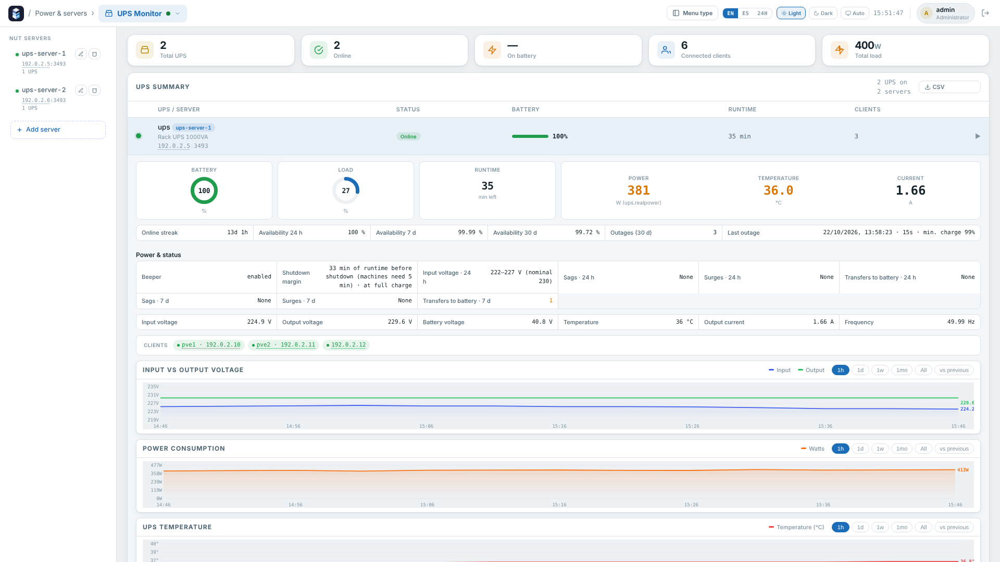 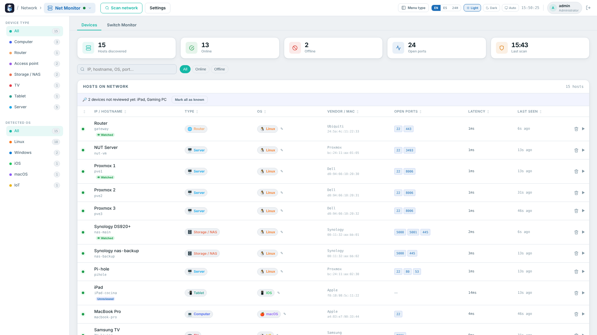 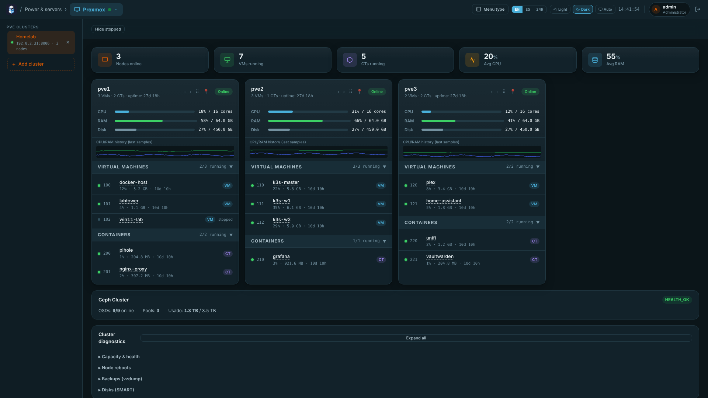 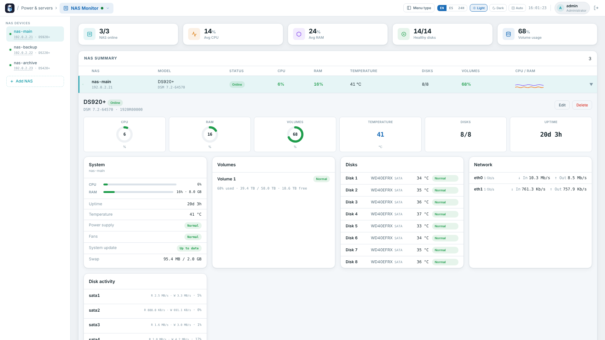

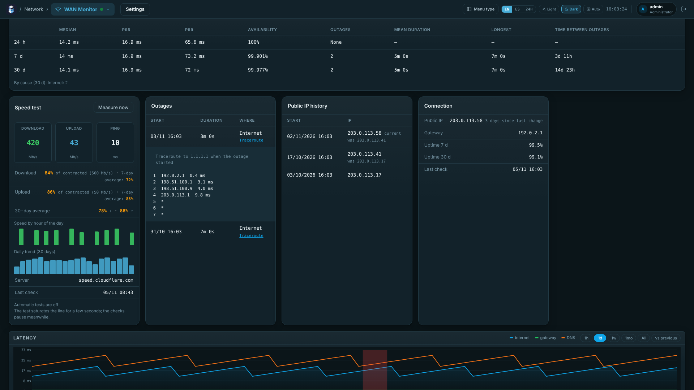 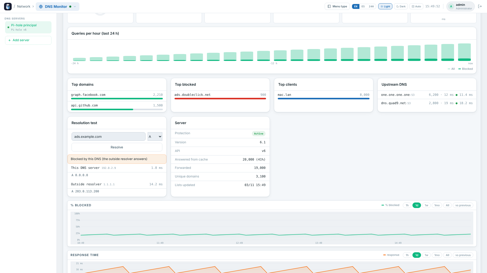 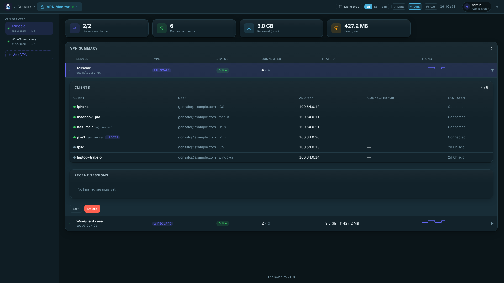 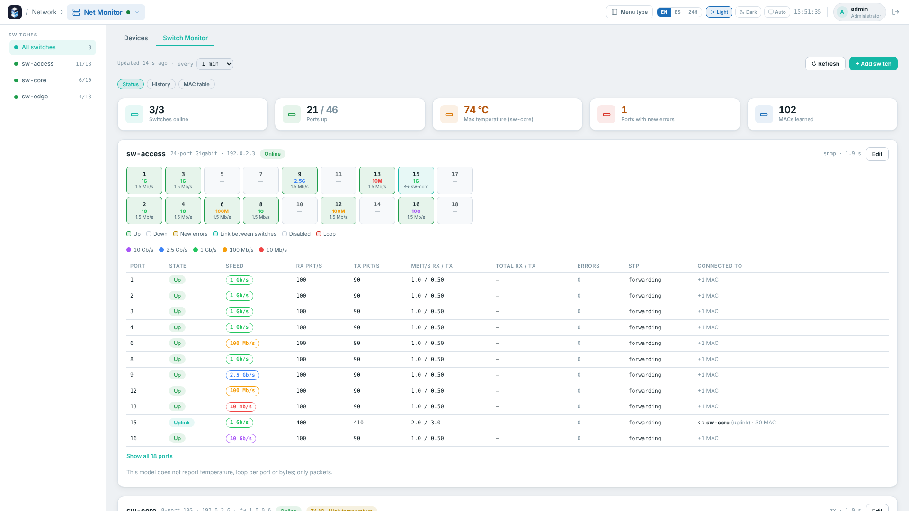

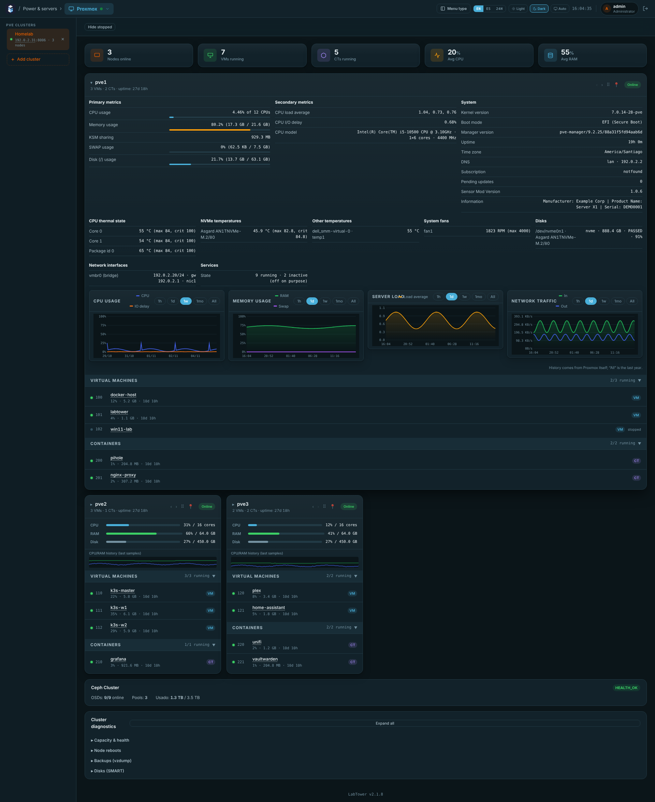 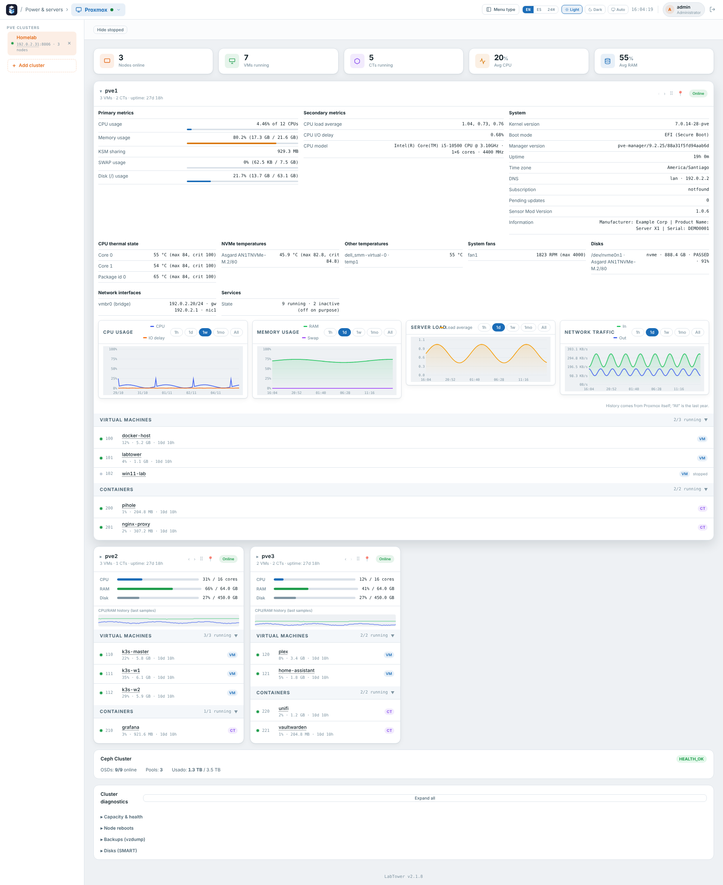

All screens (light and dark, 4 sizes) are in [`docs/screenshots/`](docs/screenshots/). The data is demo data.

---

## Requirements

- Raspberry Pi (tested on 3A+) or a VM/x86 machine, with Raspberry Pi OS, DietPi, Debian 12+ or Ubuntu.
- Python 3.9+, nginx, `sudo`, `snmp`, NUT (`nut`, `nut-client`), `openssh-client`, `gnupg`, `gpg-agent`, `openssl`, `cron`, `curl`, `iproute2`, `systemd` and other base packages. `apt` installs them with the `.deb`.
- Optional: `ieee-data` (local MAC vendor database) and the speed-test engines (see below).

## Install

- **Install in a Proxmox container (CT):** [guide and script](docs/CT.md) (`scripts/labtower-ct` creates the CT and installs LabTower).
- **Install on a VM or a Raspberry Pi (Debian 12+, Ubuntu, DietPi or Raspberry Pi OS):**

```bash
wget https://github.com/gonzalovalenzuela/labtower/releases/download/2.1.8/labtower_2.1.8_all.deb
sudo apt-get update
sudo apt-get install -y ./labtower_2.1.8_all.deb
```

Use `apt-get install ./file.deb`, not `dpkg -i`, so `apt` installs the dependencies. Then open `http://<labtower-ip>/`.

The installer creates one system user per service (`labtower-auth`, `labtower-wol`, …), the systemd services, the nginx config and the `admin` user with a **random password**, shown when it finishes. If you lost it: `sudo cat /var/lib/labtower/auth/initial-admin-password`. If you already changed it and forgot the new one, reset it with `sudo labtower-resetpw` (see below).

**From source** (development): copy the modules to `/opt/labtower`, install the config from `etc/nginx/` and create the services using `debian/postinst` as a guide.

### Speed tests (optional)

WAN Monitor ships its own engine and needs nothing else. To use **Ookla** or **LibreSpeed**, install their program; it then shows up in *WAN Monitor → Settings → Test engine* (until then it is marked "not installed").

**Ookla `speedtest`** (the official package is called `speedtest`; Debian's `speedtest-cli` is a different program and will not work):

```bash
sudo apt-get install -y curl
curl -s https://packagecloud.io/install/repositories/ookla/speedtest-cli/script.deb.sh | sudo bash
sudo apt-get install -y speedtest
speedtest --version
```

If the repository script does not recognise your Debian or Raspberry Pi OS release, download the Linux `.tgz` for your architecture (`x86_64`, `aarch64`, `armhf`) from <https://www.speedtest.net/apps/cli>, extract it and copy `speedtest` to `/usr/local/bin/`. LabTower runs it with `--accept-license --accept-gdpr`.

**LibreSpeed `librespeed-cli`:**

```bash
sudo apt-get install -y librespeed-cli     # Debian 13 (trixie) or later
librespeed-cli --version
```

Where the package does not exist, use the binary from [release v1.0.14](https://github.com/librespeed/speedtest-cli/releases/tag/v1.0.14). Each file is a `.tar.gz` holding the `librespeed-cli` program; pick the one for your architecture (`uname -m`):

| `uname -m` | File |
|---|---|
| `x86_64` | `librespeed-cli_1.0.14_linux_amd64.tar.gz` |
| `aarch64` (64-bit Raspberry Pi) | `librespeed-cli_1.0.14_linux_arm64.tar.gz` |
| `armv7l` (32-bit Raspberry Pi) | `librespeed-cli_1.0.14_linux_armv7.tar.gz` |

```bash
wget https://github.com/librespeed/speedtest-cli/releases/download/v1.0.14/librespeed-cli_1.0.14_linux_arm64.tar.gz
tar -xzf librespeed-cli_1.0.14_linux_arm64.tar.gz librespeed-cli
sudo install -m 755 librespeed-cli /usr/local/bin/librespeed-cli
librespeed-cli --version
```

## Update

```bash
wget https://github.com/gonzalovalenzuela/labtower/releases/download/2.1.8/labtower_2.1.8_all.deb
sudo apt-get install -y ./labtower_2.1.8_all.deb
labtower-health
```

- Works from any 1.1.x, 1.2.x, 1.3, 1.4 and also from **Pi Console** (the previous name, see below). Data in `/var/lib/labtower` is kept and also copied to `/var/backups/labtower`.
- **From Pi Console (1.x):** LabTower is the same project under a new name. The 2.0 `.deb` replaces `pi-console` and migrates by itself the user, data, HTTPS certificates, SFTP backup and earlier backups to the new paths (`/var/lib/labtower`, `/etc/labtower`…). You have to log in again. The `pi-console-*` commands are now `labtower-*`. Afterwards you can run `sudo dpkg -P pi-console` to clean up the old package record.
- Installing a **lower** version number than the current one needs `--allow-downgrades`.
- After updating, reload the page (Ctrl+Shift+R). On iPad, close and reopen the page.
- Changes for each version are in [CHANGELOG.en.md](CHANGELOG.en.md) (Spanish, with every development build: [CHANGELOG.md](CHANGELOG.md)).

## First login

1. Sign in as `admin` with the password the installer showed.
2. You must choose a new password (minimum 8 characters) before using any module.
3. Create your users in the Admin Panel. "Must change password" is ticked by default when creating a user, and when an admin resets another account's password the change is always mandatory. Creating users, resetting passwords and changing permission levels ask for your current password.
   - **Serial numbers:** each user has a separate "See serial numbers" permission (yes/no) that covers the UPS, the NAS, drives and Proxmox nodes. Without it the server does not even send that data to the browser. New users get "no"; on update, WOL or UPS administrators keep it and everyone else gets it when an administrator ticks it. Only someone who has it can grant or remove it.

---

## Features by module

### Overview
- **Global status** (All good / Attention / Failure) and a list of what needs attention, linked to the module.
- **Only with problems:** the filter hides the healthy cards and is remembered in the browser.
- **UPS:** state, battery, load, runtime, power and 24 h charts.
- **Proxmox:** nodes online, running VMs and CTs, CPU and memory (12 h chart), Ceph health.
- **NAS:** per NAS, status, CPU and memory (12 h chart with temperature), healthy disks, temperature and the fullest volume.
- **Network:** hosts online, known and offline, last scan, device types and new hosts from the last 48 h.
- **VPN:** how many clients are connected per server; the detail (who, from where, traffic) is in VPN Monitor.
- **Uptime:** how many services are up, the ones that are down and the certificates about to expire.
- **Server (LabTower Server):** temperature, CPU, memory, disk, uptime and power supply status. On a Raspberry Pi only, it adds a 24 h temperature chart with under-voltage and throttling marks (kept 7 days in `metrics.db`).
- **Event timeline:** important changes with their time (UPS on battery, node down, Ceph change, new or vanished hosts). The modules record them even when nobody has the page open: last 300 events or 30 days.
- **Global search** (top bar or the `/` key): Net Monitor hosts, UPS, Proxmox VMs and containers, NAS, DNS servers and WOL devices; it only shows what each user can see.
- **Alert rules** (admins): thresholds on server, UPS, NAS, Proxmox, DNS and internet metrics, as warning or critical; they are evaluated while the Overview is open and the ones that trigger show in the attention panel.
- **Detail charts** (UPS, NAS, DNS, WAN and switches): same look everywhere, 1-week range, "vs previous" button (dotted previous period) and event marks.
- Everyone sees only the modules they can access.
- **Refresh:** interval selector (10 s, 30 s, 1, 2, 5 min or manual with ↻), per browser. A hidden tab makes no requests.

**Kiosk mode** (*Kiosk* button or `/overview/?kiosk=1`): full screen, large text, no buttons or cursor, screen kept awake. A touch or the mouse shows the exit button. URL options: `?zoom=0.8` (0.5 to 2) and `?autoscroll=1` (scrolls up and down by itself if the content does not fit). A read-only user is recommended.

**iPad as a display:** open `http://SERVER-IP/overview/?kiosk=1` in Safari → Share → *Add to Home Screen*, with *Open as Web App* on. To stop it from locking: *Guided Access* or *Auto-Lock: Never*.

### UPS Monitor
- Starts with no servers. An admin adds one (name, `upsd` host and port, default 3493) and can test the connection before saving.
- Polls `upsd` every 10 s and keeps history in SQLite (WAL, 1 year).
- Voltage, power and temperature charts (if the UPS reports it). CSV export.
- Shows the clients connected to each UPS.
- **Battery:** under each UPS you see the **runtime now** (as reported by the UPS), the **runtime projected to a full battery** and an estimate if the load rose 50 % (an approximation: runtime is inversely proportional to the load), the **battery age** (from `battery.date` or `battery.mfr.date`, whichever is the most recent credible one; an age over 10 years is ignored because some UPSs keep the factory date; warning from 4 years; the ✎ button lets you set the real replacement date, which takes priority) and the **capacity trend**: weekly mean of the runtime with battery ≥ 95 % and a load close to the usual one, over the last 120 days, warning if it falls 20 % or more (needs about a month of history; recomputed every 6 hours).
- **Self-test log:** if the UPS reports `ups.test.result`, every change is logged (time LabTower saw it) and the last 8 are shown. A failed test raises an Overview warning; a passed one after "In progress", an informational event. "Last result" shows the time LabTower saw it and, if the UPS goes back to "No test initiated", the last real test. LabTower only reads: it never starts tests on the UPS (they are started with `upscmd` if the driver allows it).
- **Power & status:** each UPS detail shows the **status flags** NUT reports besides mains/battery (`RB` replace battery, `OVER` overload, `BYPASS`, `OFF`, `FSD` forced shutdown, `ALARM`, and the informational `TRIM`, `BOOST` and `CAL`), the **alarm** (`ups.alarm`) and the beeper state. Warning flags, the alarm and an insufficient margin appear in the Overview attention panel and create events when they change (the first reading is only remembered). **Mains quality:** from the input-voltage history (7 days) it counts **sags and surges** outside ±10 % of the nominal voltage (`input.voltage.nominal`; if the UPS does not report it, the median of the history is used) and the **transfers to battery** in 24 h and 7 d, and shows the 24 h minimum and maximum; a single stray reading does not count, at least 2 in a row are needed. **Shutdown margin:** compares the runtime down to the UPS shutdown threshold (`battery.runtime.low`) with the time your machines need to shut down (`NUT_SHUTDOWN_SEC`, 300 s by default); on mains it uses the runtime projected at full charge and on battery the current runtime, and warns if it is shorter. Everything depends on the variables the UPS driver exposes: whatever it does not report is simply not shown.

### Net Monitor
- **Network:** detected automatically (the server's /24) or set with `SCAN_NETWORK`.
- **Scanning:** a new install scans nothing until you ask (*Run initial scan* button). Automatic scanning, clean-up of offline devices, SNMP and Pi-hole are set in the *Settings* window (minimum 60 s between scans); *Scan network* and *Settings* are in the top bar.
- **Detection:** ping (TTL), ports and HTTP banner. It does not use `nmap`.
- **MAC and vendor**, in this order: Pi-hole, local ARP, SNMP (ARP table of a router or switch). Vendors come from the Wireshark `manuf` list (weekly download) or `ieee-data`.
- **Device types:** computer, phone, tablet, router, switch, access point, storage, TV, camera, printer, game console, server, IP phone, UPS, smart speaker and other. OS, type and group can be edited by hand.
- **Trash button** to remove a host from the list (admins only). If it is still connected, the next scan discovers it again.
- **Proxmox:** VMs and containers are recognised in the table ("VM 100" / "CT 200" badge) by matching MAC, IP and, with no other clue, an identical name. The Hosts / Online / Offline cards filter the table.
- Hovering (or tapping on iPad) an IP in UPS, Proxmox, WOL or Overview shows a card with the host's data.
- SNMP credentials and the Pi-hole password are stored with 600 permissions and the API never returns them. Saving the Pi-hole settings with an empty password keeps the stored one (the field says so). If Pi-hole regenerates its own certificate with the same subject and issuer it is pinned again automatically and an event is recorded; a different identity is refused until you save again.
- **Device security and stability:** (1) **MAC change on an IP:** if an IP that was online shows a different MAC on the next scan, an event is recorded and the device shows a *MAC changed* badge (7 days); it could be a duplicate IP, a replaced device or spoofing. Nothing is reported if the device was offline in between, because DHCP handing IPs to other devices is normal. (2) **Unreviewed devices:** devices discovered before updating count as known; new ones stay *unreviewed* (badge, strip above the table and Overview card) until an admin marks them as known, one by one or all at once. (3) **Per-device connectivity:** in the detail, the share of time online over 7 and 30 days, the drops of the last 7 days and a bar of the last week, computed from the connection log; a history shorter than the period is not judged as if it covered it. A device with 4 or more drops in 24 h raises an event and is flagged *Unstable* when it has 8 or more in the week. (5) **Watched devices:** in the detail, *Watch this device* (admins, up to 40) probes it every 30 s (`NET_WATCH_EVERY`, 0 disables it); after 2 failures in a row there is a critical event and an Overview alert, and another when it is back. (4) The **latency** of each watched device is stored (`NET_LATENCY_KEEP_DAYS`, 30 days by default) and the detail shows its 1, 7 or 30 day chart with mean, p95, maximum and loss. (6) **New ports:** if a device shows a port it never showed before, an event is recorded (a port that closes and reopens because of a timeout does not count); remote-access, file-sharing and database ports (21, 23, 135, 139, 445, 3389, 5900, 3306, 5432, 6379…) are raised as warnings. A device's group is no longer lost on rescan.

#### Switch Monitor (Net Monitor tab)
- Second tab next to *Devices*. For each switch it shows the front panel with every port's state (up, down, disabled, new errors, link between switches, loop), negotiated speed, packets per second, errors, STP, temperature and which device is behind each port (the switch's MAC table is matched with the hosts Net Monitor already knows).
- **Models:** ZX310S (web interface), HC-SWTGW218AS (web interface) and any SNMP v2c switch (TP-Link and others); SNMP is the only one that reports bytes, so only there you get Mb/s.
- **Added from the UI** (*+ Add switch*, admins only), with a *Test* button before saving. User, password or community are stored in `switches.json` with 600 permissions and the API never returns them.
- **Stored web session:** the web-interface switches (ZX, HC) keep a single session open and do not hand it out to another client while it is alive; LabTower stores its session cookie (600 permissions, in the Net Monitor data) and reuses it after a restart or an upgrade, and waits longer between attempts when the switch rejects the session several times in a row.
- **Read-only:** nothing is changed on the switches. Dangerous operations (clearing the ZX counters, wiping the HC MAC table, reboot, save) are blocked in the code.
- **1-year history** (like UPS Monitor): temperature and, per port, state, speed, packets or Mb/s and errors; ranges 1 h, 1 d, 1 wk, 1 mo and all. Rates are computed between samples and tolerate counters that reset to zero.
- **History** (sub-tab): cumulative totals per port (real bytes via SNMP; on ZX and HC, which only report packets, bytes are an estimate = packets × an average size configurable per switch, marked with «≈»), stored in the database and kept across switch and LabTower restarts. It adds up how far each counter advances between reads and starts from the value the switch already had when it was added.
- **Alerts** in the Overview (Net Monitor card and timeline): switch unreachable (after 2 failed reads), temperature ≥ 70 °C (warning) / ≥ 80 °C (critical), new errors on a port, link changes and loop. Ports between switches do not alert on loop. Thresholds can be changed with `SWITCH_TEMP_WARN` and `SWITCH_TEMP_CRIT`.
- **CRC errors and flapping ports:** over SNMP the **CRC/FCS** and alignment errors (EtherLike-MIB) of each port are also read; if they rise, the alert says "CRC errors (cable or network card)" instead of a generic one, and the port detail shows the counters. A link that changes 4 or more times in 10 minutes raises a **link flapping** alert (at most one every 30 min per port), even if the port is not watched.
- **Alert per port:** in the detail of any port, *Alert when this port goes down or up* (admins only) records every drop and recovery of that port on the Overview timeline. Links between switches and manual uplinks were already watched.
- **TP-Link JetStream (T2600G, T1600G, SG3428…):** in the web interface, *SNMP → Global Config* → enable, and in *SNMP → SNMP Community* create a read-only community (*Read-Only*) and, if you like, limit it to LabTower's IP. Then add the switch with the SNMP type. Only SNMP v1/v2c is used (not v3). Temperature is not read over SNMP on these models.
- **Basic topology** worked out from the MAC tables. Label and "link to another switch" are edited per port.
- Polled every 60 s by default (30 s to 1 h, configurable); each switch is read one request at a time, with pauses, because their web servers are fragile.
- Console diagnostic: `python3 /opt/labtower/net-monitor/switches.py --config switches.json --once`.

### Proxmox Monitor
- Polls each cluster every 5 s with the page open and every 60 s when idle.
- **Node detail — temperatures and fans:** requires the **[PVE mods](https://github.com/Meliox/PVE-mods)** add-on (`lm-sensors`) installed on each Proxmox node. Without it the detail still shows everything else (CPU, memory, network, services, disks…) but not the *CPU thermal state*, *NVMe temperatures*, *Other temperatures*, *System fans* or *Sensor Mod Version* sections. LabTower only reads what the add-on publishes through the Proxmox API; it installs nothing on the nodes and never shows machine or drive serial numbers.
- **Node detail:** click a node's name to open its detail (CPU, memory, network, disks, services) with charts by range. Services that are intentionally off are not flagged as failures.
- Node order and pinned nodes are saved per cluster (admin only).
- When adding a cluster you must confirm its certificate SHA-256 fingerprint, which is then pinned. If the certificate changes, the token is not sent.
- **Cluster diagnostics** (panel below the nodes): node reboots with a common timeline (those less than 10 minutes apart are flagged as *simultaneous*, and they are detected even if LabTower was stopped), corosync quorum state, down OSDs and Ceph warnings, and the SMART data of each node's disks (health, wear, temperature, errors, sectors and, on NVMe, *Unsafe Shutdowns*) read every 15 minutes (`PVE_SMART_EVERY`, in seconds; 0 disables it). Everything creates events on the Overview timeline. The API token needs the `Sys.Audit` privilege on `/nodes` (role `PVEAuditor`) to read the disks.
- **Backups (vzdump):** for each VM and CT, its last backup, read from the content of the storages that allow *backup* (a shared storage is queried once; on Proxmox Backup Server its verification state is shown), with its age, size and number of copies. It flags **No backup** or **Too old** (over 36 h by default; change it with the `/api/clusters/<id>/backup` API) and records an Overview event when a guest enters that state, and another when it is back to normal. Failed `vzdump` tasks of the last 7 days are listed and raise a critical event. Test VMs can be **ignored** from the panel (admins only). If a storage cannot be read, the VMs are not accused of having no backup. Read every 10 minutes (`PVE_BACKUP_EVERY`, in seconds; 0 disables it). The token needs `Datastore.Audit` on the storages (role `PVEAuditor`).
- **Capacity & health** (section of the diagnostics panel, read every 5 minutes; `PVE_EXTRA_EVERY`, in seconds, 0 disables it): **days until full** for every storage and for Ceph (regression over 45 days of history, as in NAS Monitor; warns under 14 days, critical under 3), **capacity** (vCPU and RAM allocated to running VMs/CTs per node, RAM overcommit and the **N-1** test: whether everything still fits if the biggest node goes down), **HA** (services in error/fence and unresponsive managers), **replication** (failing jobs), **failed tasks** of any type (last 2 days), **Ceph** (throughput, recovery and PGs not clean) and per-node data (PVE version, flagged when nodes differ, kernel, load, swap, iowait and certificate expiry, warns at 21 days). The Overview timeline also records when a VM/CT starts, stops, is created or changes node (more than 5 at once become a single summary event; the tag `labtower-ignore` on a VM excludes it) and VMs/CTs holding a **lock** for over 1 hour (6 h for backups). Whatever the token cannot read is simply not shown and the panel says so.
- **API token privileges:** create the token with **privilege separation** and give it read-only access. The simplest way is to assign the **`PVEAuditor`** role to the user *and* to the token on `/` (with *Propagate*). What each feature needs:

  | Feature | Endpoint | Privilege |
  |---|---|---|
  | Nodes, VMs, CTs, storages, locks | `/cluster/resources` | `VM.Audit`, `Datastore.Audit`, `Sys.Audit` |
  | Quorum, version, Ceph | `/cluster/status`, `/version`, `/cluster/ceph/status` | `Sys.Audit` |
  | SMART, node status, certificates, replication | `/nodes/<n>/disks/*`, `/nodes/<n>/status`, `/nodes/<n>/certificates/info`, `/nodes/<n>/replication` | `Sys.Audit` on `/nodes` |
  | HA | `/cluster/ha/status/current` | `Sys.Audit` on `/` |
  | Backups | `/nodes/<n>/storage/<s>/content` | `Datastore.Audit` |
  | Tasks, guest IPs (agent) | `/cluster/tasks`, `/nodes/<n>/qemu/<id>/agent/*` | `Sys.Audit` / `VM.Monitor` (or `VM.GuestAgent.Audit` on PVE 9) |

  All of them are **read-only**; LabTower never writes anything to Proxmox. *Pending updates* (`apt/update`) are not queried because they require `Sys.Modify`. The table follows the Proxmox VE documentation; if a feature shows "no permission" in the panel, check that the privilege is assigned to the **token** too (with privilege separation the user's permissions are not inherited).
- **VMs and containers in Net Monitor:** each VM/CT's MAC (from its configuration) and IP (container static IP, guest agent on VMs, container interface) are read every 5 min. A VM/CT name links to its detail in Net Monitor.

### NAS Monitor
- Works like UPS Monitor: a **NAS Summary** table with every NAS (status, model, CPU, RAM, temperature, disks and fullest volume). Each row opens and shows its detail right below; the first one opens by default. You can also pick one from the side menu.
- **Trends and reading alerts (Synology, TrueNAS and OpenMediaVault):** every 15 minutes the usage of each volume and the temperature of each disk are stored (45 days, in `metrics.db`). With that, every volume shows **how many days are left until it is full** from its growth over the last 14 days (only with 2 days of data or more, steady growth and less than a year; warning at 30 days, critical at 7) and every disk shows its **24 h maximum and average temperature** (and the 7-day maximum on hover).
- **Network (Synology):** link state of each port ("Link down") and input and output errors.
- **New events on the Overview timeline:** a system update is available, fan failure and recovery, a disk going over 55 °C and back to normal, a network link going down or up, sustained network errors (10 per minute or more) and a NAS restart (also when it happened while it was not answering).
- Add as many NAS as you like (like Proxmox clusters or UPS servers). When adding one you pick its **type**: **Synology** (over **SNMP v3** —user, level `authPriv`/`authNoPriv`/`noAuthNoPriv`, auth and privacy keys— or v2c), **TrueNAS** (API key) or **OpenMediaVault** (user and password). The type cannot be changed later. *Test connection* checks the data before saving.
- **Detail of each NAS:** gauges (CPU, RAM, volume, temperature, disks and uptime), system, volumes with their space, disks with status and temperature, network, attached UPS and disk activity.
- **Charts** for CPU/RAM, temperature and network with **1h / 1d / 1mo / All** ranges; hovering shows the value at each moment. History is stored in `metrics.db` (`NAS_KEEP_DAYS`, 7 days by default).
- **Alerts** (also on the Overview timeline): failed disk, degraded or nearly full volume (90 %), high temperature and an available system update (TrueNAS also shows the machine's own alerts). A full *Storage Pool* does not alert, because it is normal for it to be full when its volumes use all the space.
- **Certificate expiry:** once a day (after an hour if a port failed, and at startup or when the host or the ports change) the TLS certificate of the chosen ports on each NAS is read: by default 5001 (DSM) on Synology and its own HTTPS port on TrueNAS and OpenMediaVault; several can be given, comma-separated, or none. It is only read, not validated, so self-signed certificates work too. The *Certificates* section shows name, issuer, date and days left; the *Check now* button (execute permission) reads them right away. It warns at 14 days and turns critical at 3 (both set per NAS, 1 to 90 and critical lower than warning), expired is critical too and a port that does not answer shows as a warning. Days and level are recomputed on every NAS reading from the last read. The Overview timeline records when a certificate enters warning or critical, expires or is renewed.
- SNMP keys are stored with 600 permissions and the API never returns them. While polling they live in a private temporary file, never on the command line. When editing, leaving a key blank keeps the stored one.
- **Enable SNMP on Synology:** *Control Panel → Terminal & SNMP → SNMP → Enable SNMPv3*, set user and passwords (8+ characters) and use `SHA`/`AES`. Other NAS using the standard MIBs (UCD/IF-MIB) show CPU, memory and network, but not disks or volumes.
- Needs the `snmpget` and `snmpbulkwalk` commands (package `snmp`, already installed by the LabTower package) only for Synology NAS.
- **TrueNAS** (25.04 or newer): read over the JSON-RPC 2.0 API on WebSocket (`wss://host/api/current`); the REST API no longer exists in newer versions. Create an **API key** for a dedicated user (the *Read-only Admin* role is enough) and paste it in the form together with that user's name. It shows system, live CPU, memory and network, pools (status and space), disks with temperature and the machine's own alerts. TrueNAS only accepts keys over TLS, so HTTPS is always used.
- **OpenMediaVault** (7 or newer): read through `rpc.php` with an **administrator** user and password (OpenMediaVault has no read-only role: a dedicated account is recommended). It shows system, CPU, memory, disks with SMART status and temperature, file systems with their space, network interfaces and whether updates are available or a reboot is needed. It does not measure network speed. The session is reused between readings, so OpenMediaVault does not log a login per poll; the "new browser" notice may arrive once after LabTower restarts. Prefer HTTPS: over HTTP the password travels unencrypted.
- **Certificates:** with "Verify the TLS certificate" on, it is validated against the system CAs. Without it, ANY certificate is **not** accepted: the SHA-256 fingerprint is pinned on the first connection and, if it changes, the connection is dropped before the key is sent. Saving the NAS again clears the fingerprint and it is learned again.
- Read-only: LabTower never calls a TrueNAS or OpenMediaVault method that changes anything.

### WAN Monitor
- Every 30 s (`interval`) it measures the internet uplink with ping or TCP to the targets you choose, to the gateway and to a DNS name; latency, jitter and loss are stored in SQLite.
- **Outages:** an outage opens after 2 failed rounds and closes when service returns. Each one is classified as **Local network (LAN)** (the gateway does not answer either), **Line / provider (WAN)** (the router reports its link is down) or **Internet** (the router does not confirm it).
- **Router check (optional):** in *Settings → Router check*, turn on "Ask the router" and pick the type. It only reads the WAN state; it never changes anything on the router.

  | Type | How it asks | Notes |
  |---|---|---|
  | **Huawei** (WiFi AX3, Mesh and other HiLink) | HiLink login and `api/ntwk/wandetect` | the router web user and password |
  | **OpenWrt** | `ubus` over HTTP | needs `uhttpd-mod-ubus`; the interface is `wan` by default |
  | **DD-WRT** | `Status_Router.live.asp` pages with HTTP basic | |
  | **TP-Link** (classic firmware) | `userRpm/StatusRpm.htm` with HTTP basic | newer models with encrypted login (Archer, Deco) cannot be read |

  Leave the address empty to use the gateway. "Test router" shows whether it connected, the WAN state, the IP and the reason if it fails. The password is stored on the server (mode 600) and is never shown or sent to the browser. While an outage is open it asks every 10 s.
- The **Connection** card shows how long the WAN has been connected according to the router and how many outages LabTower recorded in that period, so you can compare both.
- Public IP with change alert, scheduled speed test (built-in engine, Ookla or LibreSpeed; the period is set in minutes or hours, minimum 5 minutes, and under 30 minutes a warning says it can saturate the link) and history charts.
- **Quality and availability:** a card with **latency percentiles** (median, p95 and p99) and availability over 24 h, 7 d and 30 d, with the number of outages, mean duration, the longest, **mean time between outages (MTBF)** and a breakdown by cause (LAN / WAN / Internet). A history shorter than the period is not judged as if it covered it. The targets table adds the **24 h p95** and the **share of failed rounds in 24 h for each target**, to tell "only one fails" from "everything fails" (one sample per target and round is stored, with the same retention as the history, `WAN_KEEP_DAYS`).
- **Speed against the plan:** with the contracted speed set in *Settings*, the card shows the share of the plan of the last test, the 7 and 30 day means, the **download speed by hour of the day** and the **30-day daily trend**. If **3 tests in a row** fall under 70 % of the plan, a warning appears (also on the Overview) and an event is recorded when it starts and another when it clears.
- **Quality events:** packet loss (≥ 5 %) or latency (≥ 150 ms) that last **3 rounds in a row** create an event when they start and another when they end; a single spike does not. Outages have their own events.
- **Public IP history:** a card with every IP change (date with year, new IP and the previous one), besides the Overview notice. It is never pruned. LabTower only knows since it started watching, so the date of the oldest record is corrected in *Settings → Public IP known since* (dd-mm-yyyy). The *Connection* card and the side panel show the days since the last change.
- **Traceroute on every outage:** when an outage opens a `traceroute` (15 hops max) runs towards the first target and is stored with the outage; the *Traceroute* button in the outages table shows how far the uplink got. It needs the `traceroute` package (the installer recommends it); without it nothing is stored.


### VPN Monitor
- Shows the clients connected to each VPN server: name, real and virtual address, time connected, traffic, recent sessions and connect / disconnect alerts in the Overview timeline. Read-only: it never changes anything on the VPN server. Up to 16 servers.
- **Permission:** give users the **vpn** permission in *Admin Panel → Users*.
- **Tailscale:** read through the Tailscale API. Create an **API key** in the Tailscale admin console and paste it with your tailnet name (or `-` for the default). A device counts as connected if Tailscale sees it online.
- **OpenVPN and WireGuard:** read over **SSH** on the VPN server, which can be another VM, CT or a NAS. LabTower generates its own SSH key and only runs two fixed commands: `cat <status file>` (OpenVPN) and `wg show all dump` (WireGuard).

  1. In *Add VPN* choose the type, enter host, SSH user and port, and press **Create / show key**.
  2. Copy the public key to the SSH user's `~/.ssh/authorized_keys` on the VPN server. Restricting it is recommended; the form shows the ready-made line, for example `command="cat /path/to/status",no-pty,no-port-forwarding,no-agent-forwarding,no-X11-forwarding ssh-ed25519 AAAA…`.
  3. Press **Test**. The server's host key is accepted the first time and enforced afterwards.

  The SSH key is **not** included in backups: after a restore, create it again and reinstall it on the VPN server.
- **OpenVPN:** the server must write its status file with `status <file> 2` (or `3`) in its configuration, and that file is the one that goes in *Status file*. Find the path with `grep -rn "^status" /etc/openvpn/`. On Debian it is usually `/run/openvpn-server/status-server.log`; a relative path is relative to `/etc/openvpn/server/`. If there is no `status` line, add it and restart the service (`sudo systemctl restart openvpn-server@server`). The list is empty when nobody is connected.
- **WireGuard:** WireGuard has no users, so peers are named with **aliases**: one `<public key> Name` line per peer. A peer counts as connected if its last handshake is under 180 seconds old. `wg show` needs root: use `root` or tick "Run with sudo".
- **Run with sudo:** for when the status file or `wg show` are root-only. LabTower prefixes `sudo -n` (it never asks for a password) and only to those two fixed commands. On the VPN server allow **only** that command for the SSH user, with **both** paths of `cat`: over SSH without a terminal the `PATH` is shorter and `cat` usually resolves to `/usr/bin/cat`, not `/bin/cat`. If one path is missing the error is "sudo: a password is required". Check with `sudo -l -U <user>` and, from LabTower, with `ssh <user>@<server> 'command -v cat; sudo -n cat <status file>'`. Sudo's log (`/var/log/auth.log`) shows the exact command it received.
- **Synology (VPN Server with OpenVPN):** the status file is `/tmp/ovpn_status_2_result` (confirm it with `grep -n "^status" /usr/syno/etc/packages/VPNCenter/openvpn/openvpn.conf`); it is root-owned with mode 600 and refreshed every 30 s. It needs SSH enabled (*Control Panel → Terminal & SNMP*) and an administrator user. Use "Run with sudo" with this rule (in `/etc/sudoers.d/labtower-vpn`, mode 440; Synology has no `visudo`, check with `sudo -l -U <user>`):

  ```
  user ALL=(root) NOPASSWD: /bin/cat /tmp/ovpn_status_2_result, /usr/bin/cat /tmp/ovpn_status_2_result
  ```
  If SSH fails with "Permission denied" it is almost always permissions: `chmod 755 ~`, `chmod 700 ~/.ssh` and `chmod 600 ~/.ssh/authorized_keys`. With certificate-only authentication the user column is empty and LabTower shows the certificate's *Common Name*.

### Uptime Monitor
- Checks at an interval whether a service answers and keeps the history: a bar with the last 50 checks, 24 h, 7 and 30 day uptime, a response-time chart (1h, 1d, 1w, 1mo and all ranges, with "vs previous", red bands where it was down and marks for its events, like the other modules) and the certificate expiry. Up to 100 monitors.
- **Permission:** give users the **uptime** permission in *Admin Panel → Users*. "Execute" can press *Check now*; "administrator" can add, edit and delete monitors.
- **HTTP(S):** `GET` to the URL. It is up when the status code is in the list (`200-399` by default; `200,301` or ranges work) and, if set, the page contains the keyword (case-insensitive). Redirects are not followed. On https the certificate expiry is read and a warning comes N days before (14 by default). For a self-signed certificate (Proxmox, NAS) tick **Do not verify the certificate**: the expiry is still checked.
- **TCP:** opens a connection to the port (SSH, SMB, MQTT, a database…).
- **DNS:** resolves a name (A or AAAA) with the server's resolver or with a given DNS server; if an expected IP is set, it has to be among the answers.
- **Failures before down:** failed checks in a row before it is marked down (3 by default, 1 to 6). Meanwhile it shows "Pending" and counts as up.
- **Events:** down, up again, certificate expiring and certificate expired, on the Overview timeline. The Overview card shows how many services are up, the ones that are down and the certificates about to expire.
- **Order:** an administrator reorders the monitors by dragging a row's ⠿ handle onto another row, or with the ↑ ↓ buttons of the detail (on touch screens). The order is stored on the server and is the same in every browser.
- **Security:** HTTP cannot target this machine or link-local addresses (checked on save and again on connect). TCP and DNS may look at the own machine.
- The history lives in the module's `metrics.db`: every check for 2 days and an hourly summary for 365 days (`UPTIME_KEEP_DAYS`). It is included in backups.

### DNS Monitor
- **Upstream health:** every 60 s `example.com` is asked directly to each upstream DNS reported by Pi-hole or AdGuard Home; the list shows whether it answers and how fast. One that does not answer raises an alert (critical if none answers) and an event on the Overview timeline. DoH/DoT, this machine and link-local addresses are not probed.
- **Queries per hour and per client:** "Queries per hour" with ranges (1 day, 1 week, 1 month, all) and, on Pi-hole, a per-client activity chart.
- **Resolution test** ("execute" level): type a name and it is asked to the DNS server and to an outside resolver (`1.1.1.1`, changeable with `DNS_COMPARE`); it shows both answers and warns when the name is **blocked** by your DNS.


### WOL Console
- Sends magic packets (at most 10 per minute per IP).
- Picks hosts found by Net Monitor (name, MAC, IP and category) and uses the latest IP if DHCP changed it.
- Net Monitor tags hosts registered here with *WOL*.
- **Live state:** each device's dot turns green when it answers ping (checked from the server every 12 s, using Net Monitor's latest IP).
- **Wake-up confirmation:** after sending the packet the dot blinks until the device answers and reports "is up (N s)"; if it does not answer within 3 minutes, it says so.

### Admin Panel
- Users and per-module permissions (none, read-only, execute, admin).
- **Active sessions:** signed-in devices (user, browser, IP, last activity); close one or all the others.
- **Two-factor authentication (2FA):** "Security" card. Turn it on by scanning a QR code with any authenticator app (Google Authenticator, Aegis, 1Password…); the typed key is the fallback. 10 single-use recovery codes are issued. With 2FA on, every sign-in form asks for the code. An admin can reset another user's 2FA.
- **Audit log:** who created or deleted users, changed permissions or passwords, turned 2FA on or reset it, closed sessions, made backups or restores, and changed WAN Monitor settings or a battery date. It keeps the last 5,000 entries and never passwords or codes.
- **Updates:** warns when a new stable release is on GitHub (checked at most every 12 h; read only). Turn it off with `LABTOWER_UPDATE_CHECK=0` in `/etc/default/labtower`.
- **System health** card and **Backups** (Teleporter).

### All modules
- **Language:** English (default) or Spanish; shared across modules.
- **24H/12H time** (since 1.2.2a): button next to the language buttons. Default 24 h; stored in the browser.
- **Remember me** at login: 1 day, 1 week, 1 month or forever. Unticked, the session lasts 24 h.

---

## HTTPS

By default it is served over HTTP on port 80, meant for a trusted local network. To encrypt:

```bash
sudo labtower-https enable --redirect                                  # self-signed certificate
sudo labtower-https enable --redirect --cert fullchain.pem --key privkey.pem   # your own certificate (for example Let's Encrypt)
sudo labtower-https status
sudo labtower-https disable
```

`--redirect` sends port 80 to HTTPS, marks the cookie `Secure` and sends HSTS. With the self-signed certificate the browser warns once. On iPad/iPhone you must install it and trust it (Settings → General → About → Certificate Trust Settings). With your own certificate, use the name in the certificate, not the IP.

---

## Backups

### Teleporter (manual)
```bash
sudo teleporter backup ~/labtower-$(date +%Y%m%d).tar.gz   # create
teleporter check ~/labtower-20261009.tar.gz                # verify, changes nothing
sudo teleporter restore ~/labtower-20261009.tar.gz         # restore (-y to skip the question)
```

- **Includes:** users, WOL, UPS (servers and history), Net Monitor (hosts, SNMP and switches with their history), Proxmox, NAS Monitor (NAS list and history), Overview histories, and the NUT and nginx config. **Does not include** sessions, HTTPS certificates or the SFTP backup key.
- **Restoring NUT and nginx** is only done from the console with `--nut` and `--nginx`; the panel does not allow it.
- **Before restoring**, a copy of the current state is saved in `/var/backups/labtower/`.
- **Limits:** an archive that expands to more than 2 GiB is rejected; uploads from the panel are capped at 200 MB.
- **From the panel** (`/admin/` → *Backup & restore*): create, download, upload, verify and restore. Only admins of every module can use it. Downloading asks for your account password and the file comes out **encrypted** (gpg, AES-256) with a passphrase you choose (12+ characters); uploading a `.gpg` asks for that passphrase. To open it by hand: `gpg --decrypt backup.tar.gz.gpg > backup.tar.gz`. Creating a backup does not download it.
- **Moving to another server:** install the `.deb`, sign in as `admin`, upload the backup and press *Restore*.
- The file holds password hashes and tokens (600 permissions): keep it somewhere private.

### Automatic SFTP backup
A daily cron job (03:17) makes a backup, verifies it and uploads it over SFTP. It ships installed and **disabled** until `SFTP_USER` is set. It only uses an SSH key.

```bash
sudo labtower-sftp-backup setup       # creates the SSH key and shows the public one
sudo nano /etc/labtower/backup.conf   # set SFTP_USER (and SFTP_HOST, SFTP_DIR)
sudo labtower-sftp-backup test        # checks connection, folder and write access
sudo labtower-sftp-backup run         # back up now
sudo labtower-sftp-backup status      # result of the last run
```

- **Encryption:** the file is uploaded encrypted with gpg (AES-256). The passphrase is created automatically in `/etc/labtower/backup_passphrase`: **keep a copy off the server** (`sudo cat /etc/labtower/backup_passphrase`); without it no backup can be opened.
- **Restore:** download the `.tar.gz.gpg`, run `sudo labtower-sftp-backup decrypt file.tar.gz.gpg`, then `sudo teleporter restore file.tar.gz`.
- **Safe:** uploaded as `.part` and renamed; the remote size is compared; the server's host key is pinned on first connection.
- **Retention:** 30 copies on the storage (`KEEP_REMOTE`) and 7 on the LabTower server (`KEEP_LOCAL`). Only files named `labtower-auto-<host>-<date>_<time>.tar.gz` are deleted.
- **Verification:** `sudo labtower-sftp-backup verify` (also a daily cron at 09:43, `/etc/cron.d/labtower-sftp-verify`) lists the storage and checks that the newest copy exists, is not empty and is less than `VERIFY_MAX_AGE` hours old (36 by default, in `backup.conf`). It notices a stopped cron, a deleted copy or a storage that stopped answering. The result (`/var/log/labtower/backup.verify`) shows on the Overview card as *Copy on storage*.
- Result in `/var/lib/labtower/state/backup.status`; errors with `journalctl -t labtower-sftp-backup`. Change the schedule in `/etc/cron.d/labtower-sftp-backup`.
- Use a dedicated SFTP user with access to that folder only.

---

## Health and operations

```bash
labtower-health         # summary: exit 0 = ok, 1 = degraded, 2 = failed (-j for JSON)
labtower-resources      # memory and CPU per service (-w refreshes every 2 s)
sudo labtower-resetpw   # forgot the password: generates a new one for "admin" (see below)
systemctl status labtower-wol labtower-ups labtower-auth labtower-net labtower-pve labtower-nas labtower-dns labtower-wan labtower-vpn labtower-uptime labtower-overview
journalctl -u labtower-net -f        # logs of one service
sudo systemctl restart labtower-net  # restart one
```

### Disabling modules you do not use

In **Admin Panel → Modules** (only for someone who administers every module) you can turn off the ones you do not need, for example the UPS Monitor if you have no UPS. A disabled module stops, disappears from the menus, the home page and the Overview, does not count in the system health and **stays off** after restarts, updates (`apt`) and backup restores. Its data is not deleted: enabling it brings everything back as it was. From the console:

```bash
sudo labtower-modules list              # state of every module
sudo labtower-modules disable vpn       # turn off (wol nut net pve nas dns wan vpn uptime)
sudo labtower-modules enable vpn        # turn it back on
```

The state lives in `/etc/labtower/modules.disabled` (one module per line). The Admin Panel and the Overview cannot be turned off.

### Forgot the password

From the machine's console, as root (no login needed):

```bash
sudo labtower-resetpw                  # generates a new password for "admin" and prints it
sudo labtower-resetpw ana              # same for another user
sudo labtower-resetpw --ask ana        # you type the new password
sudo labtower-resetpw --disable-2fa ana  # also turns 2FA off (lost phone)
sudo labtower-resetpw --list           # list the users
```

The new password must be changed at the next login (except with `--ask --no-change`). The command closes every session of that user, clears its failed-login lock and is recorded in the audit log as "console". It uses the same code as the Admin Panel and runs as the authentication service's user; the services do not need a restart.


Each module answers `GET /api/health` (200 = ok or degraded, 503 = failed). Without a session it only shows levels. It detects a stopped service, a corrupt data file, a nearly full disk, a locked history database, a stuck scan, and `upsd`, Proxmox or a NAS not answering. On a Raspberry Pi it also warns about under-voltage or throttling; that warning comes from the firmware and only clears on reboot.

| Service | Module |
|---|---|
| `labtower-wol` | WOL Console |
| `labtower-ups` | UPS Monitor (formerly `nut-monitor`, which clashed with NUT's `upsmon`) |
| `labtower-auth` | Admin Panel |
| `labtower-net` | Net Monitor |
| `labtower-pve` | Proxmox Monitor |
| `labtower-nas` | NAS Monitor |
| `labtower-dns` | DNS Monitor |
| `labtower-wan` | WAN Monitor |
| `labtower-vpn` | VPN Monitor |
| `labtower-uptime` | Uptime Monitor |
| `labtower-overview` | Overview |

Since 2.1.8 every service is called `labtower-<module>` (formerly `wol-console`, `admin-panel`, `net-monitor`, `proxmox-monitor`, `nas-monitor`, `dns-monitor`, `wan-monitor`, `vpn-monitor`). When upgrading, the installer removes the old names and enables the new ones; the data is not touched.

**Uninstall:** `sudo apt remove labtower` stops the services and saves a copy of the data in `/var/backups/labtower`. `sudo apt purge labtower` also removes the code, services, nginx site and the `labtower-*` users. In both cases `/var/lib/labtower` and `/var/backups/labtower` are **not deleted**; remove them by hand for a clean machine.

---

## Settings

The defaults suit most setups. To change them, write `NAME=value` in `/etc/default/labtower` and restart the services:

```bash
echo 'NUT_POLL=5' | sudo tee -a /etc/default/labtower
sudo systemctl restart labtower-wol labtower-ups labtower-auth labtower-net labtower-pve labtower-nas labtower-dns labtower-wan labtower-vpn labtower-uptime labtower-overview
```

| Variable | Module | Default | Purpose |
|---|---|---|---|
| `SCAN_NETWORK` | Net | Server's /24 | Network to scan (e.g. `192.0.2.0/24`) |
| `SCAN_INTERVAL` | Net | manual | Seconds between automatic scans (0 = manual) |
| `SCAN_PORTS` | Net | common ports | Ports probed |
| `PORT_TIMEOUT` | Net | `0.5` | Seconds to wait per port |
| `MAX_WORKERS` | Net | `30` | Hosts scanned at once |
| `PIHOLE_HOSTS`, `PIHOLE_PASS` | Net | empty | Pi-hole (also set from the page) |
| `NUT_POLL` | UPS | `10` | Seconds between `upsd` polls |
| `NUT_SHUTDOWN_SEC` | UPS | `300` | Seconds the machines need to shut down (shutdown margin) |
| `NET_WATCH_EVERY` | Net | `30` | Seconds between probes of watched devices; 0 disables them |
| `NUT_DB_FLUSH` | UPS | `60` | Seconds between history writes |
| `PVE_POLL_ACTIVE`, `PVE_POLL_IDLE` | Proxmox | `5`, `60` | Seconds between polls with the page open / idle |
| `PVE_KEEP_DAYS` | Proxmox | `7` | Days of CPU and memory history |
| `PVE_EXTRA_EVERY` | Proxmox | `300` | Seconds between capacity & health reads (HA, replication, certificates, tasks, trends); 0 disables them |
| `NAS_POLL_ACTIVE`, `NAS_POLL_IDLE` | NAS | `15`, `60` | Seconds between polls with the page open / idle |
| `NAS_KEEP_DAYS` | NAS | `7` | Days of history per NAS |
| `LABTOWER_PI_KEEP_DAYS` | Overview | `7` | Days of Pi history |
| `WOL_BROADCAST` | WOL | automatic | Comma-separated broadcast addresses |
| `DNS_COMPARE` | DNS | `1.1.1.1` | Outside resolver of the resolution test |
| `LABTOWER_SECURE_COOKIE` | all | off | `1` marks the cookie `Secure` (only behind HTTPS) |

---

## Security

Designed for a **trusted local network**. Do not expose port 80 to the internet.

- **Access:** the Python services listen on `127.0.0.1` only; only nginx is visible on the network. To encrypt, see [HTTPS](#https).
- **Passwords:** minimum 8 characters, stored with scrypt. The initial account uses a random password that must be changed.
- **Login attempts:** 5 failures from one IP within 10 minutes lock that IP for 5 minutes; each account also has its own limit. The counter is shared by all modules. nginx rate-limits requests and connections per IP.
- **2FA and audit:** optional two-factor authentication (TOTP) per user, with recovery codes, and an audit log of administrative actions.
- **Sessions:** `HttpOnly` and `SameSite=Strict` cookie; only the SHA-256 hash of the token is stored on disk. They can be viewed and closed in the Admin Panel.
- **CSRF:** every request that changes data is rejected (403) unless it comes from the app's own page.
- **Strict CSP:** no inline scripts or handlers (`script-src 'self'`). Browsers: Chrome 75+, Firefox 105+, Safari 15.4+.
- **Per-module permissions:** an admin can only grant or remove permissions on modules where they hold that level, and cannot delete or change the password of a user with more permissions.
- **Least privilege:** the code in `/opt/labtower` is root-owned and read-only for the services; their data lives in `/var/lib/labtower/`. The systemd units are hardened. Scripts that run as root (installer, Teleporter, SFTP backup) never follow symlinks inside the services' folders.
- **Validated input:** NUT, Proxmox, NAS and Pi-hole hosts and names; the Pi-hole certificate is pinned on first connection (renewed automatically only if the new one has the same subject and issuer, or the pinned one has expired); each Proxmox cluster's fingerprint is pinned. An old cluster without a fingerprint shows a permanent warning (use *Pin certificate*). If the Proxmox certificate changes, LabTower stops sending the token and the page offers *Pin certificate again*. Each cluster is edited with ✎ in the list (name, host, port, user and token; an empty secret keeps the stored one and if host or port change the certificate must be confirmed with *Test*).
- **Backup from the panel:** runs as root through a `sudo` rule limited to `teleporter.sh gui-backup` and `gui-restore`. Restoring the NUT config can bring in commands that `upsd` runs as root: restore trusted backups only.

- **Critical actions:** creating a user, resetting someone else's password, restoring or downloading a backup ask again for your account password (with the same attempt brake as the login). A stolen session or an unattended browser is not enough.
- **Session life:** besides the sliding window, every session has an absolute cap since its creation (14 days the normal one, 30 for "one week", 90 for "one month", 400 for "forever"): a stolen token is not good forever.
- **Device credentials:** to connect to Proxmox, NAS, Pi-hole/AdGuard and switches, LabTower stores their users and passwords **readable** (they cannot be hashed because they are needed to log in) in files under `/var/lib/labtower/` with 600 permissions. Use **read-only** accounts on those devices (the exception is OpenMediaVault, which has no such role: LabTower needs an administrator account, so use a dedicated one) and, if you can, a management VLAN; whoever reads those files (or an unencrypted backup) gets those credentials.
- **Connection targets:** Proxmox, NAS, DNS, Pi-hole and switches do not accept the machine itself (loopback) or link-local addresses as a target, so LabTower cannot be used as a bridge to its own internal services. If a name is later changed to point there, the check is only repeated when the device is edited.
- **DNS servers with their own certificate:** if you turn "Verify the TLS certificate" off, the fingerprint is pinned on the first connection and a change is refused (saving the server again clears it).
- **Isolation between modules:** every service runs as its own system user (`labtower-wol`, `-nut`, `-net`, `-pve`, `-nas`, `-dns`, `-wan`, `-vpn`, `-overview`) and can only write its own folder `/var/lib/labtower/<module>/` (mode 700, with its own `metrics.db`); systemd denies it the rest of the disk. Users, sessions, attempt counters and the event timeline belong to the **authentication service** (the Admin Panel, user `labtower-auth`, folder `auth/`), which the other modules query through a Unix socket (`/run/labtower/auth.sock`) that identifies the caller with the kernel (`SO_PEERCRED`). The socket only lets a module check a session, log in or out (the password is verified there, a module never sees a hash) and record events under the caller's own name; there is no operation to create a session without a password or to read users. A compromised module can no longer forge sessions, take password hashes away or read or delete another module's data. The only shared items are two read-only files (`wol-console/devices.json` and `net-monitor/hosts.json`, mode 640 for the `labtower` group) that each module reads from the other as untrusted input. Remaining limits: a compromised module can still **try** passwords against the authentication service (same per-account brake; it can dodge the per-IP brake by claiming another IP), and the Admin Panel keeps the only `sudo` into Teleporter.

---

## Layout

```
labtower/
├── auth/              # shared authentication, 2FA, audit log, Admin Panel and panel backups
├── wol-console/       # each module: server.py + static/
├── nut-monitor/       # (UPS Monitor)
├── net-monitor/
├── proxmox-monitor/
├── nas-monitor/       # NAS Monitor (Synology over SNMP, TrueNAS and OpenMediaVault over API)
├── dns-monitor/       # DNS Monitor (Pi-hole / AdGuard Home)
├── wan-monitor/       # WAN Monitor (internet and router check)
├── vpn-monitor/       # VPN Monitor (Tailscale, OpenVPN, WireGuard)
├── uptime-monitor/    # Uptime Monitor (HTTP(S), TCP, DNS)
├── overview/          # Overview
├── home/              # home page and icons
├── etc/               # nginx, backup.conf, cron
├── scripts/           # teleporter.sh, labtower-sftp-backup, -https, -health, -resources, apt-repo.py
├── debian/            # .deb packaging
├── assets/icons/      # source icon and the script that regenerates the PNGs
├── assets/brand/      # brand kit: one icon per module and the palette
├── assets/nav.*       # shared navigation (nav.js, nav.css); every module has an identical copy in its static/
├── tests/             # automated tests (unittest)
├── docs/              # APT.md and screenshots
├── CHANGELOG.md, CHANGELOG.en.md, RELEASE_NOTES_2.0.md, VERSION, LICENSE
└── README.md, README.en.md
```

On the server:

| Path | Content |
|---|---|
| `/opt/labtower/` | Code (replaced on every update) |
| `/var/lib/labtower/` | Data: `auth/` (users, sessions, events; `labtower-auth` only) and `<module>/` (each with its own `metrics.db`) |
| `/etc/labtower/` | `backup.conf`, backup key and passphrase, `tls/` |
| `/var/backups/labtower/` | Copies made before updating, uninstalling or restoring |
| `/var/lib/labtower/state/` | SFTP backup status and restore log |
| `/usr/local/bin/` | `teleporter`, `labtower-sftp-backup`, `labtower-https`, `labtower-health`, `labtower-resources`, `labtower-resetpw`, `labtower-modules` |

Each module is an independent Python HTTP server. All of them use `auth/auth.py` for users and sessions.

Tests (standard library only, never touches `/var/lib`): `python3 -m unittest discover -s tests -t . -v`

Code comments are in Spanish and English (English ones start with `EN:`). A generator for an APT repository is in `scripts/apt-repo.py` (not published yet, see [docs/APT.md](docs/APT.md)).

---

## License

[PolyForm Noncommercial 1.0.0](LICENSE), from version 1.3.

- **Free** for personal use, hobby projects, study, education and non-profit organizations.
- **Commercial use (for example, inside a company) and commercial derivative works require the author's written permission.** To ask for it, open an issue on GitHub.
- Versions before 1.3 were released under the MIT license; those copies keep that license.

Created with the help of AI.
