<p align="center"></p>

# LabTower

**Panel para homelab** (Raspberry Pi, VM o equipo x86): UPS, red, Proxmox, NAS (Synology, TrueNAS, OpenMediaVault), Wake-on-LAN y administración en un solo lugar. Sin dependencias externas: Python estándar + nginx.

[English → README.en.md](README.en.md)

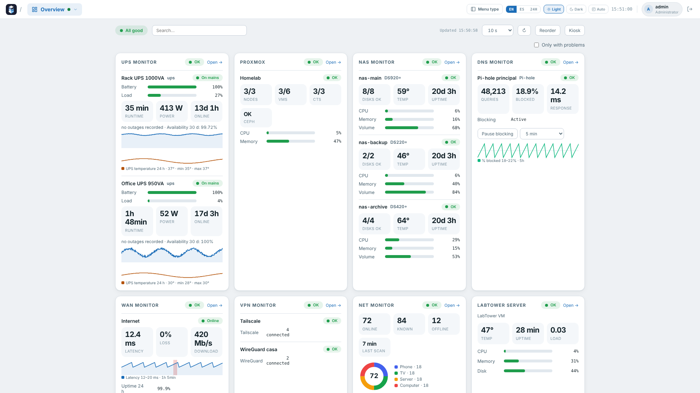

**Contenido:** [Módulos](#módulos) · [Capturas](#capturas) · [Requisitos](#requisitos) · [Instalar](#instalar) · [Actualizar](#actualizar) · [Primer ingreso](#primer-ingreso) · [Funciones por módulo](#funciones-por-módulo) · [HTTPS](#https) · [Respaldos](#respaldos) · [Salud y operación](#salud-y-operación) · [Configuración](#configuración) · [Seguridad](#seguridad) · [Estructura](#estructura) · [Licencia](#licencia)

---

## Módulos

| Módulo | Ruta | Puerto | Qué hace |
|---|---|---|---|
| **Resumen** | `/overview/` | 8085 | Estado de todo en una pantalla, línea de tiempo de eventos y modo kiosko |
| **UPS Monitor** | `/nut/` | 8081 | Lee UPS por NUT: batería, carga, autonomía, salud de la batería, autotests, voltajes, temperatura, historial y CSV |
| **Net Monitor** | `/net/` | 8083 | Escanea la red: equipos, tipo, SO, puertos, MAC y fabricante |
| **Proxmox Monitor** | `/pve/` | 8084 | Clusters Proxmox VE: nodos, VMs, CTs y Ceph |
| **NAS Monitor** | `/nas/` | 8086 | Uno o varios NAS (Synology por SNMP, TrueNAS y OpenMediaVault por su API): discos, volúmenes, temperatura, CPU, memoria y red |
| **DNS Monitor** | `/dns/` | 8087 | Pi-hole (v5 y v6) y AdGuard Home: consultas, % bloqueado, tops, DNS de salida y pausa del bloqueo |
| **WAN Monitor** | `/wan/` | 8088 | Salida a internet: latencia, pérdida, cortes (local o de la línea, consultando al router), IP pública y prueba de velocidad programada |
| **VPN Monitor** | `/vpn/` | 8089 | Quién está conectado a Tailscale, OpenVPN y WireGuard: desde cuándo, desde qué dirección y cuánto tráfico, con avisos de conexión y desconexión |
| **Uptime Monitor** | `/uptime/` | 8090 | Servicios HTTP(S), TCP y DNS: disponibilidad de 24 h, 7 y 30 días, tiempo de respuesta y vencimiento de certificados |
| **WOL Console** | `/wol/` | 8080 | Enciende equipos con Wake-on-LAN |
| **Admin Panel** | `/admin/` | 8082 | Usuarios, permisos, 2FA, sesiones, auditoría, respaldos y salud del sistema |

La página de inicio (`/`) tiene una tarjeta por módulo, agrupadas igual que el menú: Energía y servidores, Red, Herramientas y Sistema.

### Navegación

Todas las pantallas comparten la misma navegación, con el mismo orden y agrupación. Solo aparecen los módulos a los que tienes permiso y los que el admin no apagó.

- **Barra superior con selector** (por defecto): el logo lleva al inicio, y el selector de módulo abre un panel con todos los módulos agrupados y su estado (activo, con avisos o con fallas, con forma y texto, no solo color). Se cierra con Esc o al hacer clic fuera. Idioma, tema, reloj, usuario y «Tipo de menú» van en la misma barra. En el móvil hay una barra inferior (Inicio, Resumen, Módulos y Opciones) y los módulos se eligen en una hoja desde abajo.
- **Menú lateral clásico:** los módulos agrupados en el panel lateral y, en el Resumen, una tira arriba.
- **Elegir el tipo de menú:** la primera vez que entras aparece un asistente con las dos opciones. Se cambia después en **Tipo de menú** (junto al idioma y el tema). La elección se guarda en el navegador.
- **Barra común:** idioma, tema, reloj, usuario, salir, 24H y «Tipo de menú» se ven igual en todos los módulos y en el Resumen; con la barra superior suben a la barra global y la barra del módulo desaparece si no le queda nada propio. Los botones de acción de cada módulo (Escanear red, Ajustes, Despertar todos) comparten un solo aspecto y también suben a la barra global.
- **Avisos:** si algún módulo está con avisos o fallas, aparece un recuadro bajo la barra del módulo, alineado con el contenido, con enlace a cada uno. El estado sale de un único GET público a `/admin/api/health`.
- Los módulos conservan en su panel lateral solo lo propio (listas de servidores, filtros). Si no tienen nada propio, el panel se oculta. En modo kiosko no se muestra nada de esto.

## Capturas

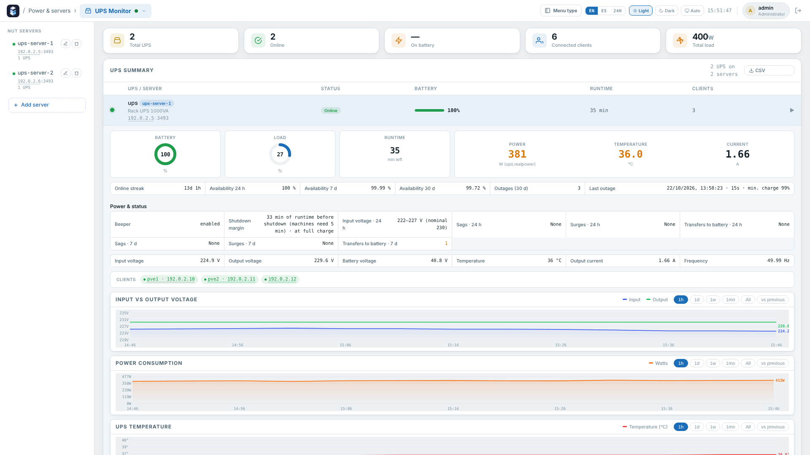 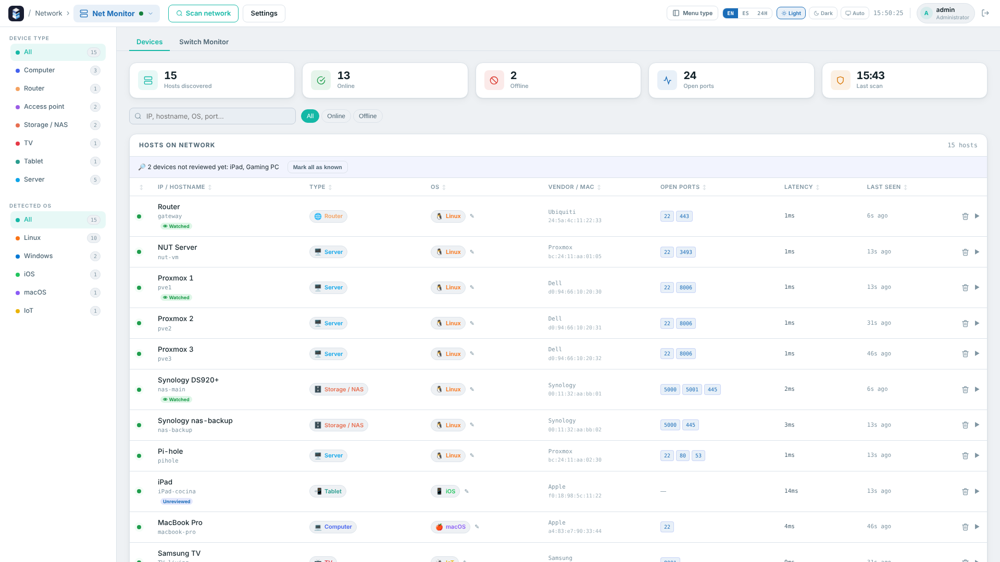 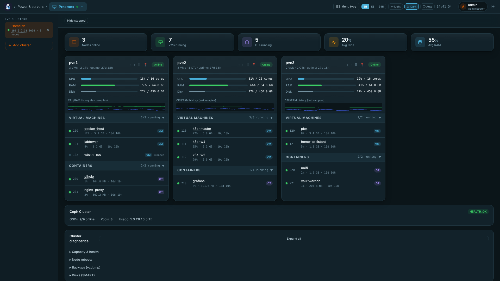 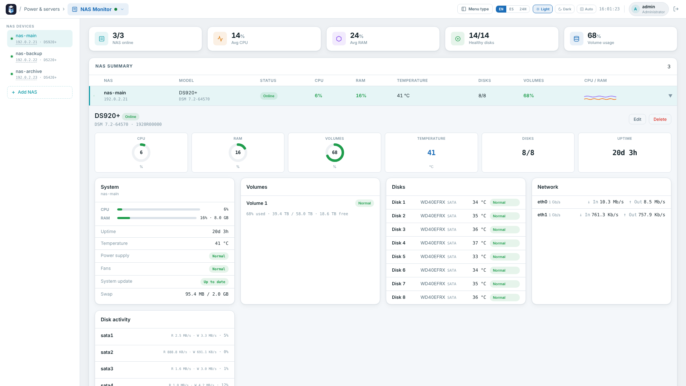

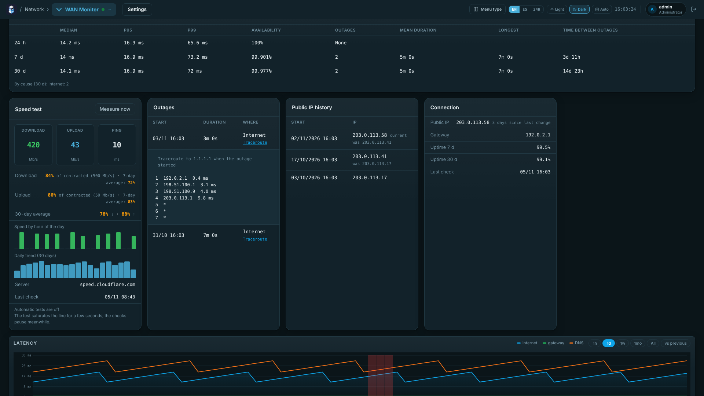 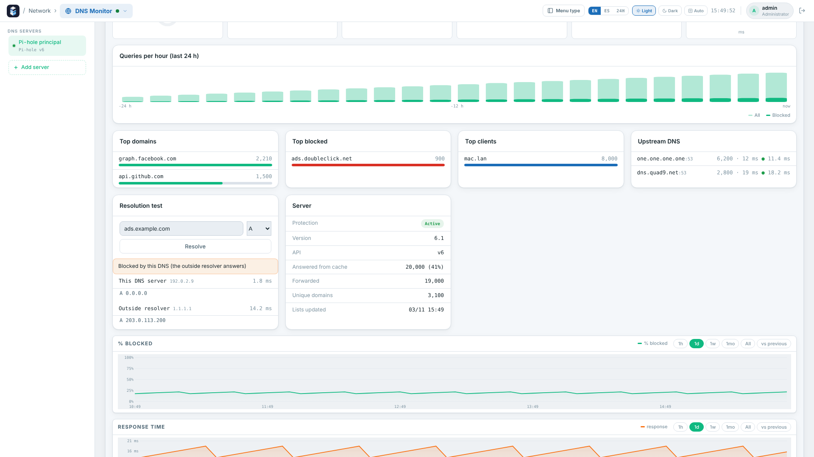 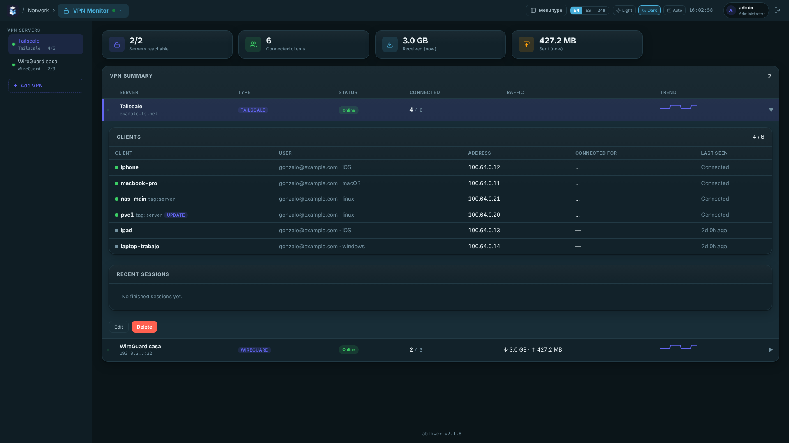 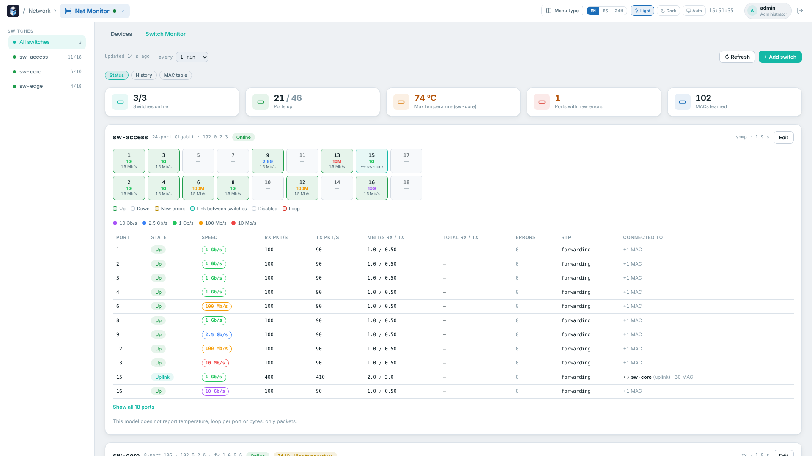

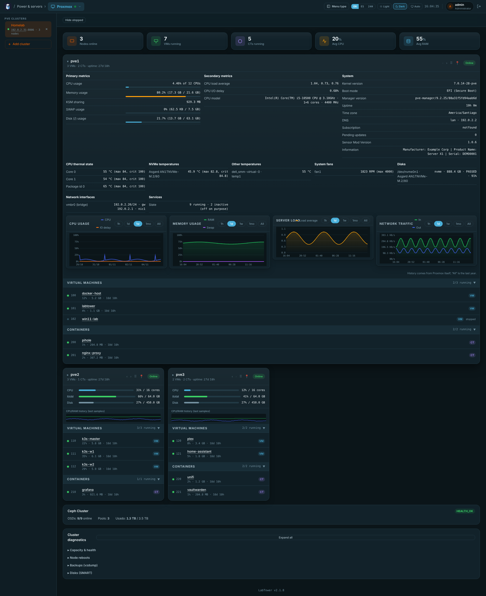 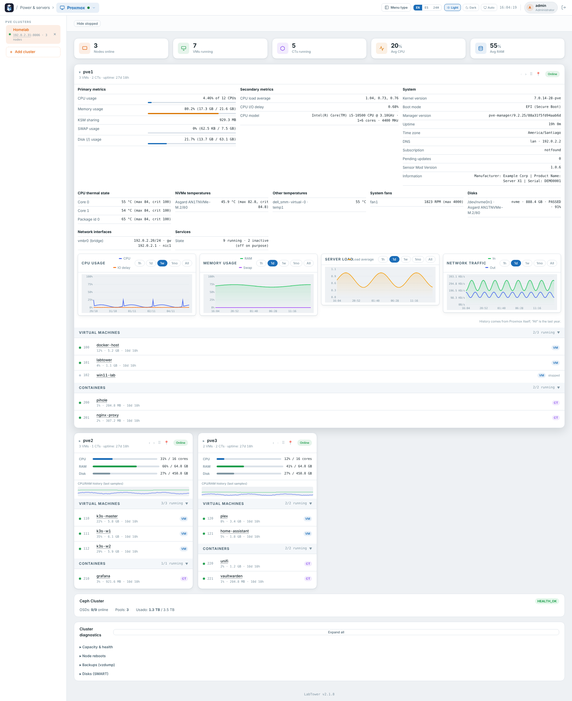

Todas las pantallas (tema claro y oscuro, 4 tamaños) están en [`docs/screenshots/`](docs/screenshots/). Los datos son de demostración.

---

## Requisitos

- Raspberry Pi (probado en 3A+) o una VM/equipo x86, con Raspberry Pi OS, DietPi, Debian 12+ o Ubuntu.
- Python 3.9+, nginx, `sudo`, `snmp`, NUT (`nut`, `nut-client`), `openssh-client`, `gnupg`, `gpg-agent`, `openssl`, `cron`, `curl`, `iproute2`, `systemd` y otros paquetes base. `apt` los instala con el `.deb`.
- Opcional: `ieee-data` (base local de fabricantes por MAC) y los motores de prueba de velocidad (ver más abajo).

## Instalar

- **Instalar en un contenedor de Proxmox (CT):** [guía y script](docs/CT.md) (`scripts/labtower-ct` crea el CT e instala LabTower).
- **Instalar en una VM o en una Raspberry Pi (Debian 12+, Ubuntu, DietPi o Raspberry Pi OS):**

```bash
wget https://github.com/gonzalovalenzuela/labtower/releases/download/2.1.9/labtower_2.1.9_all.deb
sudo apt-get update
sudo apt-get install -y ./labtower_2.1.9_all.deb
```

Usa `apt-get install ./archivo.deb` y no `dpkg -i`, para que `apt` instale las dependencias. Luego abre `http://<ip-de-labtower>/`.

El instalador crea un usuario del sistema por servicio (`labtower-auth`, `labtower-wol`, …), los servicios systemd, la configuración de nginx y el usuario `admin` con una **contraseña aleatoria** que muestra al terminar. Si la perdiste: `sudo cat /var/lib/labtower/auth/initial-admin-password`. Si ya la cambiaste y olvidaste la nueva, restablécela con `sudo labtower-resetpw` (ver abajo).

**Desde el código fuente** (desarrollo): copia los módulos a `/opt/labtower`, instala la configuración de `etc/nginx/` y crea los servicios con `debian/postinst` como guía.

### Pruebas de velocidad (opcional)

WAN Monitor trae un motor propio y no necesita nada más. Si quieres usar **Ookla** o **LibreSpeed**, instala su programa; después aparece como opción en *WAN Monitor → Ajustes → Motor de la prueba* (mientras falte, sale marcado «no instalado»).

**Ookla `speedtest`** (el paquete oficial se llama `speedtest`; el `speedtest-cli` de Debian es otro programa y no sirve):

```bash
sudo apt-get install -y curl
curl -s https://packagecloud.io/install/repositories/ookla/speedtest-cli/script.deb.sh | sudo bash
sudo apt-get install -y speedtest
speedtest --version
```

Si el script del repositorio no reconoce tu versión de Debian o Raspberry Pi OS, descarga el `.tgz` de Linux para tu arquitectura (`x86_64`, `aarch64`, `armhf`) desde <https://www.speedtest.net/apps/cli>, descomprímelo y copia `speedtest` a `/usr/local/bin/`. LabTower lo ejecuta con `--accept-license --accept-gdpr`.

**LibreSpeed `librespeed-cli`:**

```bash
sudo apt-get install -y librespeed-cli     # Debian 13 (trixie) o posterior
librespeed-cli --version
```

Donde el paquete no existe, usa el binario de la [versión v1.0.14](https://github.com/librespeed/speedtest-cli/releases/tag/v1.0.14). Cada archivo es un `.tar.gz` con el programa `librespeed-cli`; elige el de tu arquitectura (`uname -m`):

| `uname -m` | Archivo |
|---|---|
| `x86_64` | `librespeed-cli_1.0.14_linux_amd64.tar.gz` |
| `aarch64` (Raspberry Pi 64 bits) | `librespeed-cli_1.0.14_linux_arm64.tar.gz` |
| `armv7l` (Raspberry Pi 32 bits) | `librespeed-cli_1.0.14_linux_armv7.tar.gz` |

```bash
wget https://github.com/librespeed/speedtest-cli/releases/download/v1.0.14/librespeed-cli_1.0.14_linux_arm64.tar.gz
tar -xzf librespeed-cli_1.0.14_linux_arm64.tar.gz librespeed-cli
sudo install -m 755 librespeed-cli /usr/local/bin/librespeed-cli
librespeed-cli --version
```

## Actualizar

```bash
wget https://github.com/gonzalovalenzuela/labtower/releases/download/2.1.9/labtower_2.1.9_all.deb
sudo apt-get install -y ./labtower_2.1.9_all.deb
labtower-health
```

- Sirve desde cualquier 1.1.x, 1.2.x, 1.3, 1.4 y también desde **Pi Console** (el nombre anterior, ver abajo). Los datos de `/var/lib/labtower` se conservan y además se copian a `/var/backups/labtower`.
- **Desde Pi Console (1.x):** LabTower es el mismo proyecto con otro nombre. El `.deb` de la 2.0 reemplaza a `pi-console` y migra solo el usuario, los datos, los certificados HTTPS, el respaldo SFTP y los respaldos anteriores a las rutas nuevas (`/var/lib/labtower`, `/etc/labtower`…). Hay que iniciar sesión otra vez. Los comandos `pi-console-*` ahora son `labtower-*`. Después puedes ejecutar `sudo dpkg -P pi-console` para limpiar el registro del paquete viejo.
- Si instalas un número **menor** que el actual, `apt` pide `--allow-downgrades`.
- Después de actualizar, recarga la página (Ctrl+Shift+R). En el iPad, cierra y abre la página.
- Los cambios de cada versión están en [CHANGELOG.md](CHANGELOG.md) (en inglés: [CHANGELOG.en.md](CHANGELOG.en.md)).

## Primer ingreso

1. Entra con `admin` y la contraseña que mostró el instalador.
2. El sistema te obliga a elegir una contraseña nueva (mínimo 8 caracteres) antes de usar cualquier módulo.
3. Crea tus usuarios en el Admin Panel. Al crear un usuario viene marcado «debe cambiar contraseña», y cuando un admin restablece la clave de otra cuenta ese cambio es siempre obligatorio. Crear usuarios, restablecer claves y cambiar niveles de permiso piden tu contraseña actual.
   - **Números de serie:** cada usuario tiene un permiso aparte, «Ver números de serie» (sí/no), que vale para el UPS, el NAS, los discos y los nodos de Proxmox. Sin él, el servidor ni siquiera envía esos datos al navegador. Los usuarios nuevos lo traen en «no»; al actualizar lo conservan los administradores de WOL o UPS, y el resto lo recibe cuando un administrador se lo marca. Solo puede darlo o quitarlo quien lo tiene.

---

## Funciones por módulo

### Resumen
- **Estado global** (Todo en orden / Atención / Falla) y lista de lo que requiere atención, con enlace al módulo.
- **Solo con problemas:** el filtro oculta las tarjetas sanas y se recuerda en el navegador.
- **UPS:** estado, batería, carga, autonomía, consumo y gráficos de las últimas 24 h.
- **Proxmox:** nodos en línea, VMs y CTs corriendo, CPU y memoria (gráfico de 12 h), salud de Ceph.
- **NAS:** por cada NAS, estado, CPU y memoria (gráfico de 12 h con temperatura), discos sanos, temperatura y el volumen más lleno.
- **VPN:** cuántos clientes hay conectados por servidor; el detalle (quién, desde dónde, tráfico) está en VPN Monitor.
- **Uptime:** cuántos servicios están arriba, los caídos y los certificados por vencer.
- **Red:** equipos en línea, conocidos y apagados, último escaneo, reparto por tipo y equipos nuevos de las últimas 48 h.
- **Servidor (LabTower Server):** temperatura, CPU, memoria, disco, tiempo encendida y estado de la fuente de poder. Solo en una Raspberry Pi agrega el gráfico de 24 h de temperatura con marcas de bajo voltaje y limitación (se guarda 7 días en `metrics.db`).
- **Línea de tiempo:** cambios importantes con hora (UPS a batería, nodo caído, cambio de Ceph, equipos nuevos o que dejaron de responder). Los guardan los módulos, aunque nadie tenga la página abierta: últimos 300 eventos o 30 días.
- **Búsqueda global** (barra superior o tecla `/`): equipos de Net Monitor, UPS, VMs y contenedores de Proxmox, NAS, servidores DNS y equipos WOL; solo muestra lo que cada usuario puede ver.
- **Reglas de alerta** (administradores): umbrales sobre métricas del servidor, UPS, NAS, Proxmox, DNS e internet, como aviso o crítico; se evalúan con el Resumen abierto y las que se cumplen aparecen en el panel de atención.
- **Gráficos de detalle** (UPS, NAS, DNS, WAN y switches): mismo aspecto en todos, rango de 1 semana, botón «vs anterior» (período previo punteado) y marcas de eventos.
- Cada persona ve solo los módulos a los que tiene acceso.
- **Actualización:** selector de intervalo (10 s, 30 s, 1, 2, 5 min o manual con ↻), por navegador. Con la pestaña oculta no consulta.

**Modo kiosko** (botón *Kiosko* o `/overview/?kiosk=1`): pantalla completa, letra grande, sin botones ni cursor, y la pantalla no se apaga. Un toque o el mouse muestra el botón para salir. Opciones por URL: `?zoom=0.8` (0.5 a 2) y `?autoscroll=1` (sube y baja solo si no cabe). Se recomienda un usuario de solo lectura.

**iPad como pantalla:** abre `http://IP-DEL-SERVIDOR/overview/?kiosk=1` en Safari → Compartir → *Añadir a pantalla de inicio*, con *Abrir como app web* activado. Para que no se bloquee: *Acceso guiado* o *Bloqueo automático: Nunca*.

### UPS Monitor
- Empieza sin servidores. Un administrador agrega uno (nombre, host y puerto de `upsd`, por defecto 3493) y puede probar la conexión antes de guardar.
- Consulta `upsd` cada 10 s y guarda el historial en SQLite (WAL, 1 año).
- Gráficos de voltaje, consumo y temperatura (si la UPS la informa). Exporta CSV.
- Muestra los clientes conectados a cada UPS.
- **Batería:** bajo cada UPS se ve la **autonomía ahora** (la que informa el UPS), la **autonomía proyectada a batería llena** y una estimación si la carga subiera 50 % (aproximación: la autonomía es inversamente proporcional a la carga), la **edad de la batería** (de `battery.date` o `battery.mfr.date`, la más reciente que sea creíble; una edad de más de 10 años se ignora porque algunos UPS dejan la fecha de fábrica; aviso desde los 4 años; el botón ✎ permite indicar la fecha real del cambio, que tiene prioridad) y la **tendencia de capacidad**: promedio semanal de la autonomía con batería ≥ 95 % y carga parecida a la habitual, de los últimos 120 días, que avisa si cae 20 % o más (necesita cerca de un mes de historial; se recalcula cada 6 horas).
- **Registro de autotests:** si el UPS informa `ups.test.result`, cada cambio se anota (hora en que LabTower lo vio) y se muestran los últimos 8. Un test fallido genera un aviso en el Resumen; uno aprobado después de «In progress», un evento informativo. «Último resultado» muestra la fecha en que LabTower lo vio y, si el UPS vuelve a «No test initiated», la última prueba real. LabTower solo lee: no lanza pruebas en el UPS (se lanzan con `upscmd` si el driver lo permite).
- **Energía y estado:** el detalle de cada UPS muestra las **banderas de estado** que informa NUT además de red/batería (`RB` reemplazar batería, `OVER` sobrecarga, `BYPASS`, `OFF`, `FSD` apagado forzado, `ALARM`, y las informativas `TRIM`, `BOOST` y `CAL`), la **alarma** (`ups.alarm`) y el estado del beeper. Las banderas de aviso, la alarma y un margen insuficiente aparecen en el panel de atención del Resumen y generan eventos al cambiar (la primera lectura solo se memoriza). **Calidad de la red:** con el historial de voltaje de entrada (7 días) cuenta los **bajones y subidas** fuera de ±10 % del voltaje nominal (`input.voltage.nominal`; si el UPS no lo informa se estima con la mediana del historial) y los **cambios a batería** en 24 h y 7 d, y muestra el mínimo y máximo de 24 h; una lectura aislada no cuenta, hacen falta al menos 2 seguidas. **Margen de apagado:** compara la autonomía hasta el umbral de apagado del UPS (`battery.runtime.low`) con el tiempo que necesitan tus equipos para apagarse (`NUT_SHUTDOWN_SEC`, 300 s por defecto); con red usa la autonomía proyectada a carga completa y en batería la autonomía actual, y avisa si es menor. Todo depende de las variables que exponga el driver del UPS: lo que no informe simplemente no se muestra.

### Net Monitor
- **Red:** se detecta sola (la /24 del servidor) o se fija con `SCAN_NETWORK`.
- **Escaneo:** en una instalación nueva no escanea hasta que lo pidas (botón *Hacer escaneo inicial*). El escaneo automático, la limpieza de equipos sin conexión, SNMP y Pi-hole se configuran en la ventana *Ajustes* (mínimo 60 s entre escaneos); *Escanear red* y *Ajustes* están en la barra superior.
- **Detección:** ping (TTL), puertos y banner HTTP. No usa `nmap`.
- **MAC y fabricante**, en este orden: Pi-hole, ARP local, SNMP (ARP de un router o switch). El fabricante sale de la base `manuf` de Wireshark (descarga semanal) o de `ieee-data`.
- **Tipos de equipo:** computador, teléfono, tablet, router, switch, punto de acceso, almacenamiento, TV, cámara, impresora, consola de juegos, servidor, teléfono IP, UPS, altavoz inteligente y otros. SO, tipo y grupo se pueden editar a mano.
- **Basurero** para quitar un equipo de la lista (solo administradores). Si sigue conectado, el próximo escaneo lo vuelve a descubrir.
- **Proxmox:** las VM y contenedores se reconocen en la tabla (insignia «VM 100» / «CT 200») cruzando MAC, IP y, si no hay otra pista, nombre idéntico. Las tarjetas Hosts / Online / Offline filtran la tabla.
- Al pasar el mouse (o tocar en iPad) por una IP en UPS, Proxmox, WOL o Resumen aparece una tarjeta con los datos del equipo.
- Las credenciales SNMP y la clave de Pi-hole se guardan con permisos 600 y la API nunca las devuelve. Guardar los ajustes de Pi-hole con la contraseña en blanco conserva la guardada (el campo lo indica). Si Pi-hole regenera su certificado propio con el mismo sujeto y emisor, se vuelve a fijar solo y queda un evento; con otra identidad se rechaza hasta que guardes de nuevo.
- **Seguridad y estabilidad de los equipos:** (1) **Cambio de MAC en una IP:** si una IP que estaba conectada aparece en el siguiente escaneo con otra MAC, se anota un evento y el equipo muestra la insignia *MAC cambió* (7 días); puede ser una IP duplicada, un equipo reemplazado o una suplantación. Si el equipo estuvo desconectado entre medio no se avisa, porque el DHCP reparte las IP a otros equipos con normalidad. (2) **Equipos sin revisar:** los equipos descubiertos antes de actualizar cuentan como conocidos; los nuevos quedan *sin revisar* (insignia, franja sobre la tabla y tarjeta del Resumen) hasta que un administrador los marca como conocidos, uno por uno o todos a la vez. (3) **Conectividad de cada equipo:** en el detalle, porcentaje conectado en 7 y 30 días, caídas de 7 días y una barra de la última semana, calculados con el registro de conexiones; un historial más corto que el período no se juzga como si lo cubriera. Un equipo con 4 o más caídas en 24 h genera un evento y se marca *Inestable* si lleva 8 o más en la semana. (5) **Equipos vigilados:** en el detalle, *Vigilar este equipo* (administradores, hasta 40) lo sondea cada 30 s (`NET_WATCH_EVERY`, 0 lo desactiva); tras 2 fallos seguidos hay un evento crítico y un aviso en el Resumen, y otro cuando vuelve. (4) De cada equipo vigilado se guarda la **latencia** (`NET_LATENCY_KEEP_DAYS`, 30 días por defecto) y el detalle muestra su gráfico de 1, 7 o 30 días con promedio, p95, máximo y pérdida. (6) **Puertos nuevos:** si un equipo muestra un puerto que nunca había mostrado se anota un evento (un puerto que se cierra y se reabre por un tiempo de espera no cuenta); los de acceso remoto, archivos compartidos y bases de datos (21, 23, 135, 139, 445, 3389, 5900, 3306, 5432, 6379…) salen como aviso. El grupo de un equipo ya no se pierde al reescanear.

#### Switch Monitor (pestaña de Net Monitor)
- Segunda pestaña junto a *Equipos*. Para cada switch muestra el panel frontal con el estado de cada puerto (arriba, abajo, deshabilitado, errores nuevos, enlace entre switches, loop), velocidad negociada, paquetes por segundo, errores, STP, temperatura y a qué equipo está conectado cada puerto (cruza la tabla MAC del switch con los equipos que ya conoce Net Monitor).
- **Modelos:** ZX310S (interfaz web), HC-SWTGW218AS (interfaz web) y cualquier switch con SNMP v2c (ej: TP-Link y otros); este último es el único que entrega bytes, así que solo ahí hay Mb/s.
- **Se agregan desde la interfaz** (botón *+ Agregar switch*, solo administradores), con botón *Probar* antes de guardar. Usuario, contraseña o community se guardan en `switches.json` con permisos 600 y la API nunca los devuelve.
- **Sesión web guardada:** los switches de interfaz web (ZX, HC) mantienen una sola sesión abierta y no la entregan a otro cliente mientras siga viva; LabTower guarda su cookie de sesión (permisos 600, en los datos de Net Monitor) y la reutiliza tras reiniciar o actualizar, y espera más entre intentos si el switch rechaza la sesión varias veces seguidas.
- **Solo lectura:** no cambia nada en los switches. Las operaciones peligrosas (borrar contadores del ZX, vaciar la tabla MAC del HC, reiniciar, guardar) están bloqueadas en el código.
- **Historial de 1 año** (como UPS Monitor): temperatura y, por puerto, estado, velocidad, paquetes o Mb/s y errores; rangos 1 h, 1 d, 1 sem, 1 mes y todo. Las tasas se calculan entre muestras y toleran contadores que vuelven a cero.
- **Historial** (subpestaña): totales acumulados por puerto (bytes reales por SNMP; en ZX y HC, que solo informan paquetes, los bytes son una estimación = paquetes × tamaño medio configurable por switch, marcada con «≈»), guardados en la base y sin perderse cuando el switch o LabTower se reinician. Suma cuánto avanza cada contador entre lecturas y parte del valor que el switch ya traía al agregarlo.
- **Alertas** en el Resumen (tarjeta Net Monitor y línea de tiempo): switch sin conexión (tras 2 lecturas fallidas), temperatura ≥ 70 °C (aviso) / ≥ 80 °C (crítico), errores nuevos en un puerto, cambios de enlace y loop. Los puertos entre switches no alertan por loop. Los umbrales se pueden cambiar con `SWITCH_TEMP_WARN` y `SWITCH_TEMP_CRIT`.
- **Errores CRC y puertos que rebotan:** por SNMP se leen también los errores **CRC/FCS** y de alineación (EtherLike-MIB) de cada puerto; si suben, el aviso dice «errores CRC (cable o tarjeta de red)» en lugar de uno genérico, y el detalle del puerto muestra los contadores. Un enlace que cambia 4 veces o más en 10 minutos genera un aviso de **enlace rebotando** (un aviso cada 30 min como máximo por puerto), aunque el puerto no esté vigilado.
- **Avisar por puerto:** en el detalle de cualquier puerto, *Avisar si este puerto se cae o vuelve* (solo administradores) anota en la línea de tiempo del Resumen cada caída y recuperación de ese puerto. Los enlaces entre switches y los uplinks manuales ya se vigilaban.
- **TP-Link JetStream (T2600G, T1600G, SG3428…):** en la interfaz web, *SNMP → Global Config* → activar, y en *SNMP → SNMP Community* crear una community de solo lectura (*Read-Only*) y, si quieres, limitarla a la IP de LabTower. Luego agrega el switch con el tipo SNMP. Solo se usa SNMP v1/v2c (no v3). La temperatura no se lee por SNMP en estos modelos.
- **Topología básica** deducida de las tablas MAC. Etiqueta y «enlace a otro switch» se editan por puerto.
- Se consulta cada 60 s por defecto (30 s a 1 h, configurable); cada switch se lee de a una petición a la vez, con pausas, porque sus servidores web son frágiles.
- Diagnóstico por consola: `python3 /opt/labtower/net-monitor/switches.py --config switches.json --once`.

### Proxmox Monitor
- Consulta cada cluster cada 5 s con la página abierta y cada 60 s en reposo.
- **Detalle del nodo — temperaturas y ventiladores:** requiere el add-on **[PVE mods](https://github.com/Meliox/PVE-mods)** (sensores `lm-sensors`) instalado en cada nodo de Proxmox. Sin él, el detalle muestra todo lo demás (CPU, memoria, red, servicios, discos…) pero no las secciones *CPU thermal state*, *NVMe temperatures*, *Other temperatures*, *System fans* ni *Sensor Mod Version*. LabTower solo lee lo que el add-on publica en la API de Proxmox; no instala nada en los nodos y nunca muestra el número de serie del equipo ni de los discos.
- **Detalle del nodo:** un clic en el nombre del nodo abre su detalle (CPU, memoria, red, discos, servicios) con gráficos por rango. Los servicios apagados a propósito no se marcan como fallas.
- Orden de nodos y nodos fijados por cluster (solo admin).
- Al agregar un cluster hay que confirmar la huella SHA-256 de su certificado, que queda fijada. Si el certificado cambia, no se envía el token.
- **Diagnóstico del cluster** (panel bajo los nodos): reinicios de nodos con línea de tiempo común (los que ocurren con menos de 10 minutos de diferencia se marcan como *simultáneos*, y se detectan aunque LabTower estuviera parado), estado del quórum de corosync, OSD caídos y avisos de Ceph, y SMART de los discos de cada nodo (salud, desgaste, temperatura, errores, sectores y, en NVMe, *Unsafe Shutdowns*) leído cada 15 minutos (`PVE_SMART_EVERY`, en segundos; 0 lo desactiva). Todo genera eventos en la línea de tiempo del Resumen. El token de API necesita el privilegio `Sys.Audit` sobre `/nodes` (rol `PVEAuditor`) para leer los discos.
- **Respaldos (vzdump):** para cada VM y CT, su último respaldo, leído del contenido de los storages que admiten *backup* (un storage compartido se consulta una sola vez; si es Proxmox Backup Server se muestra su verificación), con su antigüedad, tamaño y número de copias. Marca **Sin respaldo** o **Muy viejo** (más de 36 h por defecto; se cambia con la API `/api/clusters/<id>/backup`) y anota un evento en el Resumen al pasar a ese estado, y otro cuando se normaliza. Las tareas `vzdump` fallidas de los últimos 7 días se listan y generan un evento crítico. Las VMs de prueba se pueden **ignorar** desde el panel (solo administradores). Si un storage no se puede leer, no se acusa a las VMs de no tener respaldo. Se lee cada 10 minutos (`PVE_BACKUP_EVERY`, en segundos; 0 lo desactiva). El token necesita `Datastore.Audit` sobre los storages (rol `PVEAuditor`).
- **Capacidad y salud** (sección del panel de diagnóstico, se lee cada 5 minutos; `PVE_EXTRA_EVERY`, en segundos, 0 la desactiva): **días hasta llenarse** de cada storage y de Ceph (por regresión del historial de 45 días, igual que en NAS Monitor; avisa por debajo de 14 días, crítico por debajo de 3), **capacidad** (vCPU y RAM asignadas a las VM/CT encendidas por nodo, sobreasignación de RAM y prueba **N-1**: si caben todas al caer el nodo más grande), **HA** (servicios en error/fence y gestores sin respuesta), **replicación** (trabajos con fallos), **tareas fallidas** de cualquier tipo (últimos 2 días), **Ceph** (rendimiento, recuperación y PG no limpios) y datos por nodo (versión de PVE con aviso de versiones distintas, kernel, carga, swap, iowait y vencimiento del certificado, avisa a 21 días). Además, la línea de tiempo del Resumen anota cuando una VM/CT se enciende, se detiene, se crea o cambia de nodo (si cambian más de 5 a la vez, un solo evento resumen; la etiqueta `labtower-ignore` en una VM la excluye) y las VM/CT con un **bloqueo** (`lock`) de más de 1 hora (6 h si es de respaldo). Lo que el token no pueda leer simplemente no se muestra y el panel lo indica.
- **Privilegios del token de API:** crea el token con **separación de privilegios** y dale solo lectura. Lo más simple es asignar el rol **`PVEAuditor`** al usuario *y* al token sobre `/` (con *Propagar*). Qué necesita cada función:

  | Función | Endpoint | Privilegio |
  |---|---|---|
  | Nodos, VMs, CTs, storages, bloqueos | `/cluster/resources` | `VM.Audit`, `Datastore.Audit`, `Sys.Audit` |
  | Quórum, versión, Ceph | `/cluster/status`, `/version`, `/cluster/ceph/status` | `Sys.Audit` |
  | SMART, estado del nodo, certificados, replicación | `/nodes/<n>/disks/*`, `/nodes/<n>/status`, `/nodes/<n>/certificates/info`, `/nodes/<n>/replication` | `Sys.Audit` sobre `/nodes` |
  | HA | `/cluster/ha/status/current` | `Sys.Audit` sobre `/` |
  | Respaldos | `/nodes/<n>/storage/<s>/content` | `Datastore.Audit` |
  | Tareas, IP de invitados (agente) | `/cluster/tasks`, `/nodes/<n>/qemu/<id>/agent/*` | `Sys.Audit` / `VM.Monitor` (o `VM.GuestAgent.Audit` en PVE 9) |

  Todas son de **solo lectura**; LabTower no hace ninguna escritura en Proxmox. Los *pendientes de actualización* (`apt/update`) no se consultan porque exigen `Sys.Modify`. La tabla refleja la documentación de Proxmox VE; si una función muestra «sin permiso» en el panel, revisa que el privilegio esté asignado también **al token** (con separación de privilegios, los permisos del usuario no se heredan).
- **VM y contenedores en Net Monitor:** se lee la MAC de cada VM/CT (configuración) y su IP (fija del contenedor, agente de invitado en las VM, interfaz del contenedor) cada 5 min. El nombre de cada VM/CT lleva a su detalle en Net Monitor.

### NAS Monitor
- Funciona como UPS Monitor: una tabla **Resumen de NAS** con todos los NAS (estado, modelo, CPU, RAM, temperatura, discos y volumen más lleno). Cada fila se abre y muestra su detalle debajo; por defecto se abre el primero. También se elige desde el menú lateral.
- **Tendencias y avisos de la lectura (Synology, TrueNAS y OpenMediaVault):** cada 15 minutos se guarda el uso de cada volumen y la temperatura de cada disco (45 días, en `metrics.db`). Con eso cada volumen muestra **cuántos días faltan para llenarse** según su crecimiento de los últimos 14 días (solo con 2 días de datos o más, crecimiento sostenido y menos de un año; aviso a 30 días, crítico a 7) y cada disco muestra su **temperatura máxima y promedio de 24 h** (y el máximo de 7 días al pasar el mouse).
- **Red (Synology):** estado del enlace de cada puerto («Enlace caído») y errores de entrada y salida.
- **Eventos nuevos en la línea de tiempo del Resumen:** hay una actualización del sistema, falla y recuperación de ventiladores, disco que pasa de 55 °C y vuelve a lo normal, enlace de red que cae o vuelve, errores de red sostenidos (10 por minuto o más) y reinicio del NAS (también si ocurrió mientras no respondía).
- Agrega todos los NAS que quieras (como los clusters de Proxmox o los servidores de UPS). Al agregarlo se elige el **tipo**: **Synology** (por **SNMP v3** —usuario, nivel `authPriv`/`authNoPriv`/`noAuthNoPriv`, clave de autenticación y de cifrado— o por v2c), **TrueNAS** (clave de API) u **OpenMediaVault** (usuario y contraseña). El tipo no se puede cambiar después. El botón *Probar conexión* revisa los datos antes de guardar.
- **Detalle de cada NAS:** medidores (CPU, RAM, volumen, temperatura, discos y tiempo encendido), sistema, volúmenes con su espacio, discos con estado y temperatura, red, UPS conectado y actividad de disco.
- **Gráficos** de CPU/RAM, temperatura y red con rangos **1h / 1d / 1mo / Todo**; al pasar el cursor muestran el valor de cada momento. El historial se guarda en `metrics.db` (`NAS_KEEP_DAYS`, 7 días por defecto).
- **Avisos** (también en la línea de tiempo del Resumen): disco con falla, volumen degradado o casi lleno (90 %), temperatura alta y actualización del sistema disponible (en TrueNAS se muestran además las alertas del propio equipo). Un *Storage Pool* lleno no avisa, porque es normal que lo esté si sus volúmenes usan todo el espacio.
- **Vencimiento de certificados:** una vez al día (a la hora si un puerto falló, y al arrancar o al cambiar el host o los puertos) se lee el certificado TLS de los puertos elegidos en cada NAS: por defecto 5001 (DSM) en Synology y su propio puerto HTTPS en TrueNAS y OpenMediaVault; se pueden poner varios separados por coma, o ninguno. Solo se lee, no se valida, así que también sirve con certificados autofirmados. La sección *Certificados* muestra nombre, emisor, fecha y días restantes; el botón *Revisar ahora* (permiso de ejecutar) los lee al momento. Avisa a los 14 días y pasa a crítico a los 3 (ambos se cambian por NAS, de 1 a 90 y crítico menor que aviso), vencido también es crítico y un puerto que no responde aparece como aviso. Los días y el nivel se recalculan en cada lectura del NAS con lo último leído. La línea de tiempo del Resumen anota cuando un certificado entra en aviso o crítico, vence o se renueva.
- Las claves SNMP se guardan con permisos 600 y la API nunca las devuelve. Al leer, van en un archivo temporal privado, nunca en la línea de comandos. Al editar, dejar una clave en blanco conserva la guardada.
- **Activar SNMP en el Synology:** *Panel de control → Terminal y SNMP → SNMP → Habilitar SNMPv3*, define usuario y contraseñas (mínimo 8 caracteres) y usa `SHA`/`AES`. Otros NAS que usen las MIB estándar (UCD/IF-MIB) muestran CPU, memoria y red, pero no discos ni volúmenes.
- Necesita los comandos `snmpget` y `snmpbulkwalk` (paquete `snmp`, que ya instala el paquete de LabTower) solo para los NAS Synology.
- **TrueNAS** (25.04 o más nuevo): se lee por la API JSON-RPC 2.0 sobre WebSocket (`wss://equipo/api/current`); la API REST ya no existe en las versiones nuevas. Crea una **clave de API** para un usuario dedicado (basta el rol *Read-only Admin*) y pégala en el formulario junto con el nombre de ese usuario. Muestra sistema, CPU, memoria y red en vivo, pools (estado y espacio), discos con temperatura y las alertas del equipo. TrueNAS solo acepta claves por TLS, por eso siempre se usa HTTPS.
- **OpenMediaVault** (7 o más nuevo): se lee por `rpc.php` con un usuario y contraseña de **administrador** (OpenMediaVault no tiene un rol de solo lectura: se recomienda una cuenta dedicada). Muestra sistema, CPU, memoria, discos con estado SMART y temperatura, sistemas de archivos con su espacio, interfaces de red y si hay actualizaciones o falta reiniciar. No mide la velocidad de red. La sesión se reutiliza entre lecturas, así que OpenMediaVault no registra un inicio de sesión por consulta; el aviso de «nuevo navegador» puede llegar una vez tras reiniciar LabTower. Prefiere HTTPS: con HTTP la contraseña viaja sin cifrar.
- **Certificados:** con «Verificar el certificado TLS» activo se valida contra las CA del sistema. Sin ello **no** se acepta cualquier certificado: se fija la huella SHA-256 en la primera conexión y, si cambia, la conexión se corta antes de enviar la clave. Guardar el NAS otra vez borra la huella y se aprende de nuevo.
- Solo lectura: LabTower nunca llama a un método de TrueNAS ni de OpenMediaVault que cambie algo.

### WAN Monitor
- Mide cada 30 s (`interval`) la salida a internet con ping o TCP a los destinos que elijas, a la puerta de enlace y a un nombre DNS; guarda latencia, jitter y pérdida en SQLite.
- **Cortes:** se abre un corte tras 2 rondas fallidas y se cierra al volver. Cada corte se clasifica como **Red local (LAN)** (la puerta de enlace tampoco responde), **Línea / proveedor (WAN)** (el router informa que su enlace está caído) o **Internet** (el router no lo confirma).
- **Chequeo del router (opcional):** en *Ajustes → Chequeo del router*, activa «Consultar el router» y elige el tipo. Solo lee el estado WAN; nunca cambia nada en el router.

  | Tipo | Cómo lo consulta | Notas |
  |---|---|---|
  | **Huawei** (WiFi AX3, Mesh y otros HiLink) | inicio de sesión HiLink y `api/ntwk/wandetect` | usuario y clave de la web del router |
  | **OpenWrt** | `ubus` por HTTP | requiere `uhttpd-mod-ubus`; la interfaz es `wan` por defecto |
  | **DD-WRT** | páginas `Status_Router.live.asp` con HTTP básico | |
  | **TP-Link** (firmware clásico) | `userRpm/StatusRpm.htm` con HTTP básico | los modelos nuevos con inicio de sesión cifrado (Archer, Deco) no se pueden consultar |

  Deja la dirección vacía para usar la puerta de enlace. «Probar router» muestra si conectó, el estado WAN, la IP y el motivo si falla. La clave se guarda en el servidor (permisos 600) y nunca se muestra ni se envía al navegador. Mientras hay un corte pregunta cada 10 s.
- En la tarjeta **Conexión** se ve cuánto tiempo lleva conectada la WAN según el router y cuántos cortes registró LabTower en ese período, para contrastar ambos, y cuánto lleva encendido el router (Huawei, OpenWrt y DD-WRT; en OpenWrt el usuario necesita acceso a `system info`).
- IP pública con aviso de cambio, prueba de velocidad programada (motor propio, Ookla o LibreSpeed; el período se fija en minutos u horas, mínimo 5 minutos, y bajo 30 minutos se avisa que puede saturar el enlace) y gráficos históricos.
- **Calidad y disponibilidad:** tarjeta con **percentiles de latencia** (mediana, p95 y p99) y disponibilidad en 24 h, 7 d y 30 d, con número de cortes, duración media, el más largo, **tiempo medio entre cortes (MTBF)** y desglose por causa (LAN / WAN / Internet). Un historial más corto que el período no se juzga como si lo cubriera. La tabla de destinos suma el **p95 de 24 h** y el **porcentaje de rondas fallidas de 24 h de cada destino**, para distinguir «cae solo uno» de «cae todo» (se guarda una muestra por destino y ronda, con la misma retención del historial, `WAN_KEEP_DAYS`).
- **Velocidad contra el plan:** con la velocidad contratada indicada en *Ajustes*, la tarjeta muestra el porcentaje de la última prueba, el promedio de 7 y de 30 días, la **velocidad de bajada por hora del día** y la **tendencia diaria de 30 días**. Si **3 pruebas seguidas** quedan bajo el 70 % del plan, aparece un aviso (también en el Resumen) y se anota un evento al empezar y otro cuando se normaliza.
- **Eventos de calidad:** pérdida de paquetes (≥ 5 %) o latencia (≥ 150 ms) que se mantienen **3 rondas seguidas** generan un evento al empezar y otro al terminar; un pico suelto no. Los cortes tienen sus propios eventos.
- **Historial de IP pública:** tarjeta con cada cambio de IP (fecha con año, IP nueva y la anterior), además del aviso del Resumen. No se borra nunca. Como LabTower solo sabe desde que empezó a vigilar, la fecha del registro más antiguo se corrige en *Ajustes → IP pública conocida desde* (dd-mm-aaaa). La tarjeta *Conexión* y el panel lateral muestran los días desde el último cambio.
- **Traceroute en cada corte:** al abrirse un corte se ejecuta un `traceroute` (máx. 15 saltos) hacia el primer destino y se guarda con el corte; en la tabla de cortes, el botón *Traceroute* lo muestra y deja ver hasta qué salto llegaba la salida. Requiere el paquete `traceroute` (el instalador lo recomienda); sin él, simplemente no se guarda.


### VPN Monitor
- Muestra los clientes conectados a cada servidor VPN: nombre, dirección real y virtual, tiempo conectado, tráfico, sesiones recientes y avisos de conexión / desconexión en la línea de tiempo del Resumen. Solo lectura: nunca cambia nada en el servidor VPN. Se permiten hasta 16 servidores.
- **Permiso:** da el permiso **vpn** a los usuarios en *Admin Panel → Usuarios*.
- **Tailscale:** se lee por la API de Tailscale. Crea una **clave de API** en la consola de Tailscale, pégala junto con el nombre de tu tailnet (o `-` para el predeterminado). Un dispositivo cuenta como conectado si Tailscale lo ve en línea.
- **OpenVPN y WireGuard:** se leen por **SSH** en el servidor VPN, que puede ser otra VM, CT o un NAS. LabTower genera su propia llave SSH y solo ejecuta dos comandos fijos: `cat <archivo de estado>` (OpenVPN) y `wg show all dump` (WireGuard).

  1. En *Agregar VPN* elige el tipo, escribe host, usuario SSH y puerto, y pulsa **Crear / mostrar llave**.
  2. Copia la llave pública al `~/.ssh/authorized_keys` del usuario SSH en el servidor VPN. Se recomienda restringirla; el formulario muestra la línea lista, por ejemplo `command="cat /ruta/al/estado",no-pty,no-port-forwarding,no-agent-forwarding,no-X11-forwarding ssh-ed25519 AAAA…`.
  3. Pulsa **Probar**. La huella del servidor se acepta la primera vez y después se exige.

  La llave SSH **no** entra en los respaldos: tras restaurar, créala de nuevo y vuelve a instalarla en el servidor VPN.
- **OpenVPN:** el servidor debe escribir su archivo de estado con `status <archivo> 2` (o `3`) en su configuración, y ese archivo es el que va en *Status file*. Busca la ruta con `grep -rn "^status" /etc/openvpn/`. En Debian suele ser `/run/openvpn-server/status-server.log`; una ruta relativa queda relativa a `/etc/openvpn/server/`. Si no hay línea `status`, agrégala y reinicia el servicio (`sudo systemctl restart openvpn-server@server`). La lista sale vacía si nadie está conectado.
- **WireGuard:** WireGuard no tiene usuarios, así que los peers se nombran con **alias**: una línea `<clave pública> Nombre` por peer. Un peer cuenta como conectado si su último handshake tiene menos de 180 segundos. `wg show` exige root: usa `root` o marca «Ejecutar con sudo».
- **Ejecutar con sudo:** para cuando el archivo de estado o `wg show` son solo de root. LabTower antepone `sudo -n` (nunca pide contraseña) y solo a esos dos comandos fijos. En el servidor VPN autoriza **solo** ese comando para el usuario SSH, con las **dos** rutas de `cat`: por SSH sin terminal el `PATH` es más corto y `cat` suele resolverse a `/usr/bin/cat`, no a `/bin/cat`. Si falta una ruta, el error es «sudo: a password is required». Comprueba con `sudo -l -U <usuario>` y, desde LabTower, con `ssh <usuario>@<servidor> 'command -v cat; sudo -n cat <archivo de estado>'`. Los cambios de sudoers se pueden comprobar en `/var/log/auth.log`: ahí aparece el comando exacto que recibió sudo.
- **Synology (VPN Server con OpenVPN):** el archivo de estado es `/tmp/ovpn_status_2_result` (confírmalo con `grep -n "^status" /usr/syno/etc/packages/VPNCenter/openvpn/openvpn.conf`), es de root con permisos 600 y se refresca cada 30 s. Necesita SSH activado (*Panel de control → Terminal y SNMP*) y un usuario administrador. Usa «Ejecutar con sudo» con esta regla (en `/etc/sudoers.d/labtower-vpn`, permisos 440; Synology no trae `visudo`, comprueba con `sudo -l -U <usuario>`):

  ```
  usuario ALL=(root) NOPASSWD: /bin/cat /tmp/ovpn_status_2_result, /usr/bin/cat /tmp/ovpn_status_2_result
  ```
  Si el SSH falla con «Permission denied» casi siempre son permisos: `chmod 755 ~`, `chmod 700 ~/.ssh` y `chmod 600 ~/.ssh/authorized_keys`. Con autenticación solo por certificado, la columna de usuario viene vacía y LabTower muestra el *Common Name*.

### Uptime Monitor
- Revisa cada cierto intervalo si un servicio responde y guarda el historial: barra con las últimas 50 revisiones, disponibilidad de 24 h, 7 y 30 días, gráfico del tiempo de respuesta (rangos 1h, 1d, 1w, 1mo y todo, con «vs anterior», franjas rojas donde estuvo caído y marcas de sus eventos, igual que los demás módulos) y vencimiento del certificado. Hasta 100 monitores.
- **Permiso:** da el permiso **uptime** a los usuarios en *Admin Panel → Usuarios*. Con «ejecutar» se puede pulsar *Revisar ahora*; con «administrador», agregar, editar y borrar monitores.
- **HTTP(S):** `GET` a la URL. Está arriba si el código de respuesta está en la lista (por defecto `200-399`; acepta `200,301` o rangos) y, si se indica, la página contiene la palabra clave (sin distinguir mayúsculas). No se siguen redirecciones. En https se lee la fecha de vencimiento del certificado y se avisa N días antes (14 por defecto). Para un certificado autofirmado (Proxmox, NAS) marca **No verificar el certificado**: igual se revisa el vencimiento.
- **TCP:** abre una conexión al puerto (SSH, SMB, MQTT, una base de datos…).
- **DNS:** resuelve un nombre (A o AAAA) con el resolvedor del servidor o con un servidor DNS dado; si se indica una IP esperada, tiene que estar entre las respuestas.
- **Fallos para marcar caído:** revisiones fallidas seguidas antes de marcarlo caído (3 por defecto, de 1 a 6). Mientras tanto queda «Pendiente» y cuenta como arriba.
- **Eventos:** caído, vuelve a estar arriba, certificado por vencer y certificado vencido, en la línea de tiempo del Resumen. La tarjeta del Resumen muestra cuántos servicios están arriba, los caídos y los certificados por vencer.
- **Orden:** un administrador reordena los monitores arrastrando el asa ⠿ de una fila sobre otra, o con los botones ↑ ↓ del detalle (en pantallas táctiles). El orden se guarda en el servidor y es el mismo en todos los navegadores.
- **Seguridad:** HTTP no puede apuntar a esta máquina ni a direcciones link-local (se comprueba al guardar y otra vez al conectar). TCP y DNS sí pueden mirar la propia máquina.
- El historial vive en `metrics.db` del módulo: cada revisión 2 días y un resumen por hora 365 días (`UPTIME_KEEP_DAYS`). Entra en los respaldos.

### DNS Monitor
- **Salud de los DNS de salida:** cada 60 s se le pregunta `example.com` directamente a cada DNS de salida que informa Pi-hole o AdGuard Home; la lista muestra si responde y en cuánto. Uno que no responde genera una alerta (crítica si ninguno responde) y un evento en la línea de tiempo del Resumen. No se sondean DoH/DoT, esta máquina ni direcciones link-local.
- **Consultas por hora y por cliente:** «Consultas por hora» con rangos (1 día, 1 semana, 1 mes, todo) y, en Pi-hole, un gráfico de actividad por cliente.
- **Prueba de resolución** (nivel «ejecutar»): escribe un nombre y se pregunta al servidor DNS y a un resolutor externo (`1.1.1.1`, cambiable con `DNS_COMPARE`); muestra las respuestas de ambos y avisa si el nombre está **bloqueado** por tu DNS.


### WOL Console
- Envía paquetes mágicos (máximo 10 por minuto por IP).
- Toma equipos detectados por Net Monitor (nombre, MAC, IP y categoría) y usa la IP más reciente si cambió por DHCP.
- Net Monitor marca con la etiqueta *WOL* los equipos registrados aquí.
- **Estado en vivo:** el punto de cada equipo se pone verde cuando responde a ping (consultado desde el servidor cada 12 s, con la IP más reciente de Net Monitor).
- **Confirmación de encendido:** tras enviar el paquete, el punto parpadea hasta que el equipo responde y avisa «encendió (N s)»; si no responde en 3 minutos, lo avisa.

### Admin Panel
- Usuarios y permisos por módulo (ninguno, solo lectura, ejecutar, admin).
- **Sesiones activas:** dispositivos con sesión (usuario, navegador, IP, última actividad); se puede cerrar una o todas las demás.
- **Autenticación en dos pasos (2FA):** tarjeta «Seguridad». Se activa escaneando un código QR con cualquier app de autenticación (Google Authenticator, Aegis, 1Password…); la clave escrita queda como alternativa. Se entregan 10 códigos de recuperación de un solo uso. Con 2FA activo, todos los formularios de acceso piden el código. Un admin puede restablecer el 2FA de otro usuario.
- **Registro de auditoría:** quién creó o eliminó usuarios, cambió permisos o contraseñas, activó o restableció 2FA, cerró sesiones, hizo respaldos o restauraciones y cambió ajustes del WAN Monitor o la fecha de una batería. Guarda las últimas 5.000 entradas y nunca contraseñas ni códigos.
- **Actualizaciones:** avisa si hay una versión estable nueva en GitHub (consulta cada 12 h como máximo; solo lee). Se desactiva con `LABTOWER_UPDATE_CHECK=0` en `/etc/default/labtower`.
- Tarjeta de **Salud del sistema** y **Respaldos** (Teleporter).

### Todos los módulos
- **Idioma:** inglés (por defecto) o español; se comparte entre módulos.
- **Hora 24H/12H** (desde 1.2.2a): botón junto al idioma. Por defecto 24 h; se guarda en el navegador.
- **Recordarme** al iniciar sesión: 1 día, 1 semana, 1 mes o siempre. Sin marcar, la sesión dura 24 h.

---

## HTTPS

Por defecto se sirve por HTTP en el puerto 80, pensado para una red local de confianza. Para cifrar:

```bash
sudo labtower-https enable --redirect                                  # certificado autofirmado
sudo labtower-https enable --redirect --cert fullchain.pem --key privkey.pem   # certificado propio (por ejemplo Let's Encrypt)
sudo labtower-https status
sudo labtower-https disable
```

`--redirect` manda el puerto 80 a HTTPS, marca la cookie como `Secure` y envía HSTS. Con el certificado autofirmado el navegador avisa una vez. En iPad/iPhone hay que instalarlo y confiar en él (Ajustes → General → Información → Ajustes de confianza de certificados). Si se usa un certificado propio, accede por el nombre del certificado y no por la IP.

---

## Respaldos

### Teleporter (manual)
```bash
sudo teleporter backup ~/labtower-$(date +%Y%m%d).tar.gz   # crear
teleporter check ~/labtower-20261009.tar.gz                # verificar, no cambia nada
sudo teleporter restore ~/labtower-20261009.tar.gz         # restaurar (-y para no preguntar)
```

- **Incluye:** usuarios, WOL, UPS (servidores e historial), Net Monitor (hosts, SNMP y switches con su historial), Proxmox, NAS Monitor (lista de NAS e historial), históricos del Resumen, y la configuración de NUT y nginx. **No incluye** sesiones, certificados HTTPS ni la llave del respaldo SFTP.
- **Restaurar NUT y nginx** solo se hace desde la consola con `--nut` y `--nginx`; el panel no lo permite.
- **Antes de restaurar** se guarda una copia del estado actual en `/var/backups/labtower/`.
- **Límites:** se rechaza un archivo que descomprima a más de 2 GiB; las subidas desde el panel tienen tope de 200 MB.
- **Desde el panel** (`/admin/` → *Backup & restore*): crear, descargar, subir, verificar y restaurar. Solo lo usa quien es admin de todos los módulos. La descarga pide la contraseña de tu cuenta y sale **cifrada** (gpg, AES-256) con una frase que eliges (12+ caracteres); para subir un `.gpg` el panel pide esa frase. Para abrirlo a mano: `gpg --decrypt respaldo.tar.gz.gpg > respaldo.tar.gz`. Crear un respaldo no lo descarga.
- **Migrar a otra VM/servidor:** instala el `.deb`, entra con `admin`, sube el respaldo y pulsa *Restore*.
- El archivo contiene hashes de contraseñas y tokens (permisos 600): guárdalo en un lugar privado.

### Respaldo automático por SFTP
Un cron diario (03:17) hace un respaldo, lo verifica y lo sube por SFTP. Viene instalado y **desactivado** hasta que se completa `SFTP_USER`. Solo usa llave SSH.

```bash
sudo labtower-sftp-backup setup       # crea la llave SSH y muestra la pública
sudo nano /etc/labtower/backup.conf   # completar SFTP_USER (y SFTP_HOST, SFTP_DIR)
sudo labtower-sftp-backup test        # revisa conexión, carpeta y escritura
sudo labtower-sftp-backup run         # respaldo ahora
sudo labtower-sftp-backup status      # resultado de la última corrida
```

- **Cifrado:** el archivo se sube cifrado con gpg (AES-256). La contraseña se crea sola en `/etc/labtower/backup_passphrase`: **guarda una copia fuera del servidor Labtower** (`sudo cat /etc/labtower/backup_passphrase`), sin ella no se puede abrir ningún respaldo.
- **Restaurar:** baja el `.tar.gz.gpg`, ejecuta `sudo labtower-sftp-backup decrypt archivo.tar.gz.gpg` y luego `sudo teleporter restore archivo.tar.gz`.
- **Seguro:** se sube como `.part` y se renombra; se compara el tamaño remoto; la huella del servidor queda fijada en la primera conexión.
- **Retención:** 30 copias en el storage (`KEEP_REMOTE`) y 7 en el servidor LabTower (`KEEP_LOCAL`). Solo se borran archivos `labtower-auto-<equipo>-<fecha>_<hora>.tar.gz`.
- **Verificación:** `sudo labtower-sftp-backup verify` (también un cron diario a las 09:43, `/etc/cron.d/labtower-sftp-verify`) lista el storage y comprueba que la copia más reciente existe, no está vacía y tiene menos de `VERIFY_MAX_AGE` horas (36 por defecto, en `backup.conf`). Detecta un cron detenido, una copia borrada o un storage que dejó de responder. El resultado (`/var/log/labtower/backup.verify`) aparece en la tarjeta del Resumen como *Copia en el storage*.
- Resultado en `/var/lib/labtower/state/backup.status`; errores con `journalctl -t labtower-sftp-backup`. El horario se cambia en `/etc/cron.d/labtower-sftp-backup`.
- Usa un usuario SFTP propio, con acceso solo a esa carpeta.

---

## Salud y operación

```bash
labtower-health         # resumen: exit 0 = ok, 1 = degradado, 2 = falla (-j para JSON)
labtower-resources      # memoria y CPU de cada servicio (-w refresca cada 2 s)
sudo labtower-resetpw   # olvidé la contraseña: genera una nueva para «admin» (ver más abajo)
systemctl status labtower-wol labtower-ups labtower-auth labtower-net labtower-pve labtower-nas labtower-dns labtower-wan labtower-vpn labtower-uptime labtower-overview
journalctl -u labtower-net -f        # logs de un servicio
sudo systemctl restart labtower-net  # reiniciar uno
```

### Deshabilitar módulos que no usas

En **Admin Panel → Módulos** (solo para quien administra todos los módulos) puedes apagar los que no necesitas, por ejemplo el UPS Monitor si no tienes UPS. Un módulo deshabilitado se detiene, desaparece de los menús, del inicio y del Resumen, no cuenta en la salud del sistema y **sigue apagado** tras reinicios, actualizaciones (`apt`) y restauraciones de respaldo. Sus datos no se borran: al habilitarlo vuelve todo como estaba. Desde la consola:

```bash
sudo labtower-modules list              # estado de cada módulo
sudo labtower-modules disable vpn       # apagar (wol nut net pve nas dns wan vpn uptime)
sudo labtower-modules enable vpn        # volver a encender
```

El estado queda en `/etc/labtower/modules.disabled` (un módulo por línea). El Admin Panel y el Resumen no se pueden apagar.

### Olvidé la contraseña

Desde la consola del equipo, como root (no necesita iniciar sesión):

```bash
sudo labtower-resetpw                  # genera una contraseña nueva para «admin» y la muestra
sudo labtower-resetpw ana              # lo mismo para otro usuario
sudo labtower-resetpw --ask ana        # tú escribes la contraseña nueva
sudo labtower-resetpw --disable-2fa ana  # además apaga el 2FA (perdiste el teléfono)
sudo labtower-resetpw --list           # lista los usuarios
```

La contraseña nueva debe cambiarse en el próximo inicio de sesión (salvo con `--ask --no-change`). El comando cierra todas las sesiones de ese usuario, quita su bloqueo por intentos fallidos y queda en el registro de auditoría como «console». Usa el mismo código que el Admin Panel y corre como el usuario del servicio de autenticación; los servicios no hace falta reiniciarlos.


Cada módulo responde `GET /api/health` (200 = ok o degradado, 503 = falla). Sin sesión solo muestra niveles. Detecta servicio caído, archivo de datos corrupto, disco casi lleno, base de historial bloqueada, escaneo trabado, y `upsd`, Proxmox o un NAS sin respuesta. En una Raspberry Pi avisa además de bajo voltaje o limitación; ese aviso viene del firmware y solo se borra al reiniciar.

| Servicio | Módulo |
|---|---|
| `labtower-wol` | WOL Console |
| `labtower-ups` | UPS Monitor (antes `nut-monitor`, que chocaba con el `upsmon` de NUT) |
| `labtower-auth` | Admin Panel |
| `labtower-net` | Net Monitor |
| `labtower-pve` | Proxmox Monitor |
| `labtower-nas` | NAS Monitor |
| `labtower-dns` | DNS Monitor |
| `labtower-wan` | WAN Monitor |
| `labtower-vpn` | VPN Monitor |
| `labtower-uptime` | Uptime Monitor |
| `labtower-overview` | Resumen |

Desde la 2.1.8 todos los servicios se llaman `labtower-<módulo>` (antes `wol-console`, `admin-panel`, `net-monitor`, `proxmox-monitor`, `nas-monitor`, `dns-monitor`, `wan-monitor`, `vpn-monitor`). Al actualizar, el instalador borra los nombres viejos y habilita los nuevos; los datos no se tocan.

**Desinstalar:** `sudo apt remove labtower` detiene los servicios y guarda una copia de los datos en `/var/backups/labtower`. `sudo apt purge labtower` elimina además el código, los servicios, el sitio nginx y los usuarios `labtower-*`. En ambos casos `/var/lib/labtower` y `/var/backups/labtower` **no se borran**; elimínalos a mano si quieres dejar el equipo limpio.

---

## Configuración

Los valores por defecto sirven para la mayoría. Para cambiarlos, escribe `NOMBRE=valor` en `/etc/default/labtower` y reinicia los servicios:

```bash
echo 'NUT_POLL=5' | sudo tee -a /etc/default/labtower
sudo systemctl restart labtower-wol labtower-ups labtower-auth labtower-net labtower-pve labtower-nas labtower-dns labtower-wan labtower-vpn labtower-uptime labtower-overview
```

| Variable | Módulo | Por defecto | Para qué |
|---|---|---|---|
| `SCAN_NETWORK` | Net | /24 del servidor Labtower | Red a escanear (ej. `192.0.2.0/24`) |
| `SCAN_INTERVAL` | Net | manual | Segundos entre escaneos automáticos (0 = manual) |
| `SCAN_PORTS` | Net | puertos comunes | Puertos que se sondean |
| `PORT_TIMEOUT` | Net | `0.5` | Segundos de espera por puerto |
| `MAX_WORKERS` | Net | `30` | Equipos que se escanean a la vez |
| `PIHOLE_HOSTS`, `PIHOLE_PASS` | Net | vacío | Pi-hole (también se configura en la página) |
| `NUT_POLL` | UPS | `10` | Segundos entre consultas a `upsd` |
| `NUT_SHUTDOWN_SEC` | UPS | `300` | Segundos que necesitan los equipos para apagarse (margen de apagado) |
| `NET_WATCH_EVERY` | Net | `30` | Segundos entre sondeos de los equipos vigilados; 0 los desactiva |
| `NUT_DB_FLUSH` | UPS | `60` | Segundos entre escrituras del historial |
| `PVE_POLL_ACTIVE`, `PVE_POLL_IDLE` | Proxmox | `5`, `60` | Segundos entre consultas con la página abierta / en reposo |
| `PVE_KEEP_DAYS` | Proxmox | `7` | Días de historial de CPU y memoria |
| `PVE_EXTRA_EVERY` | Proxmox | `300` | Segundos entre lecturas de capacidad y salud (HA, replicación, certificados, tareas, tendencias); 0 las desactiva |
| `NAS_POLL_ACTIVE`, `NAS_POLL_IDLE` | NAS | `15`, `60` | Segundos entre consultas con la página abierta / en reposo |
| `NAS_KEEP_DAYS` | NAS | `7` | Días de historial de cada NAS |
| `LABTOWER_PI_KEEP_DAYS` | Resumen | `7` | Días de historial de Labtower |
| `WOL_BROADCAST` | WOL | automático | Direcciones de broadcast separadas por coma |
| `DNS_COMPARE` | DNS | `1.1.1.1` | Resolutor externo de la prueba de resolución |
| `LABTOWER_SECURE_COOKIE` | todos | apagado | `1` marca la cookie como `Secure` (solo detrás de HTTPS) |

---

## Seguridad

Pensado para una **red local de confianza**. No expongas el puerto 80 a internet.

- **Acceso:** los servicios Python escuchan solo en `127.0.0.1`; solo nginx es visible en la red. Para cifrar, ver [HTTPS](#https).
- **Contraseñas:** mínimo 8 caracteres, guardadas con scrypt. La cuenta inicial usa una contraseña aleatoria que hay que cambiar.
- **Intentos de login:** 5 fallos desde una IP en 10 minutos bloquean esa IP por 5 minutos; cada cuenta tiene además su propio límite. El contador es compartido por todos los módulos. nginx limita peticiones y conexiones por IP.
- **2FA y auditoría:** autenticación en dos pasos (TOTP) opcional por usuario, con códigos de recuperación, y un registro de auditoría de las acciones administrativas.
- **Sesiones:** cookie `HttpOnly` y `SameSite=Strict`; en disco solo se guarda el hash SHA-256 del token. Se pueden ver y cerrar en el Admin Panel.
- **CSRF:** toda petición que modifica datos se rechaza (403) si no viene de la propia página.
- **CSP estricta:** sin scripts ni manejadores en línea (`script-src 'self'`). Navegadores: Chrome 75+, Firefox 105+, Safari 15.4+.
- **Permisos por módulo:** un administrador solo da o quita permisos en los módulos donde él mismo tiene ese nivel, y no puede borrar ni cambiar la clave de un usuario con más permisos.
- **Privilegios mínimos:** el código de `/opt/labtower` es de root y de solo lectura para los servicios; sus datos viven en `/var/lib/labtower/`. Los servicios systemd van endurecidos. Los scripts que corren como root (instalador, Teleporter, respaldo SFTP) no siguen enlaces simbólicos dentro de carpetas de los servicios.
- **Entradas validadas:** hosts y nombres de NUT, Proxmox, NAS y Pi-hole; el certificado de Pi-hole se fija en la primera conexión (se renueva solo si el nuevo trae el mismo sujeto y emisor, o si el fijado ya venció); la huella de cada cluster Proxmox queda fijada. Un cluster antiguo sin huella muestra un aviso permanente (usa *Fijar certificado*). Si el certificado de Proxmox cambia, LabTower deja de enviar el token y la página ofrece *Volver a fijar certificado*. Cada cluster se edita con ✎ en la lista (nombre, host, puerto, usuario y token; el secreto vacío conserva el guardado y si cambian host o puerto hay que confirmar el certificado con *Probar*).
- **Respaldo desde el panel:** corre como root mediante una regla `sudo` limitada a `teleporter.sh gui-backup` y `gui-restore`. Restaurar la configuración de NUT puede introducir comandos que `upsd` ejecuta como root: restaura solo respaldos de confianza.

- **Acciones críticas:** crear un usuario, restablecer la clave de otro, restaurar o descargar un respaldo piden de nuevo la contraseña de tu cuenta (con el mismo freno de intentos del login). Una sesión robada o un navegador desatendido no bastan.
- **Vida de las sesiones:** además de la ventana deslizante, cada sesión tiene un tope absoluto desde su creación (14 días la normal, 30 «una semana», 90 «un mes», 400 «siempre»): un token robado no vale para siempre.
- **Credenciales de equipos:** para conectarse a Proxmox, NAS, Pi-hole/AdGuard y switches, LabTower guarda sus usuarios y claves **legibles** (no pueden ir con hash porque se necesitan para entrar) en archivos de `/var/lib/labtower/` con permisos 600. Usa cuentas de **solo lectura** en esos equipos (la excepción es OpenMediaVault, que no tiene ese rol: LabTower necesita una cuenta de administrador, así que usa una dedicada) y, si puedes, una VLAN de gestión; quien lea esos archivos (o un respaldo sin cifrar) obtiene esas credenciales.
- **Destinos de conexión:** Proxmox, NAS, DNS, Pi-hole y switches no aceptan la propia máquina (loopback) ni direcciones de enlace local como destino, para que LabTower no sirva de puente hacia sus servicios internos. Si un nombre cambia después de guardarse para apuntar allí, la comprobación solo se repite al editar el equipo.
- **Servidores DNS con certificado propio:** si desactivas «Verificar el certificado TLS», la huella se fija en la primera conexión y un cambio se rechaza (guardar el servidor de nuevo la borra).
- **Aislamiento entre módulos:** cada servicio corre con su propio usuario del sistema (`labtower-wol`, `-nut`, `-net`, `-pve`, `-nas`, `-dns`, `-wan`, `-overview`) y solo puede escribir su carpeta de `/var/lib/labtower/<módulo>/` (modo 700, con su propio `metrics.db`); systemd le niega el resto del disco. Los usuarios, las sesiones, los contadores de intentos y la línea de tiempo de eventos son del **servicio de autenticación** (el Panel de administración, usuario `labtower-auth`, carpeta `auth/`), que los demás módulos consultan por un socket Unix (`/run/labtower/auth.sock`) que identifica quién llama con el kernel (`SO_PEERCRED`). Ese socket solo permite comprobar una sesión, iniciar o cerrar sesión (la contraseña se verifica ahí, un módulo nunca ve un hash) y anotar eventos con el nombre de quien llama; no existe ninguna operación para crear una sesión sin contraseña ni para leer usuarios. Un módulo comprometido ya no puede falsificar sesiones, llevarse los hashes de las contraseñas ni leer o borrar los datos de otro. Lo único compartido son dos archivos de lectura (`wol-console/devices.json` y `net-monitor/hosts.json`, modo 640 para el grupo `labtower`) que cada uno lee del otro como entrada no confiable. Límites que siguen: un módulo comprometido sí puede **intentar** contraseñas contra el servicio de autenticación (con el mismo freno por cuenta; el freno por IP lo puede esquivar declarando otra IP), y el Panel de administración conserva el único `sudo` hacia Teleporter.

---

## Estructura

```
labtower/
├── auth/              # autenticación compartida, 2FA, auditoría, Admin Panel y respaldos del panel
├── wol-console/       # cada módulo: server.py + static/
├── nut-monitor/       # (UPS Monitor)
├── net-monitor/
├── proxmox-monitor/
├── nas-monitor/       # NAS Monitor (Synology por SNMP, TrueNAS y OpenMediaVault por API)
├── dns-monitor/       # DNS Monitor (Pi-hole / AdGuard Home)
├── wan-monitor/       # WAN Monitor (internet y chequeo del router)
├── vpn-monitor/       # VPN Monitor (Tailscale, OpenVPN, WireGuard)
├── uptime-monitor/    # Uptime Monitor (HTTP(S), TCP, DNS)
├── overview/          # Resumen
├── home/              # página de inicio e iconos
├── etc/               # nginx, backup.conf, cron
├── scripts/           # teleporter.sh, labtower-sftp-backup, -https, -health, -resources, apt-repo.py
├── debian/            # empaquetado .deb
├── assets/icons/      # icono fuente y script que regenera los PNG
├── assets/brand/      # kit de marca: un icono por módulo y la paleta
├── assets/nav.*       # navegación compartida (nav.js, nav.css); cada módulo tiene una copia idéntica en su static/
├── tests/             # pruebas automáticas (unittest)
├── docs/              # APT.md y capturas
├── CHANGELOG.md, CHANGELOG.en.md, RELEASE_NOTES_2.0.md, VERSION, LICENSE
└── README.md, README.en.md
```

En el servidor de Labtower:

| Ruta | Contenido |
|---|---|
| `/opt/labtower/` | Código (lo reemplaza cada actualización) |
| `/var/lib/labtower/` | Datos: `auth/` (usuarios, sesiones, eventos; solo `labtower-auth`) y `<módulo>/` (cada uno con su `metrics.db`) |
| `/etc/labtower/` | `backup.conf`, llave y contraseña del respaldo, `tls/` |
| `/var/backups/labtower/` | Copias antes de actualizar, desinstalar o restaurar |
| `/var/lib/labtower/state/` | Estado del respaldo SFTP y registro de restauración |
| `/usr/local/bin/` | `teleporter`, `labtower-sftp-backup`, `labtower-https`, `labtower-health`, `labtower-resources`, `labtower-resetpw`, `labtower-modules` |

Cada módulo es un servidor HTTP Python independiente. Todos usan `auth/auth.py` para usuarios y sesiones.

Pruebas (solo biblioteca estándar, sin tocar `/var/lib`): `python3 -m unittest discover -s tests -t . -v`

Los comentarios del código están en español e inglés (los de inglés llevan el prefijo `EN:`). Existe un generador de repositorio APT en `scripts/apt-repo.py` (aún sin publicar, ver [docs/APT.md](docs/APT.md)).

---

## Licencia

[PolyForm Noncommercial 1.0.0](LICENSE), desde la versión 1.3.

- **Gratis** para uso personal, hobby, estudio, educación y organizaciones sin fines de lucro.
- **El uso comercial (por ejemplo, dentro de una empresa) y los derivados comerciales requieren permiso escrito del autor.** Para pedirlo, abre un issue en GitHub.
- Las versiones anteriores a la 1.3 se publicaron con licencia MIT; esas copias conservan esa licencia.

Creado con ayuda de IA.
