# Pi Console

**Homelab dashboard** para Raspberry Pi: UPS, red, Proxmox, Wake-on-LAN y administración en un solo panel, sin dependencias externas (Python estándar + nginx).

[English version → README.en.md](README.en.md)


**Contenido:** [Módulos](#módulos) · [Capturas](#capturas) · [Requisitos](#requisitos) · [Instalación](#instalación) · [Actualizar](#actualizar) · [Primer ingreso](#primer-ingreso) · [Uso por módulo](#uso-por-módulo) · [Salud del sistema](#salud-del-sistema) · [Backup y migración](#backup-y-migración--teleporter) · [Configuración](#configuración-variables-de-entorno) · [Operación](#operación) · [Seguridad](#seguridad) · [Arquitectura](#arquitectura) · [Estructura del repositorio](#estructura-del-repositorio) · [Licencia](#licencia)

---

## Módulos

Orden del menú por defecto (cada usuario puede reordenarlo):

| Módulo | Puerto | Ruta | Descripción |
|--------|--------|------|-------------|
| **Resumen** | 8085 | `/overview/` | Una pantalla con lo principal de UPS, Proxmox y red, el estado de la Pi y una línea de tiempo de eventos; modo kiosko |
| **UPS Monitor** | 8081 | `/nut/` | Monitor de UPS vía NUT — batería, carga, autonomía, consumo, voltajes, temperatura (si la UPS la informa), clientes, historial con gráficos y exportación CSV |
| **Net Monitor** | 8083 | `/net/` | Escáner de red — hosts, tipo de dispositivo, OS, puertos, MAC/vendor (ARP, Pi-hole, SNMP) |
| **Proxmox Monitor** | 8084 | `/pve/` | Dashboard de clusters Proxmox VE — nodos, VMs, CTs y Ceph; orden manual y pin de nodos |
| **WOL Console** | 8080 | `/wol/` | Wake-on-LAN — enciende equipos remotamente |
| **Admin Panel** | 8082 | `/admin/` | Usuarios y permisos, respaldos (Teleporter) y salud del sistema |

La página de inicio (`/`) tiene una tarjeta por módulo y se sirve desde `/opt/pi-console/home/` vía nginx.

---

## Capturas

Todas las pantallas, en tema claro y oscuro y en 4 resoluciones (1920×1080, 1366×768, tablet y móvil), están en [`docs/screenshots/`](docs/screenshots/). Los datos son de demostración.

| Módulo | Claro | Oscuro |
|---|---|---|
| **Resumen** |  | 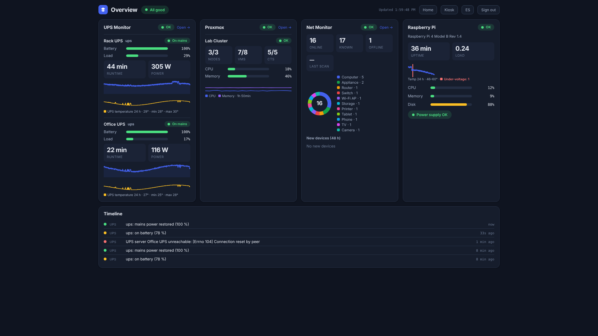 |
| **UPS Monitor** |  |  |
| **Net Monitor** |  | 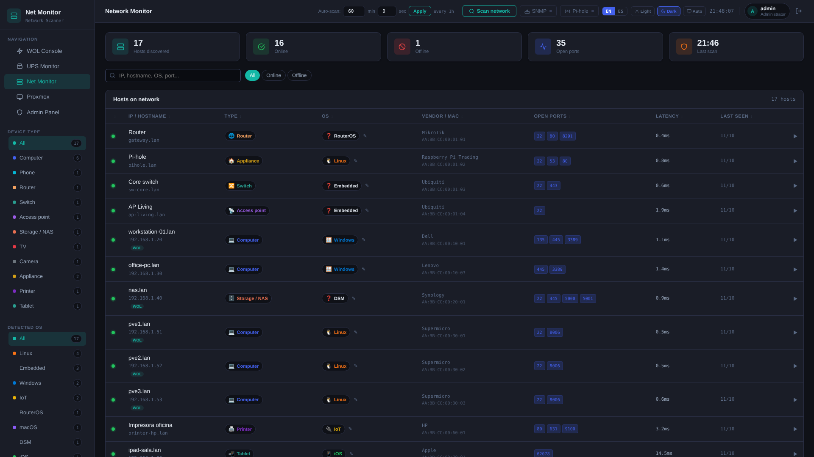 |
| **Proxmox Monitor** | 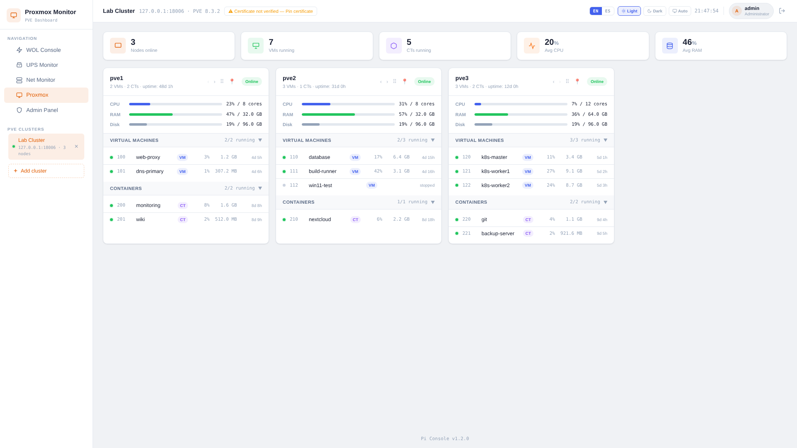 |  |
| **WOL Console** | 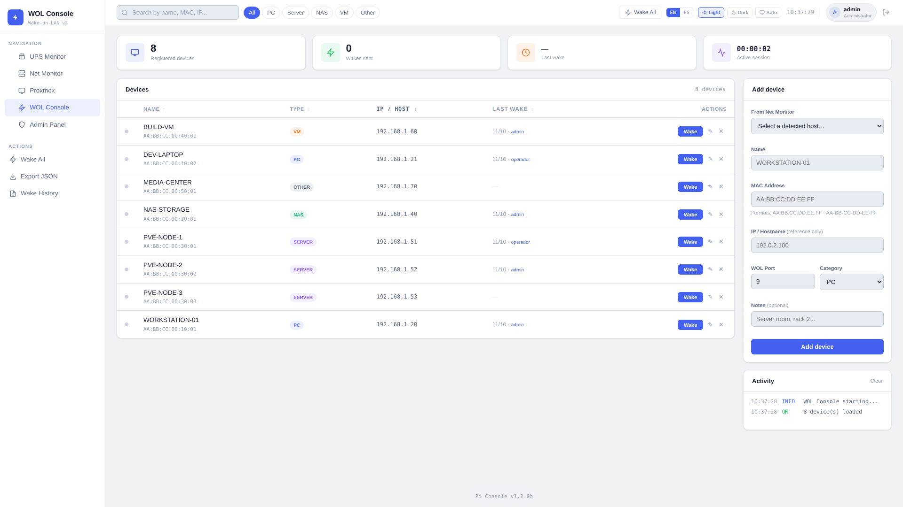 | 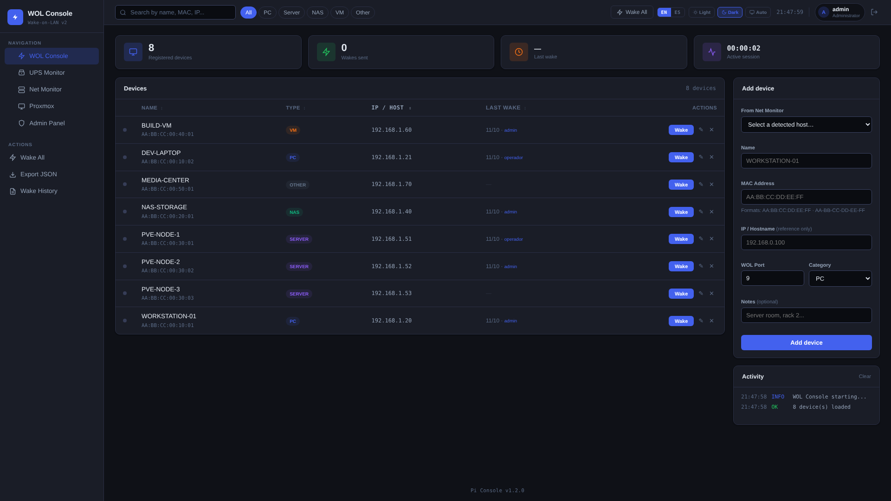 |
| **Admin Panel** | 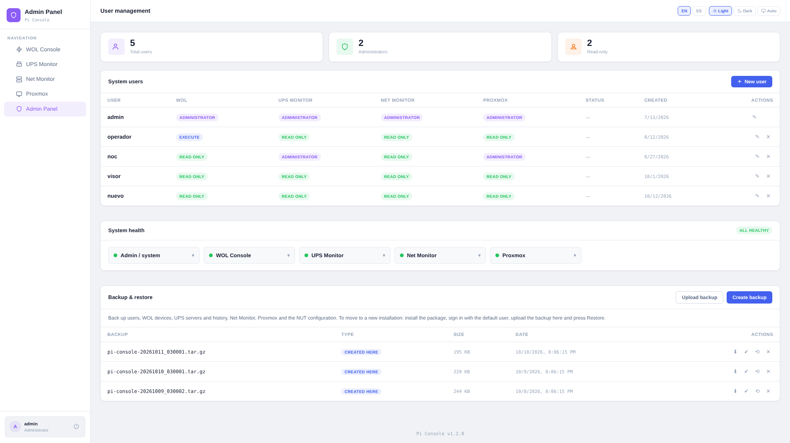 | 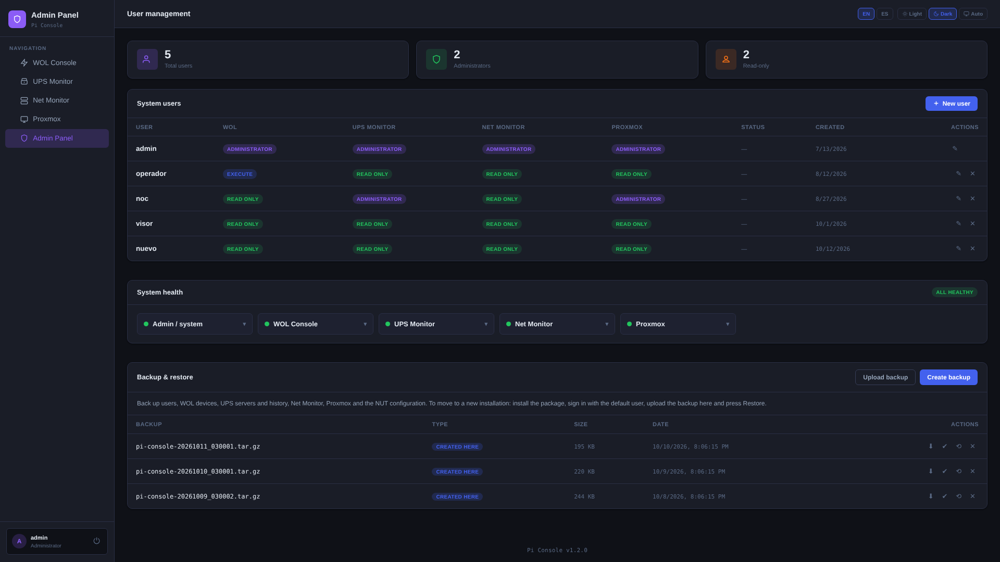 |
| **Primer ingreso** (cambio de contraseña obligatorio) | 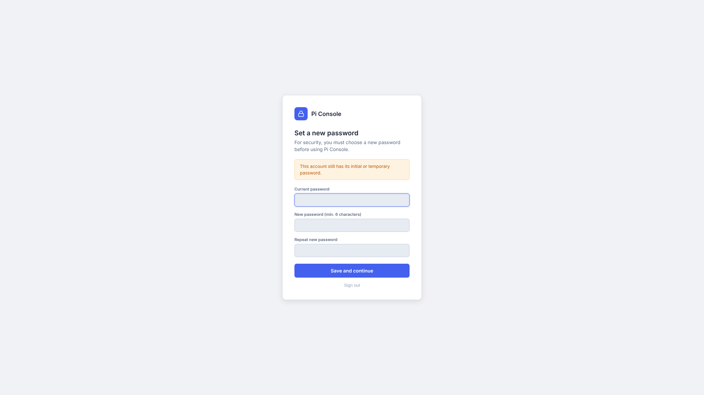 | 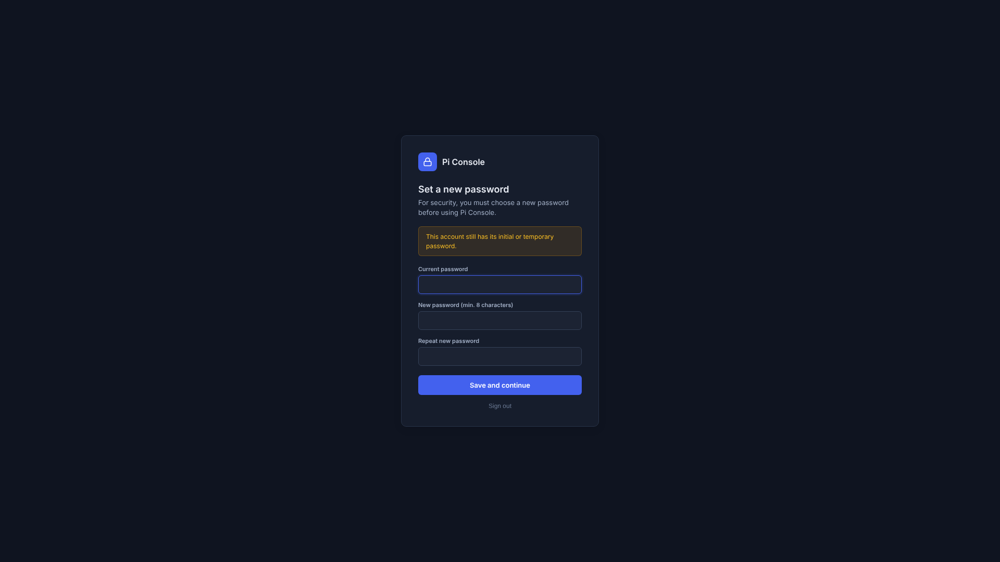 |

**Móvil (390×844)**

| Menú | UPS Monitor | Net Monitor | Proxmox |
|---|---|---|---|
|  | 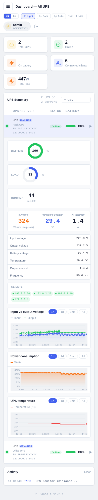 | 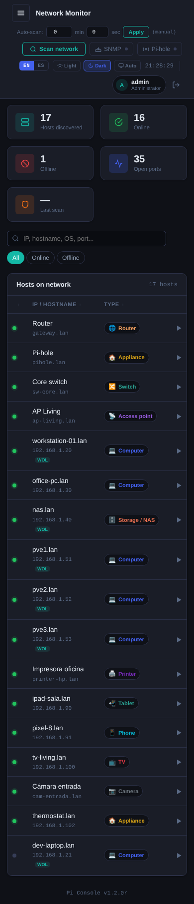 | 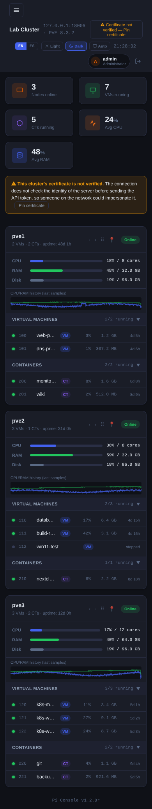 |

---

## Requisitos

- Raspberry Pi (probado en 3A+) con Raspberry Pi OS, DietPi o Debian 12 o superior (también funciona en una VM o equipo x86 con Debian/Ubuntu)
- Python 3.9+
- nginx
- NUT (`nut`, `nut-client`) — para el módulo UPS Monitor
- `sudo` — para respaldo/restauración desde el panel de administración
- `snmp` — comando `snmpwalk`, para la fuente SNMP de Net Monitor (Net Monitor no usa `nmap`)
- Opcional (`Suggests` en el `.deb`): `ieee-data` — base local de vendors por MAC (respaldo si no hay descarga de Wireshark `manuf`)

El código fuente está comentado en español e inglés (los comentarios en inglés llevan el prefijo `EN:`); cada archivo empieza con un mapa de su estructura.

---

## Instalación

### Opción A — paquete `.deb` (recomendado)

```bash
# Descargar el .deb desde Releases
wget https://github.com/gonzalovalenzuela/pi-console/releases/download/1.2.1t/pi-console_1.2.1t_all.deb

# Instalar (apt resuelve e instala las dependencias: python3, nginx, nut, nut-client, snmp, sudo…)
sudo apt-get update
sudo apt-get install -y ./pi-console_1.2.1t_all.deb
```

Usa `apt-get install ./archivo.deb` (no `dpkg -i`): así `apt` instala las dependencias que falten.

El instalador:
- Crea el usuario del sistema `pi-console`
- Instala los servicios systemd y los habilita
- Configura nginx
- Crea el usuario inicial `admin` con una **contraseña aleatoria** que el instalador muestra al terminar (también queda en `/var/lib/pi-console/initial-admin-password` hasta que la cambies) y que **obliga a cambiarla** en el primer ingreso (ver [Primer ingreso](#primer-ingreso)). Si la perdiste: `sudo cat /var/lib/pi-console/initial-admin-password`

Luego abre `http://<ip-de-la-pi>/`.

### Opción B — desde fuente (desarrollo)

```bash
git clone https://github.com/gonzalovalenzuela/pi-console.git
cd pi-console

# Copiar archivos
sudo mkdir -p /opt/pi-console
sudo cp -r wol-console nut-monitor net-monitor proxmox-monitor overview auth /opt/pi-console/
sudo cp -r home /opt/pi-console/home
sudo cp VERSION /opt/pi-console/VERSION

# Nginx
sudo cp etc/nginx/sites-available/pi-console.conf /etc/nginx/sites-available/
sudo cp etc/nginx/snippets/pi-console-site.conf /etc/nginx/snippets/
sudo mkdir -p /etc/pi-console/https.d /etc/pi-console/http-extra.d
sudo ln -s /etc/nginx/sites-available/pi-console.conf /etc/nginx/sites-enabled/
sudo nginx -t && sudo systemctl reload nginx

# Instalar servicios manualmente (ver debian/postinst como referencia)
```
---

## Actualizar

```bash
wget https://github.com/gonzalovalenzuela/pi-console/releases/download/1.2.1t/pi-console_1.2.1t_all.deb
sudo apt-get install -y ./pi-console_1.2.1t_all.deb
pi-console-health
```

- Funciona desde cualquier 1.1.x o 1.2.x anterior. Los datos (`/var/lib/pi-console`) se conservan y el instalador guarda además una copia en `/var/backups/pi-console`.
- Si el número de versión que instalas es **menor** que el que ya tienes (por ejemplo, volver a 1.2.0 teniendo 1.2.1a), `apt` lo trata como bajar de versión y pide `--allow-downgrades`:
  `sudo apt-get install -y --allow-downgrades ./pi-console_1.2.0_all.deb`.
- Los cambios de cada versión están en [CHANGELOG.md](CHANGELOG.md).

---

## Primer ingreso

Una instalación nueva trae un único usuario, `admin` con contraseña `admin`. Al iniciar sesión (en cualquier módulo) aparece una pantalla que **obliga a elegir una contraseña nueva** antes de poder usar nada; al guardarla vuelves al módulo y puedes navegar a los demás. Hasta entonces ningún módulo responde con esa sesión.

El mismo mecanismo sirve para cualquier usuario: en el Admin Panel se puede marcar «debe cambiar contraseña» al crear un usuario o al restablecerle la clave.

---

## Uso por módulo

### Resumen
Es la pantalla para mirar de un vistazo cómo está todo (`/overview/`; también es el primer acceso del menú y una tarjeta en el inicio). Muestra:
- **Estado global** (Todo en orden / Atención / Falla) y, si algo falla, una lista de qué requiere atención con enlace al módulo.
- **UPS:** estado de cada UPS (en red, con batería, batería baja), carga de batería, carga, autonomía, consumo en vatios, gráfico de carga de las últimas 24 h y, si la UPS informa temperatura, su gráfico de temperatura.
- **Proxmox:** por cluster, nodos en línea, VMs y CTs corriendo, CPU y memoria del conjunto, salud de Ceph y un gráfico de CPU y memoria de las últimas 12 h (se guarda en `metrics.db`, 7 días; `PVE_KEEP_DAYS` lo cambia).
- **Net Monitor:** equipos en línea, conocidos y apagados, último escaneo, reparto por tipo de equipo (gráfico con leyenda completa de todos los tipos) y equipos nuevos de las últimas 48 h.
- **Raspberry Pi:** temperatura, CPU, memoria, disco, tiempo encendida y problemas de la fuente de poder. **Solo si la instalación está en una Raspberry Pi** muestra además el histórico de 24 h de la temperatura, con marcas rojas cuando hubo bajo voltaje (subtensión) y ámbar cuando hubo limitación; se guarda en la base `/var/lib/pi-console/metrics.db` (7 días; `PICONSOLE_PI_KEEP_DAYS` lo cambia) y sobrevive a reinicios, actualizaciones y cortes de luz. En otros equipos no se crea ni se muestra.
- **Línea de tiempo:** los cambios importantes con su hora (UPS pasa a batería o vuelve la red, nodo Proxmox caído o recuperado, cambios de salud de Ceph, equipos nuevos o que dejaron de responder). Los guardan los propios módulos, así que quedan registrados aunque nadie tenga la página abierta; se conservan los últimos 300 eventos o 30 días en `/var/lib/pi-console/events.json`.

Cada persona ve solo las tarjetas y los eventos de los módulos a los que tiene acceso. La página se actualiza sola cada 10 s.

**Modo kiosko:** el botón *Kiosko* (o abrir `/overview/?kiosk=1`) deja la página a pantalla completa, con letra grande, sin botones y sin cursor, y evita que la pantalla se apague. Pensado para un monitor o tablet fijo; el mouse o un toque en la pantalla muestran un botón para salir. La letra se adapta al tamaño de la pantalla (tablet de 7", portátil, monitor); se puede ajustar con `?zoom=0.8` (entre 0.5 y 2). Si el contenido no cabe, el botón *Auto-desplazar* (aparece junto a *Salir de kiosko* al tocar la pantalla) hace que suba y baje solo, despacio; viene apagado y se detiene 30 s al tocar la pantalla. Con `?autoscroll=1` arranca encendido. Ejemplo: `/overview/?kiosk=1&zoom=0.9`. La sesión se renueva sola mientras la página está abierta; para dejarlo permanente conviene un usuario con permisos de solo lectura. Mientras el Resumen está abierto, Proxmox Monitor consulta a sus clusters cada 5 s (igual que con su propia página abierta).

**iPad como pantalla (app web):** abre `http://IP-DEL-PI/overview/?kiosk=1` en Safari → Compartir → *Añadir a pantalla de inicio* y deja activado *Abrir como app web*. Desde el icono se abre a pantalla completa, sin barra de Safari ni botón de cerrar. Si ya habías añadido un acceso directo antes de 1.2.1t, bórralo y créalo de nuevo. Para que el iPad no se bloquee, activa *Acceso guiado* (Ajustes → Accesibilidad) o pon *Bloqueo automático* en *Nunca*.

### UPS Monitor
Empieza **sin servidores** (no hace falta tener una UPS). Un administrador agrega uno con *Agregar servidor* (nombre, host y puerto de `upsd`, por defecto 3493) y puede probar la conexión antes de guardar. Consulta `upsd` cada 10 s y guarda el historial en una base SQLite. La primera lectura aparece en pocos segundos; las dos primeras se guardan de inmediato para que los gráficos tengan puntos enseguida.

### Net Monitor
- **Red a escanear:** se autodetecta (la /24 de la IP de la Pi); se puede fijar con `SCAN_NETWORK`.
- **Instalación nueva:** no escanea nada hasta que lo pidas. Con la lista vacía aparece el botón **«Hacer escaneo inicial»** (equivale a *Escanear red*) y la lista se va llenando mientras el escaneo avanza.
- **Escaneo automático:** se activa en *Ajustes* indicando un intervalo (mínimo 60 s; 0 = solo manual). Las instalaciones que ya tenían un intervalo lo conservan.
- **Fuentes de MAC y vendor**, por orden: 1. **Pi-hole** (si está configurado), 2. **ARP local** (`/proc/net/arp`), 3. **SNMP** (ARP de un router/switch; panel junto al botón *Scan*). El vendor se resuelve con la base `manuf` de Wireshark (`/var/lib/pi-console/manuf`, descarga semanal automática o manual desde el panel) y, si no existe, con `ieee-data`. Si no hay vendor se muestra la MAC. Las credenciales SNMP y la clave de Pi-hole se guardan en `config.json` (permisos 600) y nunca se devuelven por la API.

### Proxmox Monitor
El servidor consulta cada cluster con sondeo adaptivo (5 s con la vista abierta, 60 s en reposo). El orden de nodos y los nodos pineados se guardan por cluster (solo admin) y se mantienen entre refrescos y reinicios. Al agregar un cluster hay que confirmar la huella SHA-256 de su certificado, que queda **fijada**; si el certificado cambia, la conexión se corta antes de enviar el token. Los clusters antiguos sin huella muestran un aviso permanente con el botón *Fijar certificado*.

### WOL Console
Enciende equipos con paquetes mágicos (límite de 10 envíos por minuto por IP). **Comparte información con Net Monitor:** lee `net-monitor/hosts.json` (solo lectura), así que al agregar un equipo se puede elegir uno detectado (se rellenan nombre, MAC, IP y categoría) y, si la IP cambió por DHCP, se muestra y usa la de Net Monitor. Net Monitor marca con la etiqueta *WOL* los hosts registrados en WOL Console. Requiere permiso de lectura `net` para ver la lista en WOL.

### Admin Panel
Gestión de usuarios y permisos por módulo, tarjeta de **Salud del sistema** y respaldos (Teleporter). Solo entran administradores de WOL o de UPS; qué puede hacer cada uno, ver [Seguridad](#seguridad).

---

## Salud del sistema

Cada módulo responde `GET /api/health` (200 = ok o degradado, 503 = falla). Sin sesión solo muestra niveles; con sesión incluye el detalle. El Admin Panel muestra todo en la tarjeta **Salud del sistema**, y desde la terminal:

```bash
pi-console-health        # resumen; exit 0 = ok, 1 = degradado, 2 = falla
pi-console-health -j     # JSON completo
pi-console-resources     # memoria (RSS) y CPU de cada servicio, nginx y RAM libre del sistema
pi-console-resources -w  # lo mismo, refrescando cada 2 s
```

Detecta, entre otras cosas: servicio caído, archivo de datos corrupto, disco casi lleno, hilo de consulta muerto, base de historial bloqueada o sin guardar datos, escaneo trabado y upsd/Proxmox sin respuesta. En una Raspberry Pi avisa además de subtensión o limitación de la fuente (`power`); en una VM u otro equipo no se muestra.

---

## Backup y migración — Teleporter

```bash
sudo teleporter backup ~/pi-console-$(date +%Y%m%d).tar.gz   # crear backup
teleporter check ~/pi-console-20261009.tar.gz                # verificar (no modifica nada)
sudo teleporter restore ~/pi-console-20261009.tar.gz         # restaurar (agregar -y para no preguntar)
```

El respaldo incluye también los **históricos de los gráficos del Resumen**: temperatura de la UPS (en su `history.db`) y CPU y memoria de Proxmox y temperatura y bajo voltaje de la Pi (en `metrics.db`). Los respaldos de la versión 1.2.0o (que guardaban esos datos en JSON) también se restauran y los datos se importan solos. Un respaldo antiguo sin esos archivos sigue siendo válido: se conservan los actuales.

**Desde el panel de administración** (`/admin/` → *Backup & restore*) se hace lo mismo con botones: crear y descargar un respaldo, subir uno, verificarlo y restaurarlo. Solo lo ve y usa quien es administrador de **todos** los módulos (WOL, UPS, Net y Proxmox), porque el respaldo contiene usuarios, tokens de Proxmox y toda la configuración.

Para migrar a otra Pi: instala el `.deb`, entra con `admin` (te pedirá la contraseña nueva), sube el respaldo y pulsa *Restore*; después inicia sesión con los usuarios del respaldo. La configuración de NUT (`/etc/nut`) y el sitio nginx **no se restauran por defecto** (se configuran manualmente o se conservan los del paquete); solo se restauran desde la consola con `--nut` / `--nginx` (el panel no lo permite). Los datos del UPS Monitor (servidores e historial) sí se restauran siempre.

Incluye usuarios, WOL, UPS (servidores e historial), Net Monitor (hosts y SNMP), Proxmox, configuración de NUT y nginx. El archivo contiene contraseñas y tokens (permisos 600): guárdalo en un lugar privado. Antes de restaurar se guarda un snapshot del estado actual en `/var/backups/pi-console/`.

Seguridad: el panel ejecuta el respaldo/restauración como root mediante una regla `sudo` limitada a `teleporter.sh gui-backup` y `gui-restore`. Restaurar la configuración de NUT (opcional) puede introducir comandos que el demonio del UPS ejecuta como root: restaura solo respaldos de confianza.

---

## Respaldo automático por SFTP

Un cron diario (03:17) crea un respaldo con Teleporter, lo **verifica antes de subirlo** y lo envía por SFTP a un servidor de almacenamiento. Viene instalado pero **desactivado** hasta que se completa el usuario. Solo usa llave SSH (nunca contraseña), así que puede correr sin que nadie lo atienda.

```bash
sudo pi-console-sftp-backup setup     # crea la llave SSH y muestra la llave pública para autorizarla en el storage
sudo nano /etc/pi-console/backup.conf   # completar SFTP_USER (y SFTP_DIR, SFTP_HOST si hace falta)
sudo pi-console-sftp-backup test      # revisa conexión, carpeta y permiso de escritura
sudo pi-console-sftp-backup run       # hace un respaldo ahora (después lo hace cron solo)
sudo pi-console-sftp-backup status    # resultado de la última corrida
journalctl -t pi-console-sftp-backup  # historial / errores
```

- **Seguro:** el archivo se sube con nombre temporal (`.part`) y se renombra al terminar; después se compara el tamaño remoto con el local. Un respaldo que no pasa la verificación no se envía.
- **Retención:** se conservan 30 copias en el storage (`KEEP_REMOTE`) y 7 en la Pi (`/var/backups/pi-console`, `KEEP_LOCAL`). Solo se borran archivos llamados `pi-console-auto-<equipo>-<fecha>_<hora>.tar.gz`; cualquier otro archivo de esa carpeta no se toca.
- **Huella del servidor:** la primera conexión guarda la huella del storage (`/etc/pi-console/backup_known_hosts`); si cambia, el respaldo falla y avisa en vez de enviar los datos a un equipo distinto.
- **Cifrado:** lo que sale de la Pi va **cifrado con gpg (AES-256)**; la contraseña se crea sola en `/etc/pi-console/backup_passphrase` la primera vez. **Guarda una copia fuera de la Pi** (`sudo cat /etc/pi-console/backup_passphrase`): sin ella no se puede abrir ningún respaldo. Para restaurar: baja el `.tar.gz.gpg`, `sudo pi-console-sftp-backup decrypt archivo.tar.gz.gpg` y luego `sudo teleporter restore archivo.tar.gz`. `ENCRYPT=no` en `backup.conf` lo desactiva (no recomendado).
- **Contenido sensible:** el respaldo incluye contraseñas (hash) y tokens de API (las sesiones abiertas no). Usa un usuario SFTP propio, con acceso solo a esa carpeta, en un storage de confianza.
- El horario se cambia en `/etc/cron.d/pi-console-sftp-backup`. Para restaurar, descarga el archivo del storage, descífralo (ver arriba) y usa `teleporter restore` o el panel de administración.

---

## Configuración (variables de entorno)

Los valores por defecto sirven para la mayoría de los casos. Para cambiarlos, crea `/etc/default/pi-console` (lo leen los 6 servicios), escribe una línea `NOMBRE=valor` por variable y reinicia:

```bash
echo 'NUT_POLL=5' | sudo tee -a /etc/default/pi-console
sudo systemctl restart wol-console pi-console-ups admin-panel net-monitor proxmox-monitor pi-console-overview
```

| Variable | Módulo | Por defecto | Para qué |
|---|---|---|---|
| `SCAN_NETWORK` | Net | /24 de la IP de la Pi | Red a escanear (ej. `192.0.2.0/24`) |
| `SCAN_INTERVAL` | Net | manual en instalación nueva | Segundos entre escaneos automáticos (0 = manual) |
| `SCAN_PORTS` | Net | lista de puertos comunes | Puertos que se sondean por equipo |
| `PORT_TIMEOUT` | Net | `0.5` | Segundos de espera por puerto |
| `MAX_WORKERS` | Net | `30` | Equipos que se escanean a la vez |
| `PIHOLE_HOSTS`, `PIHOLE_PASS` | Net | vacío | Servidores Pi-hole y clave (también se configuran desde la página) |
| `NUT_POLL` | UPS | `10` | Segundos entre consultas a `upsd` |
| `NUT_DB_FLUSH` | UPS | `60` | Segundos entre escrituras del historial a disco |
| `PVE_POLL_ACTIVE`, `PVE_POLL_IDLE` | Proxmox | `5`, `60` | Segundos entre consultas con la página abierta / en reposo |
| `WOL_BROADCAST` | WOL | automático | Direcciones de broadcast separadas por coma |
| `WOL_SECRET` | WOL | aleatoria, se genera sola | Clave de los tokens CSRF |
| `PICONSOLE_SECURE_COOKIE` | todos | apagado | `1` agrega `Secure` a la cookie (solo detrás de HTTPS) |

---

## Operación

```bash
systemctl status wol-console pi-console-ups admin-panel net-monitor proxmox-monitor pi-console-overview   # estado
journalctl -u net-monitor -f          # logs de un servicio (cambia el nombre según el módulo)
sudo systemctl restart net-monitor    # reiniciar uno
pi-console-health                     # diagnóstico general
```

| Servicio | Módulo |
|---|---|
| `wol-console` | WOL Console |
| `pi-console-ups` | UPS Monitor (antes `nut-monitor`: chocaba con el `upsmon` de NUT) |
| `admin-panel` | Admin Panel |
| `net-monitor` | Net Monitor |
| `proxmox-monitor` | Proxmox Monitor |
| `pi-console-overview` | Resumen |

**Desinstalar:**
- `sudo apt remove pi-console` detiene los servicios y guarda una copia final de los datos en `/var/backups/pi-console`; los datos de `/var/lib/pi-console` se conservan.
- `sudo apt purge pi-console` además elimina el código, los servicios, el sitio nginx y el usuario `pi-console`. Los datos de `/var/lib/pi-console` y las copias de `/var/backups/pi-console` **no se borran**: elimínalos a mano si quieres dejar el equipo limpio.

---

## Seguridad

Pi Console está pensado para una **red local de confianza** y se sirve por **HTTP en el puerto 80** (nginx):

- **HTTP por defecto, HTTPS con un comando.** Por defecto las credenciales y la cookie viajan sin cifrar por la LAN: no expongas el puerto 80 a internet. Para cifrar: `sudo pi-console-https enable` (certificado autofirmado, el navegador avisa una vez) o con tu certificado: `sudo pi-console-https enable --cert fullchain.pem --key privkey.pem`. Con `--redirect` el puerto 80 redirige a HTTPS, la cookie pasa a `Secure` y se envía HSTS. `sudo pi-console-https disable` lo deshace; `status` muestra el estado.
- **Escrituras solo desde la propia página (CSRF).** Toda petición que modifica datos se rechaza (403) si el navegador indica que no viene del mismo origen (`Sec-Fetch-Site`, o `Origin` frente a `Host` en navegadores antiguos). `SameSite=Strict` no bastaba: otra página del mismo host en otro puerto podía escribir con tu sesión.
- **Los servicios Python escuchan solo en `127.0.0.1`** (8080–8085); únicamente nginx es accesible desde la red.
- **Cookie `Secure` (opcional).** La cookie de sesión lleva `HttpOnly` y `SameSite=Strict` y dura 24 h, o 1 día, 1 semana, 1 mes o «siempre» (400 días renovables) si marcas **Recordarme** al iniciar sesión. En el panel Admin, **Sesiones activas** muestra los dispositivos con sesión (usuario, navegador, IP, última actividad) y permite cerrar cualquiera o todas tus otras sesiones. Con `pi-console-https enable --redirect` (o `PICONSOLE_SECURE_COOKIE=1` detrás de tu propio proxy HTTPS, ver [Configuración](#configuración-variables-de-entorno)) lleva además `Secure`. Está apagado por defecto porque con HTTP el navegador no enviaría una cookie `Secure` y no podrías iniciar sesión.
- **Contraseñas e intentos.** Las contraseñas (mínimo 8 caracteres) se guardan con scrypt. Tras 5 intentos de login fallidos desde una IP en 10 minutos, esa IP queda bloqueada 5 minutos; además cada cuenta tiene su propio límite. El contador es **compartido por todos los módulos** (un archivo con bloqueo), cambiar la contraseña exige la actual y esos intentos también se limitan. nginx añade límite de peticiones por IP (más estricto en el login) y de conexiones simultáneas, y no revela su versión.
- **Sesiones.** El token vive solo en la cookie `HttpOnly`; en disco (`sessions.json`) se guarda únicamente su hash SHA-256, el login no lo devuelve en el JSON y los respaldos no incluyen las sesiones. Un `/api/health` público solo dice «ok/degraded/fail»; la versión y los detalles piden sesión.
- **Servicios con privilegios mínimos.** El código de `/opt/pi-console` es de root y de solo lectura para los servicios; lo que escriben vive en `/var/lib/pi-console/<módulo>/`. Las unidades systemd llevan endurecimiento (sin `/home`, `/tmp` propio, kernel de solo lectura, sin nuevos privilegios y sistema de archivos de solo lectura salvo los datos, en UPS, Proxmox y Resumen). Los scripts que corren como root (instalador, Teleporter) **nunca siguen enlaces simbólicos** dentro de las carpetas de los servicios.
- **Entradas validadas.** Hosts y nombres de NUT, Proxmox y Pi-hole se validan; el certificado de Pi-hole se fija en la primera conexión (TOFU) y si cambia no se envía la contraseña; el nombre del CSV exportado no puede inyectar cabeceras; un usuario de solo lectura no puede lanzar escaneos; un admin parcial (p. ej. solo WOL) no puede degradar, borrar ni cambiar la contraseña del administrador principal.
- **CSP estricta.** Las páginas no llevan scripts, manejadores ni `<style>` en línea: la política de nginx usa `script-src 'self'` (sin `'unsafe-inline'`). Solo se permiten atributos `style="…"` (`style-src-attr`). Las demás cabeceras (nosniff, frame, referrer, permisos) sí están.
- **Permisos por módulo.** Cada módulo (WOL, UPS, Net, Proxmox) tiene su propio nivel (ninguno, solo lectura, ejecutar, admin). Un administrador **solo puede dar o quitar permisos en los módulos donde él mismo tiene ese nivel**, y no puede borrar ni cambiar la contraseña de un usuario con más permisos que él. Los respaldos (Teleporter) solo los maneja quien es admin de todos los módulos.
- **Proxmox: certificado fijado.** Los clusters nuevos exigen fijar la huella SHA-256 del certificado. Un cluster antiguo sin huella se conecta sin validar la identidad del servidor: la página muestra un aviso permanente y el servicio lo anota en el log al arrancar; usa «Fijar certificado» para corregirlo.
- **Primer ingreso.** Ya no existe `admin`/`admin`: la cuenta inicial tiene una contraseña aleatoria (la muestra el instalador) y obliga a cambiarla antes de usar cualquier módulo.

---

## Arquitectura

```
Raspberry Pi
│
├── nginx (puerto 80)  ←── reverse proxy con rutas por módulo
│   └── /etc/nginx/sites-available/pi-console.conf
│
├── /opt/pi-console/          ←── código (lo reemplaza cada actualización)
│   ├── VERSION
│   ├── home/                 ←── página de inicio estática
│   ├── overview/             ←── Resumen: servidor Python + frontend
│   ├── auth/                 ←── autenticación compartida + Admin Panel
│   ├── wol-console/          ←── servidor Python + frontend
│   ├── nut-monitor/          ←── servidor Python + frontend
│   ├── net-monitor/          ←── servidor Python + frontend
│   └── proxmox-monitor/      ←── servidor Python + frontend
│
├── /var/lib/pi-console/      ←── datos (users.json, <módulo>/…, metrics.db…); sobreviven a las actualizaciones
├── /etc/pi-console/          ←── backup.conf, llave y contraseña del respaldo SFTP, tls/ (si activas HTTPS)
├── /var/backups/pi-console/  ←── copias automáticas antes de actualizar o desinstalar
├── /usr/local/bin/           ←── teleporter, pi-console-sftp-backup, pi-console-https, pi-console-health, pi-console-resources
│
└── systemd services
    ├── wol-console.service
    ├── pi-console-ups.service   # (antes nut-monitor: chocaba con el upsmon de NUT)
    ├── admin-panel.service
    ├── net-monitor.service
    ├── proxmox-monitor.service
    └── pi-console-overview.service
```

Cada módulo es un servidor HTTP Python 3 independiente que escucha solo en `127.0.0.1`. La autenticación se comparte: todos usan `auth/auth.py` y los mismos archivos de usuarios y sesiones (accesibles también por la ruta de compatibilidad `/opt/pi-console-auth/`, que es de root).

---

## Estructura del repositorio

```
pi-console/
├── auth/                    # Autenticación compartida y Admin Panel
│   ├── auth.py              # Librería de autenticación (usuarios, sesiones, permisos, salud)
│   ├── admin_panel.py       # Servidor del Admin Panel
│   ├── teleporter_api.py    # Respaldo/restauración desde el panel
│   └── static/
│       ├── index.html            # Admin Panel UI
│       └── change-password.html  # Cambio de contraseña obligatorio
├── wol-console/             # server.py + static/index.html
├── nut-monitor/             # server.py + static/index.html
├── net-monitor/             # server.py + static/index.html
├── proxmox-monitor/         # server.py + static/index.html
├── overview/                # Resumen: server.py + static/index.html
├── home/
│   └── index.html           # Página de inicio del dashboard
├── etc/
│   ├── nginx/sites-available/pi-console.conf
│   ├── nginx/snippets/pi-console-site.conf   # cabeceras, límites y rutas (HTTP y HTTPS)
│   ├── pi-console/backup.conf      # Configuración del respaldo por SFTP
│   └── cron.d/pi-console-sftp-backup    # Cron diario del respaldo
├── scripts/
│   ├── teleporter.sh        # Backup / check / restore
│   ├── pi-console-sftp-backup    # Respaldo automático por SFTP (cron diario)
│   ├── pi-console-health    # Diagnóstico desde la terminal
│   ├── pi-console-https     # Activa/desactiva HTTPS (certificado autofirmado o propio)
│   ├── pi-console-resources # Memoria y CPU de los servicios
│   └── apt-repo.py          # Generador del repositorio APT (aún sin publicar)
├── debian/                  # Empaquetado .deb
│   ├── control, conffiles
│   └── postinst, preinst, prerm, postrm
├── docs/
│   ├── APT.md               # Repositorio APT (preparado, sin publicar)
│   └── screenshots/         # Capturas por resolución y tema
├── VERSION
├── CHANGELOG.md
├── RELEASE_NOTES_1.2.0.md
├── RELEASE_NOTES_1.2.1.md
├── RELEASE_NOTES_1.2.1t.md
├── LICENSE
├── README.md                # Español
└── README.en.md             # English
```

---

## Internacionalización

La interfaz soporta **inglés** (por defecto) y **español**. El idioma se persiste en `localStorage` con la clave `pi-lang` y se comparte entre todos los módulos.

---

## Licencia

MIT — uso libre para homelab personal y proyectos propios. Ver [LICENSE](LICENSE).

Creado con ayuda de IA.
