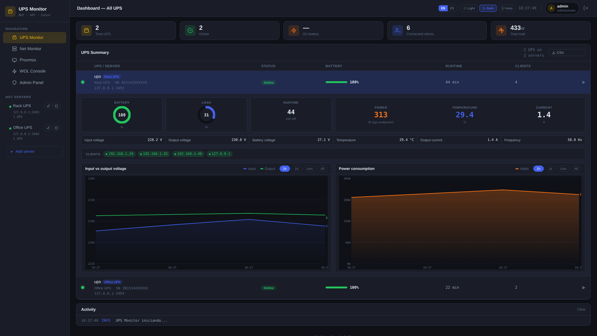
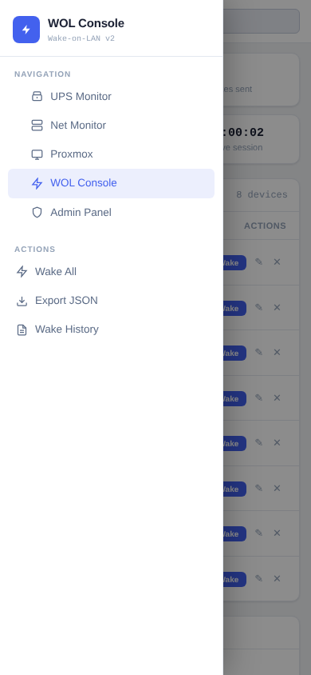
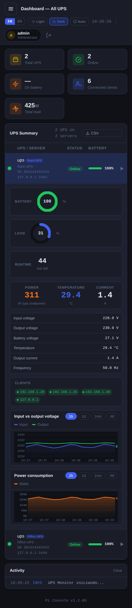

# Pi Console

**Homelab dashboard** para Raspberry Pi


---

## Módulos

| Módulo | Puerto | Ruta | Descripción |
|--------|--------|------|-------------|
| **WOL Console** | 8080 | `/wol/` | Wake-on-LAN — enciende equipos remotamente |
| **UPS Monitor** | 8081 | `/nut/` | Monitor de UPS vía NUT — batería, carga, autonomía |
| **Admin Panel** | 8082 | `/admin/` | Gestión de usuarios y permisos SSO |
| **Net Monitor** | 8083 | `/net/` | Escáner de red — hosts, tipo de dispositivo, OS, MAC/vendor (ARP, Pi-hole, SNMP) |
| **Proxmox Monitor** | 8084 | `/pve/` | Dashboard de clusters Proxmox VE — nodos, VMs, CTs; orden manual y pin de nodos |

La página de inicio (`/`) sirve desde `/opt/pi-console/home/` vía nginx.

---

## Capturas

Todas las pantallas, en tema claro y oscuro y en 4 resoluciones (1920×1080, 1366×768, tablet y móvil), están en [`docs/screenshots/`](docs/screenshots/).

| Módulo | Claro | Oscuro |
|---|---|---|

| **UPS Monitor** |  |  |

**Móvil (390×844)**

| | | | |
|---|---|---|---|
| |  |

---

## Arquitectura

```
Raspberry Pi
│
├── nginx (puerto 80)  ←── reverse proxy con rutas por módulo
│   └── pi-console.conf
│
├── /opt/pi-console/
│   ├── home/          ←── página de inicio estática
│   ├── auth/          ←── autenticación SSO compartida
│   ├── wol-console/   ←── servidor Python + frontend
│   ├── nut-monitor/   ←── servidor Python + frontend
│   ├── net-monitor/   ←── servidor Python + frontend
│   └── proxmox-monitor/ ←── servidor Python + frontend
│
└── systemd services
    ├── wol-console.service
    ├── pi-console-ups.service   # (antes nut-monitor: chocaba con el upsmon de NUT)
    ├── admin-panel.service
    ├── net-monitor.service
    └── proxmox-monitor.service
```

Cada módulo es un servidor HTTP Python 3 independiente. La autenticación se comparte a través de `/opt/pi-console-auth/` (symlinks a `auth/`).

---

## Requisitos

- Raspberry Pi (probado en 3A+) con Raspberry Pi OS / Debian Bookworm
- Python 3.9+
- nginx
- NUT (`nut`, `nut-client`) — para el módulo UPS Monitor
- `sudo` — para respaldo/restauración desde el panel de administración
- `snmp` — comando `snmpwalk`, para la fuente SNMP de Net Monitor (Net Monitor no usa `nmap`)
- Opcional (`Suggests` en el `.deb`):
  - `ieee-data` — base local de vendors por MAC (respaldo si no hay descarga de Wireshark `manuf`)

Ver [CHANGELOG.md](CHANGELOG.md) para el detalle de cambios por versión.

El código fuente está comentado en español e inglés (los comentarios en inglés llevan el prefijo `EN:`); cada archivo empieza con un mapa de su estructura. / The source code is commented in Spanish and English (English comments are prefixed with `EN:`); every file starts with a map of its structure.

---

## Instalación

### Opción A — paquete `.deb` (recomendado)

```bash
# Descargar el .deb desde Releases
wget https://github.com/gonzalovalenzuela/pi-console/releases/download/1.2.0/pi-console_1.2.0b_all.deb

# Instalar (apt resuelve e instala las dependencias: python3, nginx, nut, nut-client…)
sudo apt-get update
sudo apt-get install -y ./pi-console_1.2.0b_all.deb
```

El instalador:
- Crea el usuario del sistema `pi-console`
- Instala los servicios systemd y los habilita
- Configura nginx
- Crea el usuario inicial `admin` / `admin` (cambiar en primer login)

### Opción A2 — repositorio APT (instala y actualiza con `apt`)

Ver [docs/APT.md](docs/APT.md) (publicación y uso). En la Pi:

```bash
sudo install -d -m 0755 /etc/apt/keyrings
sudo wget -O /etc/apt/keyrings/pi-console.asc https://gonzalovalenzuela.github.io/pi-console/pi-console.asc
echo "deb [signed-by=/etc/apt/keyrings/pi-console.asc] https://gonzalovalenzuela.github.io/pi-console stable main" | sudo tee /etc/apt/sources.list.d/pi-console.list
sudo apt update && sudo apt install pi-console
```

### Opción B — desde fuente (desarrollo)

```bash
git clone https://github.com/gonzalovalenzuela/pi-console.git
cd pi-console

# Copiar archivos
sudo mkdir -p /opt/pi-console
sudo cp -r wol-console nut-monitor net-monitor proxmox-monitor auth /opt/pi-console/
sudo cp -r home /opt/pi-console/home

# Nginx
sudo cp etc/nginx/sites-available/pi-console.conf /etc/nginx/sites-available/
sudo ln -s /etc/nginx/sites-available/pi-console.conf /etc/nginx/sites-enabled/
sudo nginx -t && sudo systemctl reload nginx

# Instalar servicios manualmente (ver debian/postinst como referencia)
```

---

## WOL Console y Net Monitor comparten información

WOL Console lee `net-monitor/hosts.json` (solo lectura): al agregar un equipo se puede elegir uno detectado por Net Monitor (se rellenan nombre, MAC, IP y categoría) y, si la IP cambió por DHCP, se muestra y usa la de Net Monitor. Net Monitor marca con la etiqueta *WOL* los hosts registrados en WOL Console. Requiere permiso de lectura `net` para ver la lista en WOL.

## Net Monitor — fuentes de MAC y vendor

1. **Pi-hole** (si está configurado), 2. **ARP local** (`/proc/net/arp`), 3. **SNMP** (ARP de un router/switch; panel junto al botón *Scan*).

El vendor se resuelve con la base `manuf` de Wireshark (`/var/lib/pi-console/manuf`, descarga semanal automática o manual desde el panel) y, si no existe, con `ieee-data`. Si no hay vendor se muestra la MAC. Las credenciales SNMP se guardan en `config.json` (permisos 600) y nunca se devuelven por la API.

## Proxmox Monitor — refresco y orden

El servidor consulta cada cluster con sondeo adaptivo (5 s con la vista abierta, 60 s en reposo). El orden de nodos y los nodos pineados se guardan por cluster (solo admin) y se mantienen entre refrescos y reinicios.

---

## Salud del sistema

Cada módulo responde `GET /api/health` (200 = ok o degradado, 503 = falla). Sin sesión solo muestra niveles; con sesión incluye el detalle. El Admin Panel muestra todo en la tarjeta **Salud del sistema**, y desde la terminal:

```bash
pi-console-health        # resumen; exit 0 = ok, 1 = degradado, 2 = falla
pi-console-health -j     # JSON completo
pi-console-resources     # memoria (RSS) y CPU de cada servicio, nginx y RAM libre del sistema
pi-console-resources -w  # lo mismo, refrescando cada 2 s
```

Detecta, entre otras cosas: servicio caído, archivo de datos corrupto, disco casi lleno, hilo de consulta muerto, base de historial bloqueada o sin guardar datos, escaneo trabado y upsd/Proxmox sin respuesta.

## Backup y migración — Teleporter

```bash
sudo teleporter backup ~/pi-console-$(date +%Y%m%d).tar.gz   # crear backup
teleporter check ~/pi-console-20261009.tar.gz                # verificar (no modifica nada)
sudo teleporter restore ~/pi-console-20261009.tar.gz         # restaurar (agregar -y para no preguntar)
```

**Desde el panel de administración** (`/admin/` → *Backup & restore*) se hace lo mismo con botones: crear y descargar un respaldo, subir uno, verificarlo y restaurarlo. Para migrar: instala el `.deb` en la Pi nueva, entra con `admin / admin`, sube el respaldo y pulsa *Restore*; después inicia sesión con los usuarios del respaldo. La configuración de NUT (`/etc/nut`) y el sitio nginx **no se restauran por defecto** (se configuran manualmente o se conservan los del paquete); solo se restauran desde la consola con `--nut` / `--nginx` (el panel no lo permite). Los datos del UPS Monitor (servidores e historial) sí se restauran siempre.

Seguridad: el panel ejecuta el respaldo/restauración como root mediante una regla `sudo` limitada a `teleporter.sh gui-backup` y `gui-restore`. Restaurar la configuración de NUT (opcional) puede introducir comandos que el demonio del UPS ejecuta como root: restaura solo respaldos de confianza.

Incluye usuarios, WOL, UPS (servidores e historial), Net Monitor (hosts y SNMP), Proxmox, configuración de NUT y nginx. El archivo contiene contraseñas y tokens (permisos 600): guárdalo en un lugar privado. Para migrar a otra Pi: instalar el `.deb`, copiar el backup y ejecutar `restore`. Antes de restaurar se guarda un snapshot del estado actual en `/var/backups/pi-console/`.

---

## Internacionalización

La interfaz soporta **inglés** (por defecto) y **español**. El idioma se persiste en `localStorage` con la clave `pi-lang` y se comparte entre todos los módulos.

---

## Estructura del repositorio

```
pi-console/
├── auth/                    # Módulo de autenticación SSO
│   ├── auth.py              # Librería de autenticación compartida
│   ├── admin_panel.py       # Servidor del panel de administración
│   ├── teleporter_api.py    # Respaldo/restauración desde el panel
│   └── static/
│       ├── index.html       # Admin panel UI
│       └── login.html       # Página de login
├── wol-console/
│   ├── server.py
│   └── static/index.html
├── nut-monitor/
│   ├── server.py
│   └── static/index.html
├── net-monitor/
│   ├── server.py
│   └── static/index.html
├── proxmox-monitor/
│   ├── server.py
│   └── static/index.html
├── home/
│   └── index.html           # Página de inicio del dashboard
├── etc/
│   └── nginx/
│       └── sites-available/
│           └── pi-console.conf
├── scripts/
│   └── teleporter.sh        # Backup / check / restore
├── debian/                  # Scripts de empaquetado .deb
│   ├── control
│   ├── postinst
│   ├── preinst
│   ├── prerm
│   └── postrm
├── CHANGELOG.md
└── README.md
```

---

## Licencia

MIT — uso libre para homelab personal y proyectos propios.
Creado con ayuda de IA
